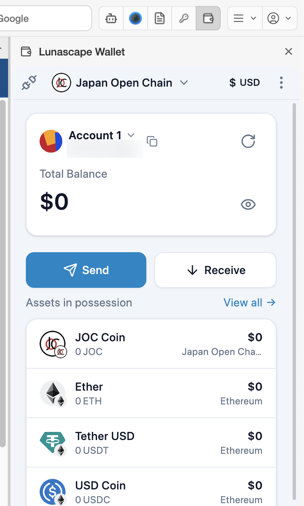
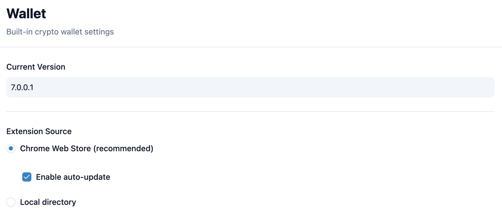

# Lunascape Wallet

Lunascape Wallet is the Web3 wallet bundled with the browser. It works with EVM-compatible chains and connects to Web3 sites (DApps).

Creating and backing up a wallet, sending and receiving, connecting to sites, settings and troubleshooting are covered in detail in the [Lunascape Wallet User Guide](https://help.lunascape.org/wallet/en/).
<!-- TODO: provisional URL above; replace once the guide is published -->

## Open the wallet

Press the Lunascape Wallet button (the wallet shape) in the toolbar and the wallet opens in a panel on the right of the window. Press the button again, or the **×** at the top right of the panel, to close it.

The first time, the wallet shows the create screen; after that, it opens on the lock screen.

> **Note:** Anyone with your recovery phrase can take your assets. Do not photograph it or send it in a chat — keep it somewhere safe. Lunascape support will never ask for it.

## Browser settings

**Settings** > **Wallet** shows the wallet extension's **Current Version** and **Extension Source**. Leave it on the default — **Chrome Web Store (recommended)** with **Enable auto-update** on.

The wallet's own settings (language, networks, connected sites and more) open from **⋮** > **Settings** at the top right of the wallet panel.

To stop using Lunascape Wallet, turn it off under **Settings** > **Extensions** > **System Extensions**.

## Related topics

- [Lunascape Wallet User Guide](https://help.lunascape.org/wallet/en/)
- [Add and manage extensions](manage.md)
