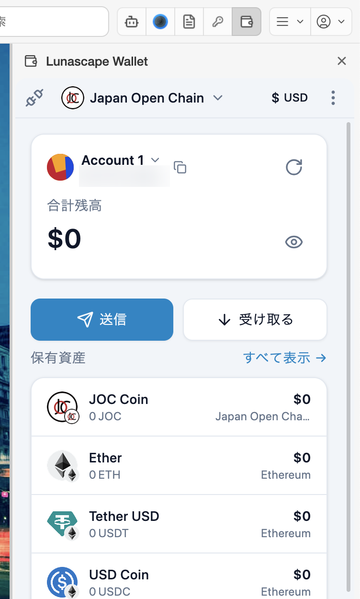

# Lunascape Wallet

Lunascape Wallet は標準で入っている Web3 ウォレットの拡張機能です。EVM 互換のチェーンに対応し、Web3 サイト（DApp）と接続できます。

ウォレットの作成とバックアップ、送金と受け取り、サイトとの接続、設定、困ったときの対処は、[Lunascape Wallet ユーザガイド](https://docs.lunascape.org/github/gu-corp/lunascape-user-guide/wallet/pc/README.md)で詳しく説明しています。

## 開きかた

ツールバーの Lunascape Wallet のアイコン（財布の形）を押すと、ウィンドウの右側にウォレットのパネルが開きます。もう一度アイコンを押すか、パネル右上の **×** で閉じます。

はじめて開いたときはウォレットの作成画面が、2 回目からはロック画面が表示されます。

> **注意:** 復元用のフレーズ（シードフレーズ）は、他人に知られると資産を失います。画面のスクリーンショットやチャットで送ることは避け、安全な場所に保管してください。Lunascape のサポートがフレーズを尋ねることはありません。

## ブラウザー側の設定

**設定** > **ウォレット** で、ウォレット拡張機能の **現在のバージョン** と **拡張機能のソース** を確認・変更できます。通常は既定のまま（**Chrome Web Store（推奨）** で **自動更新を有効にする** がオン）で使います。

ウォレットそのものの設定（言語、ネットワーク、接続したサイトなど）は、ウォレットのパネル右上の **⋮** > **設定** で開きます。

Lunascape Wallet を使わないときは、**設定** > **拡張機能** の **システム拡張** でオフにできます。

## 関連項目

- [Lunascape Wallet ユーザガイド](https://docs.lunascape.org/github/gu-corp/lunascape-user-guide/wallet/pc/README.md)
- [拡張機能を追加・管理する](manage.md)
