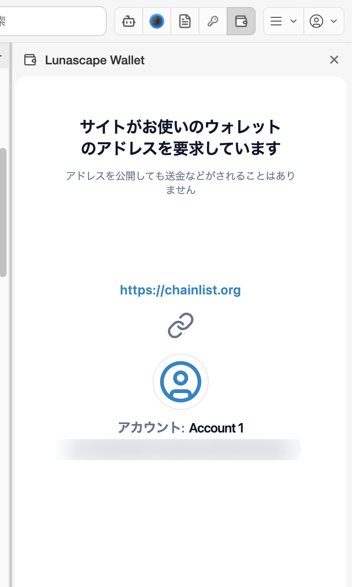
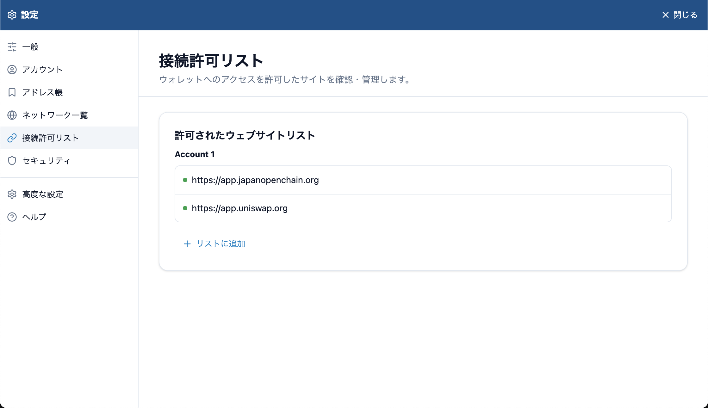

---
navigation:
  order: 100
---

# サイトと接続する

Web3 サイト（DApp）で **Connect Wallet** などのボタンを押すと、ウォレットに確認画面が表示されます。

## 接続を許可する

1. サイトの接続ボタンを押します。サイトによっては、ウォレットの一覧から Lunascape Wallet（または MetaMask などのブラウザーウォレット）を選びます。
2. ウォレットに **サイトがお使いのウォレットのアドレスを要求しています** と表示されます。
3. 表示されたサイトの URL と、接続するアカウントを確かめて **許可する** を押します。やめるときは **キャンセル** を押します。

接続で相手に伝わるのは、アカウントのアドレスだけです。接続しただけで送金されることはありません。

## サイトから届く確認

接続したサイトは、次のような確認を求めてくることがあります。どれも、内容を確かめてから許可してください。

| 確認の種類 | 内容 | 許可すると |
| --- | --- | --- |
| 署名リクエスト / イーサリアムでサインイン | アドレスの持ち主であることの証明として、署名を求めます | 送金は発生せず、秘密鍵も伝わりません |
| 取引（トランザクション）の承認 | 送金、トークンの交換、NFT の購入など | 取引が実行され、手数料（ガス代）がかかります。取り消せません |
| ネットワークの追加・切り替え | サイトが使うネットワークを、ウォレットに追加・選択させます | ウォレットのネットワークが切り替わります |
| トークンの追加 | サイトのトークンを、ウォレットの一覧に追加させます | 一覧に表示されるだけです |

> **注意:** 署名の内容が理解できないとき、サイトを信頼できないときは許可しないでください。サインインのドメインがサイトと一致しない、アドレスがアカウントと一致しないといった警告が出たときは、偽サイトの可能性があります。

## 接続状態を確かめる

ウォレットの左上のプラグのアイコンを押すと、表示中のサイトの接続状態が表示されます。接続していないサイトは、**リストに追加** で接続を許可できます。

## 接続を解除する

接続を許可したサイトは、ウォレットの **設定** > **接続許可リスト** にアカウントごとに並びます。使わなくなったサイトは、ここから削除してください。

## ほかのウォレット拡張機能と一緒に使う

MetaMask など、ほかのウォレット拡張機能が入っていると、Lunascape Wallet がサイトに正しく接続できないことがあります（**Lunascape Wallet が別のウォレットを検出しました** と表示されます）。どちらかを無効にしてください。

Lunascape Wallet は、多くのサイトで MetaMask として認識されます（**設定** > **高度な設定** の **ethereum.isMetaMask を有効にします**）。サイトに Lunascape Wallet の選択肢がないときは、MetaMask を選ぶと接続できることがあります。
