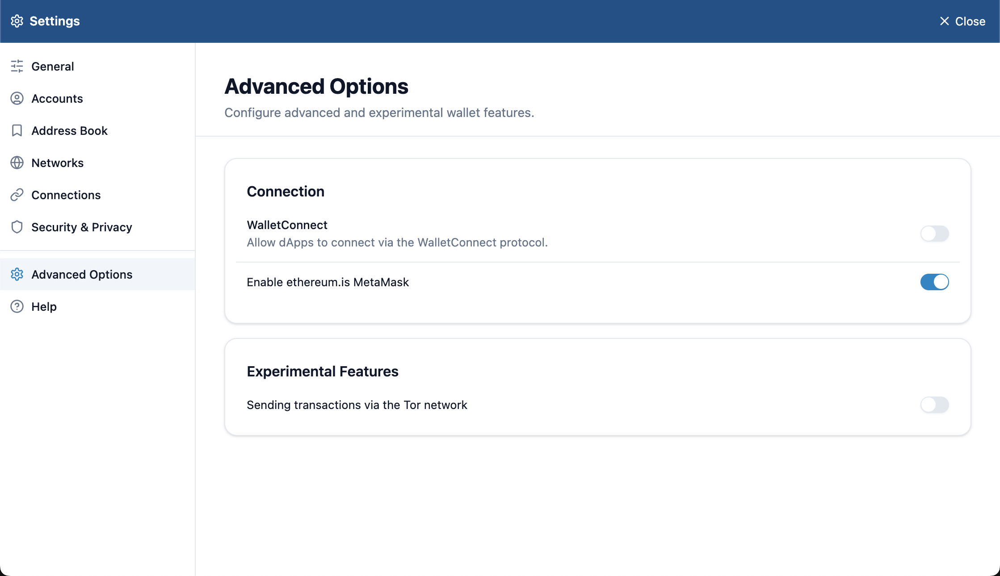

# Connect with WalletConnect

WalletConnect connects a wallet to sites and apps with a QR code or URI. Use it for sites that don't work with browser extensions, or for a site on another device.

## Turn it on

WalletConnect is off at first. Turn on **WalletConnect** under the wallet's **Settings** > **Advanced Options**.

## Connect

1. On the site, choose WalletConnect so that it shows a connection QR code.
2. Lunascape Wallet takes you to **Connect to WalletConnect**. Scan the QR code, or paste the URI the site lets you copy (a string starting with `wc:`) into **Paste the WC URI**.
3. On the confirmation screen, check the site and press **Connect**. Connecting shares your account's address with the site.

To scan QR codes with your camera, turn on **Allow camera permission for QR code capture** under **Settings** > **Security & Privacy**.

## Check or end sessions

With WalletConnect on, **WalletConnect Sessions** appears under **Settings** > **Advanced Options**. See the sites you're connected to there, and disconnect the ones you no longer use.

We recommend leaving WalletConnect off when you're not using it.
