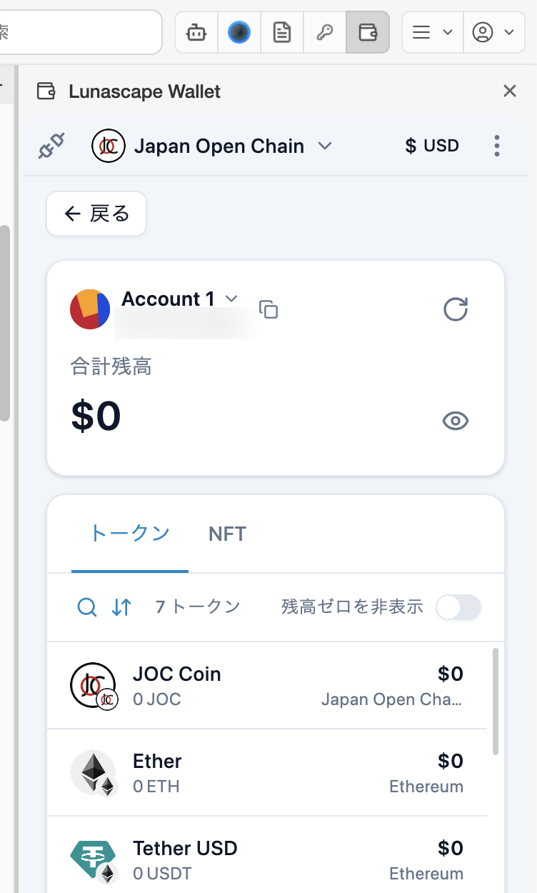
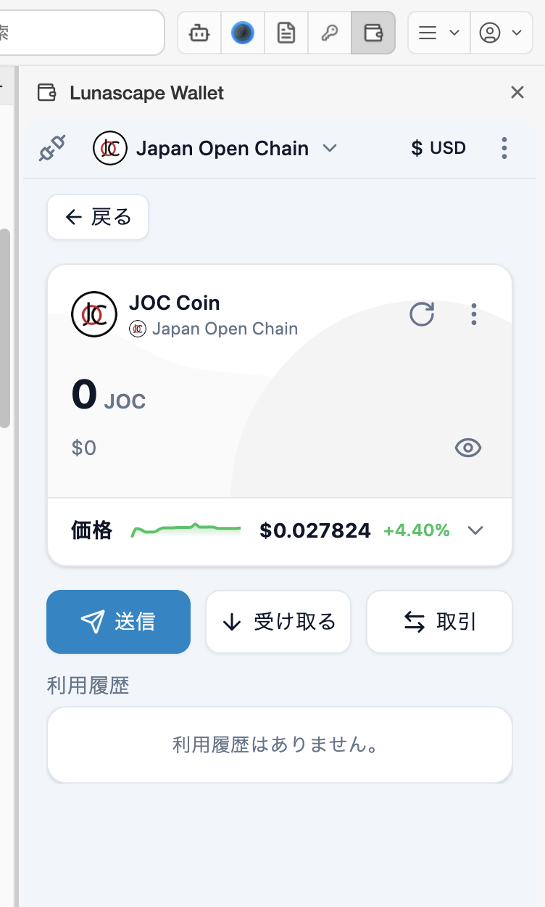
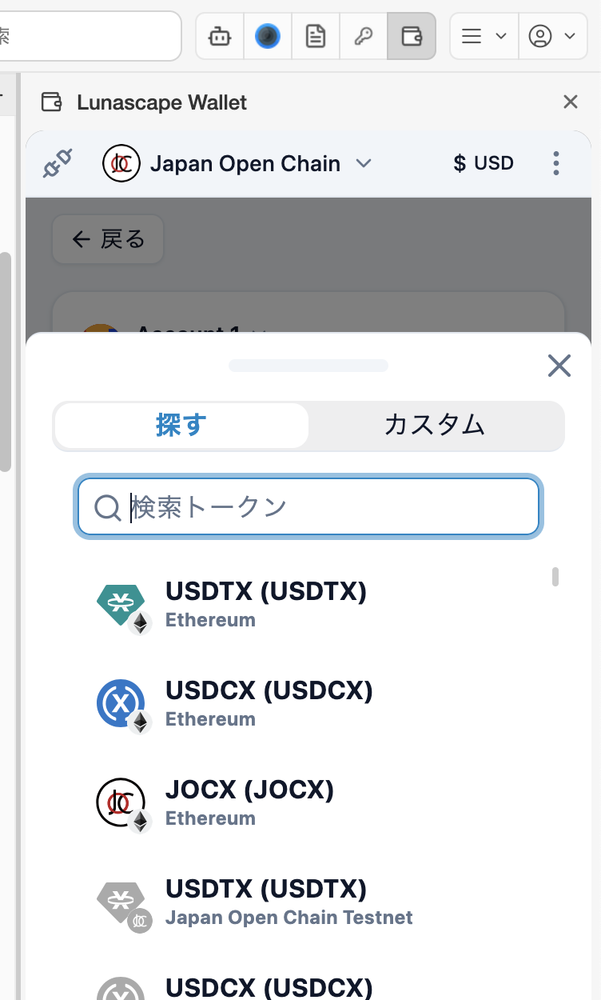
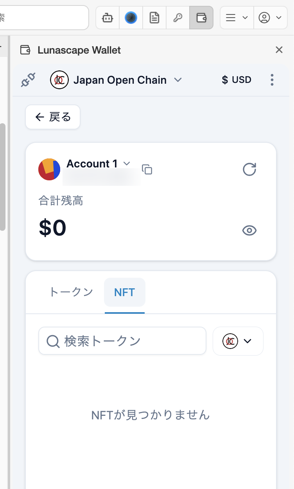
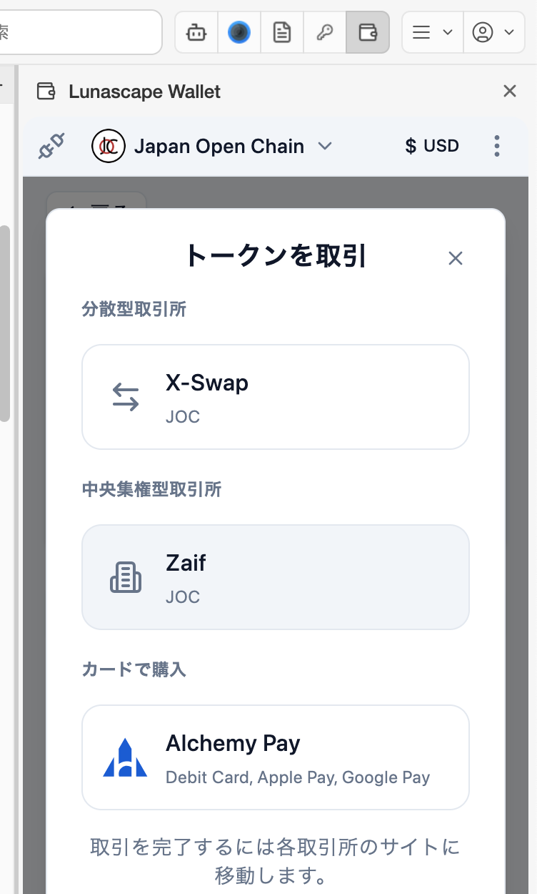

---
navigation:
  order: 300
---

# 資産を確認する

持っているトークンと NFT、価格、利用履歴を確認します。

## 保有資産の一覧

メイン画面の **保有資産** に、トークンと残高、表示通貨での金額、ネットワーク名が並びます。**すべて表示** を押すと、**トークン** と **NFT** のタブがある一覧が開きます。

- 虫めがねのアイコンでトークンを検索します。
- 矢印のアイコンで並び替えます（**デフォルト** / **アルファベット順（A〜Z）** / **残高順（高い順）**）。
- **残高ゼロを非表示** をオンにすると、残高が 0 のトークンを隠します。
- **戻る** でメイン画面に戻ります。

## トークンの詳細

一覧のトークンを押すと、詳細画面が開きます。

- **価格** の右の **∨** で価格チャートを開き、24 時間 / 7 日 / 30 日の値動きを見られます。
- **送信** / **受け取る** で、このトークンの送金と受け取りを始めます。
- **取引** で、このトークンを扱う取引所を表示します（[トークンを取引する](#トークンを取引する)）。
- 右上の **⋮** から、トークンの表示名などの編集と、一覧からの削除ができます。削除しても資産は消えません（一覧に表示されなくなるだけです）。

## トークンを追加する

受け取ったのに一覧に表示されないトークンは、追加すると表示されます。

1. 一覧の下の **通貨（トークン）を追加** を押します。
2. **探す** タブで名前を検索して選び、**次** を押します。

   

3. 候補にないときは **カスタム** タブで、ネットワーク・トークンタイプ・コントラクトアドレスなどを入力して **通貨（トークン）を追加** を押します。

コントラクトアドレスは、トークンの公式サイトなど信頼できる情報源で確かめてください。偽のトークンを追加させて詐欺サイトに誘導する手口があります。

## NFT

一覧の **NFT** タブに、持っている NFT が表示されます。右上のネットワークのボタンで、表示するネットワークを切り替えます。

- 表示されない NFT は、**NFTを追加** からコントラクトアドレスとトークン ID を入力して追加します。
- NFT を押すと詳細が開き、ほかのアドレスへ **転送** できます。転送も取り消せません。

## 利用履歴

メイン画面の **利用履歴**、またはトークンの詳細画面に、送金や受け取りの記録が並びます。記録を押すと、送金元・送金先・金額・手数料などの詳細を確認できます。

## トークンを取引する

トークンの詳細画面の **取引** を押すと、そのトークンを扱う取引所が表示されます。取引所を押すと、その取引所のサイトに移動します。取引は各取引所のサイトで行います。

| 種類 | 説明 |
| --- | --- |
| 分散型取引所 | ウォレットをサイトに接続して、トークンを交換します |
| 中央集権型取引所 | 取引所の口座で売買します。口座の開設が必要です |
| カードで購入 | クレジットカード・デビットカードなどで購入します |

表示される取引所は、ウォレットの **設定** > **一般** の **地域**（日本 / 日本以外）で変わります。取引所のサービスは、それぞれの運営会社が提供しています。
