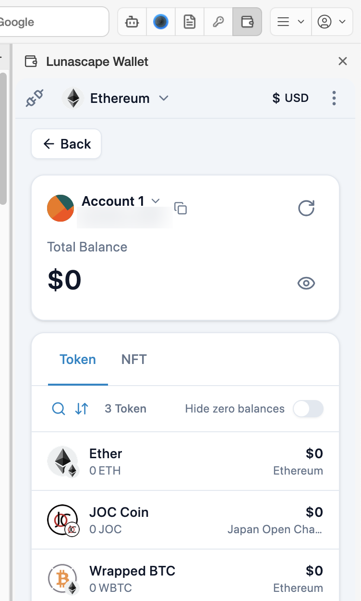
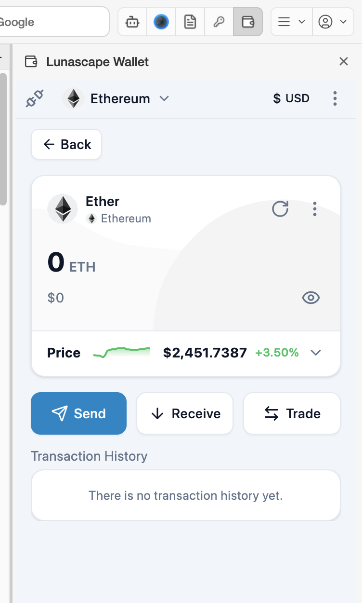
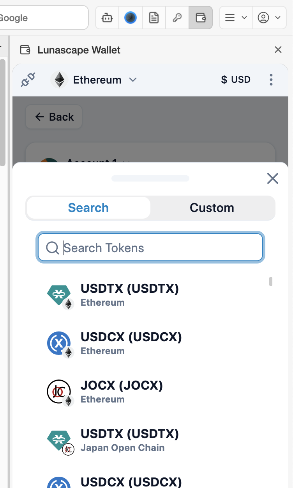
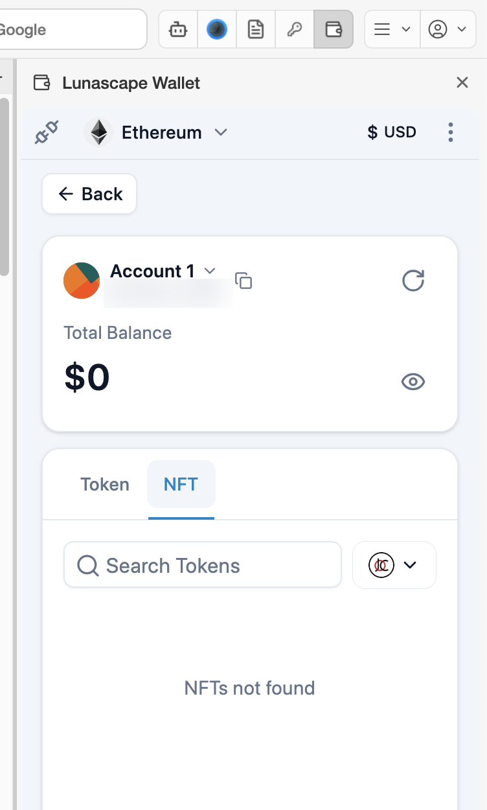
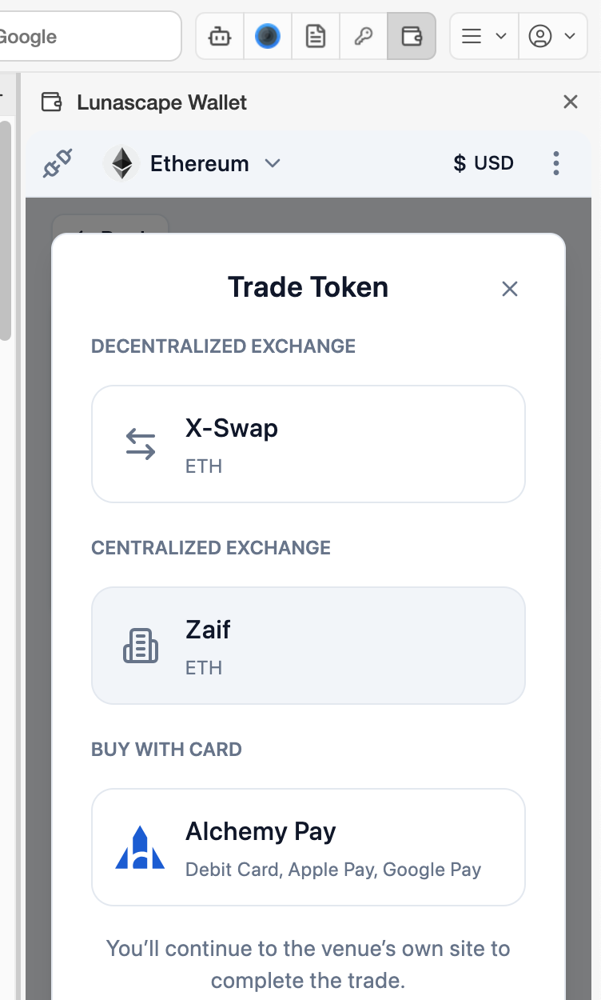

# Check your assets

See the tokens and NFTs you hold, prices and your transaction history.

## The asset list

**Assets in possession** on the main screen lists your tokens with their balance, value in the display currency and network. Press **View all** to open the full list, with **Token** and **NFT** tabs.

- The magnifier icon searches your tokens.
- The arrows icon sorts the list (**Default** / **Alphabetically (A-Z)** / **Declining balance ($ high-low)**).
- Turn on **Hide zero balances** to hide tokens with a balance of 0.
- **Back** returns to the main screen.

## Token details

Press a token in the list to open its detail screen.

- Press **∨** next to **Price** to open the price chart and see 24H / 7D / 30D movements.
- **Send** / **Receive** start sending or receiving this token.
- **Trade** lists exchanges that handle this token ([Trade a token](#trade-a-token)).
- The **⋮** at the top right lets you edit how the token is shown or remove it from the list. Removing it doesn't touch your assets — it only hides the token from the list.

## Add a token

A token you received but can't see in the list appears once you add it.

1. Press **Add Currency** below the list.
2. On the **Search** tab, search by name, select it and press **Next**.

   

3. If it's not among the candidates, open the **Custom** tab, enter the network, token type, contract address and so on, and press **Add Currency**.

Check the contract address against a trustworthy source such as the token's official site. Scammers get people to add fake tokens to lure them to phishing sites.

## NFTs

The **NFT** tab of the list shows the NFTs you hold. Use the network button at the top right to switch which network is shown.

- To show an NFT that's missing, press **Add NFT** and enter its contract address and token ID.
- Press an NFT to open its details, where you can **Transfer** it to another address. Transfers cannot be reversed either.

## Transaction history

**Transaction History** on the main screen, or on a token's detail screen, lists what you have sent and received. Press an entry to see its details, such as from, to, amount and fee.

## Trade a token

Press **Trade** on a token's detail screen to see exchanges that handle it. Pressing an exchange takes you to its site, where the trade happens.

| Kind | What it is |
| --- | --- |
| Decentralized exchange | Connect your wallet to the site and swap tokens |
| Centralized exchange | Trade through an account at the exchange (you need to open one) |
| Buy with card | Buy with a credit card, debit card or similar |

Which exchanges appear depends on **Region** (Japan / Outside Japan) under the wallet's **Settings** > **General**. Each exchange's service is provided by its own operator.
