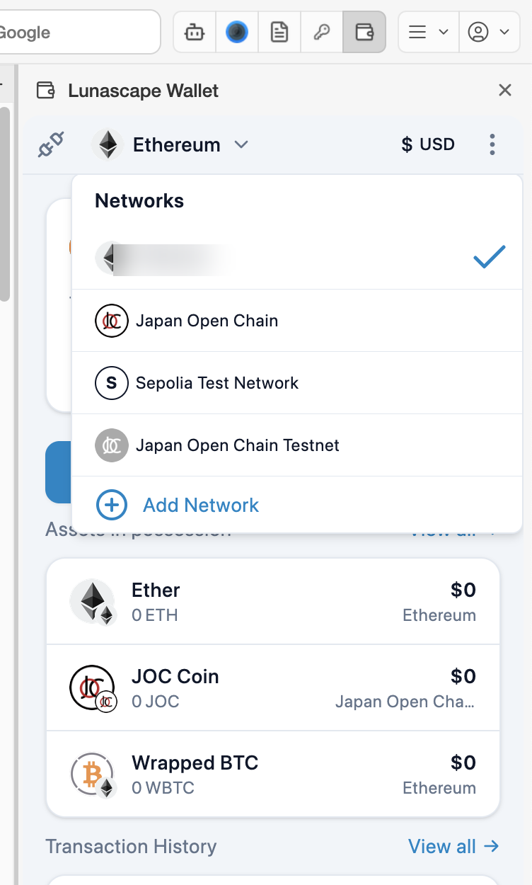
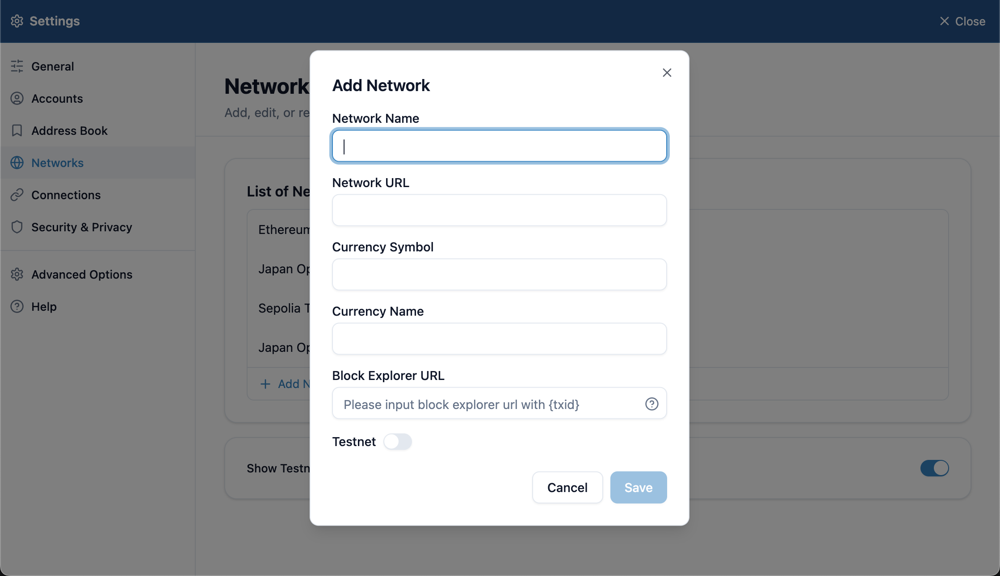

# Switch networks

A network (chain) is the blockchain your crypto moves on. Lunascape Wallet works with EVM-compatible networks. It doesn't support networks that aren't EVM-compatible, such as Bitcoin or Solana.

The network you choose at the top is mainly the one used when you connect to sites. Your assets and the tokens you can send are shown for every network, whichever one you choose (each token shows its network name).

## Switch

Press the network name at the top and choose from **Networks**. The current network has a check mark.

These networks are available from the start:

| Network | Kind |
| --- | --- |
| Ethereum | Mainnet |
| Japan Open Chain | Mainnet |
| Sepolia Test Network | Testnet (for practice) |
| Japan Open Chain Testnet | Testnet (for practice) |

Testnets appear in the list only when **Show Testnets** is on under the wallet's **Settings** > **Networks**. Assets on testnets have no value.

> **Note:** Switching networks cancels all transactions that are still pending. Wait for a send to finish before you switch.

## Add a network

To use a network that isn't in the list, add it.

1. Press **Add Network** in the list (you can also add one under the wallet's **Settings** > **Networks**).
2. Fill in the fields below and press **Save**.

| Field | What to enter |
| --- | --- |
| Network Name | The name shown in the list |
| Network URL | The RPC URL. Check it on the network's official site |
| Currency Symbol / Currency Name | The currency used for fees (such as ETH) |
| Block Explorer URL | The site for checking transactions. The transaction ID goes where you write `{txid}`; without it, the ID is added at the end |
| Testnet | Turn on for a testnet |

Registering an untrustworthy RPC URL can cause problems such as wrong balances.

## When a site asks to add or switch a network

A Web3 site may ask the wallet to add or switch to a network. A confirmation screen opens — check the network name and chain ID before you allow it. See [Connect to a site](../../../dapps/i18n/en/connect.md).

## Edit or delete a network

Under the wallet's **Settings** > **Networks**, press a network to edit or delete it. The built-in networks can't be deleted.
