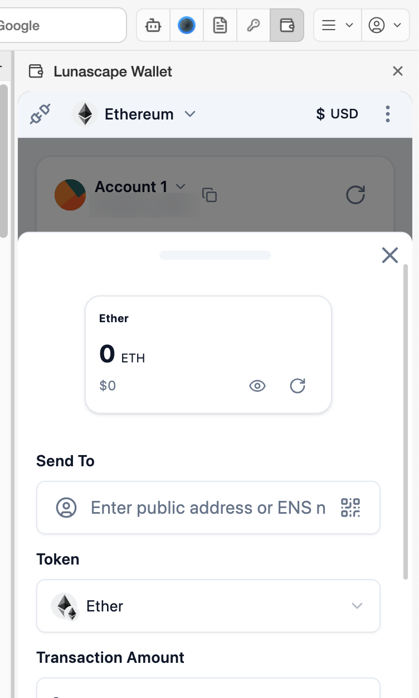

# Send

Send crypto to another address. A transaction you've sent cannot be reversed, so check the recipient and network carefully.

## Steps

1. In [Assets in possession](assets.md), check the network of the token you want to send (shown at the bottom right of each row). The send happens on the token's network, whichever network is selected at the top.
2. Press **Send** on the main screen. You can also start from **Send** on a token's detail screen.
3. Enter the recipient under **Send To**.

   - Paste the address (42 characters starting with `0x`).
   - Use the person icon to open the [address book](accounts.md#address-book) and pick a saved contact. You can also add a contact there.
   - Use the QR code icon to scan the recipient's address with your camera.
   - You can also enter an ENS name (such as `name.eth`). This doesn't work on networks without ENS.

4. Choose the token under **Token** and enter the **Transaction Amount**.
5. Press **Send**, check the recipient, amount and fee (gas), and confirm.

When the transaction finishes, a notification appears and it's recorded in [Transaction History](assets.md#transaction-history).

## About fees (gas)

Sending a transaction to the blockchain costs a fee (gas). The fee is paid in the network's own currency, separately from the token you send.

| Network | Fees paid in |
| --- | --- |
| Ethereum | ETH |
| Japan Open Chain | JOC |

For example, sending USDC on Ethereum still needs a little ETH. If you don't have enough, the wallet shows **Fees (gas) are insufficient.** and won't send. If the token's own balance is too low, it shows **Your balance is insufficient**.

## Check before you send

- **Network**: Is it the same network the recipient will receive on? If you send on a different network, they may not receive it.
- **Address**: A single wrong character sends it to someone else. Don't type it — copy and paste it or scan the QR code. Comparing the first and last few characters helps.
- **Amount**: Check where the decimal point is.

For a new recipient, it's safer to send a small amount first, confirm it arrived, then send the rest.

## If something goes wrong

See [Sending and transaction problems](../../../troubleshooting/i18n/en/transactions.md).
