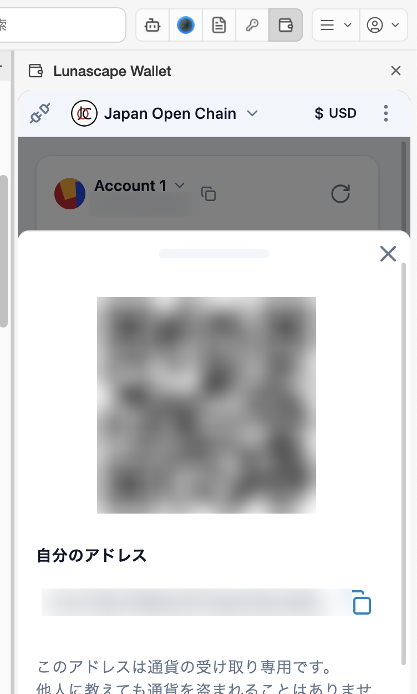

---
navigation:
  order: 200
---

# 受け取る

自分のアドレスを相手に伝えて、暗号資産を送ってもらいます。アドレスは他人に知られても問題ありません（アドレスを知られても、資産を勝手に引き出されることはありません）。

## 手順

1. 相手が送ってくるネットワーク（Ethereum、Japan Open Chain など）を確かめておきます。
2. メイン画面の **受け取る** を押します。
3. 表示された QR コードを相手に読み取ってもらうか、**自分のアドレス** の横のコピーのアイコンでアドレスをコピーして伝えます。
4. **完了** で閉じます。

メイン画面のアカウント名の横にあるコピーのアイコンからも、アドレスをコピーできます。

## 届いたか確かめる

- 受け取ったトークンは [保有資産](assets.md) に表示されます。表示されないときは、右上の更新のアイコンを押します。
- 一覧にないトークンを受け取ったときは、[トークンを追加](assets.md#トークンを追加する) すると表示されます。
- 取引の状況は、相手から取引 ID（トランザクションハッシュ）を聞いて、ブロックエクスプローラー（Etherscan など）で確かめられます。

## 注意

自分のアドレスは、Ethereum でも Japan Open Chain でも同じ文字列です。ただし資産はネットワークごとに別々に管理されます。保有資産の一覧では、トークンごとにネットワーク名が表示されます（同じ USDT でも、Ethereum 上のものと Japan Open Chain 上のものは別の資産です）。

テストネット（Sepolia Test Network など）の資産は、練習用で価値がありません。
