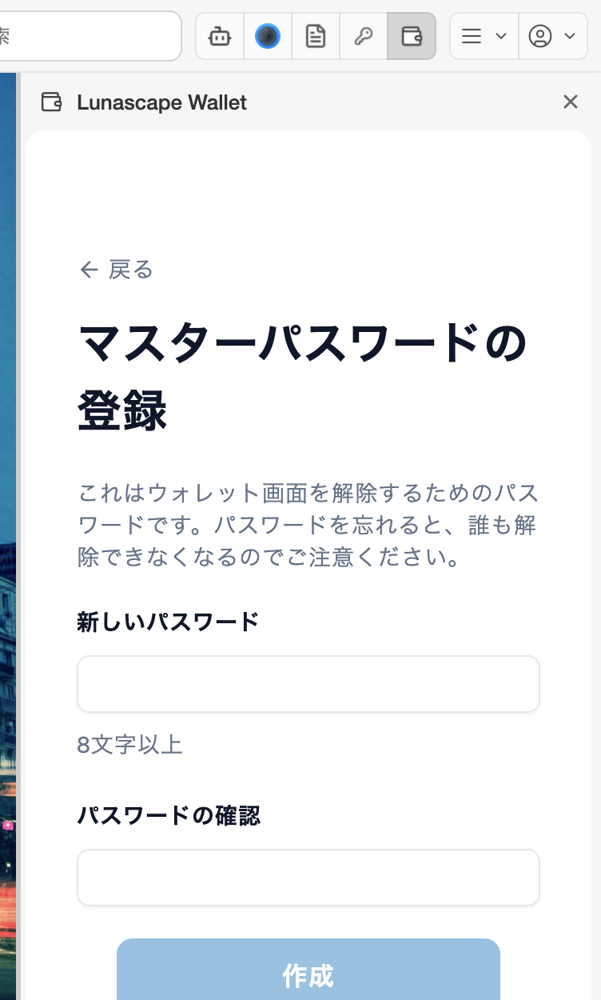

---
navigation:
  order: 200
---

# ウォレットを作成する

はじめて Lunascape Wallet を使うときの手順です。数分で終わります。

## 手順

1. **ローカルウォレットの作成** で **新しいウォレットを作成** を選び、**次** を押します。

   

2. **マスターパスワードの登録** で、パスワードを 2 回入力して **作成** を押します。8 文字以上にしてください。

   

3. **利用規約** の 3 つの項目を読み、すべてにチェックを入れて **アカウントを作成** を押します。

   

4. ウォレットのメイン画面が表示されたら完了です。**Account 1** というアカウントができています。

   

> **重要:** 作成が終わっても、シードフレーズを控える画面は自動では表示されません。続けて [シードフレーズをバックアップする](backup.md) の手順で、必ず控えてください。控えないままパソコンが壊れたり、ブラウザーのデータを消したりすると、ウォレットを二度と復元できません。

## マスターパスワードについて

- マスターパスワードは、このパソコンのこのブラウザーでウォレットのロックを解除するためのものです。
- 忘れても、シードフレーズがあればウォレットを入れ直せます（パスワードは新しく決め直します）。シードフレーズもない場合は、誰にも解除できません（[パスワードを忘れた](../troubleshooting/password.md)）。
- あとから **設定** > **セキュリティ** > **マスターパスワードの変更** で変えられます。

## 次に読む

- [シードフレーズをバックアップする](backup.md)
- [画面の見かた](screen.md)
- [受け取る](../features/receive.md) — 自分のアドレスに暗号資産を送ってもらう
