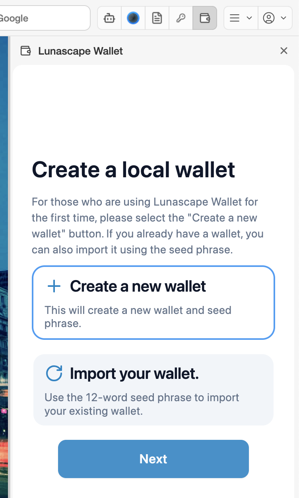
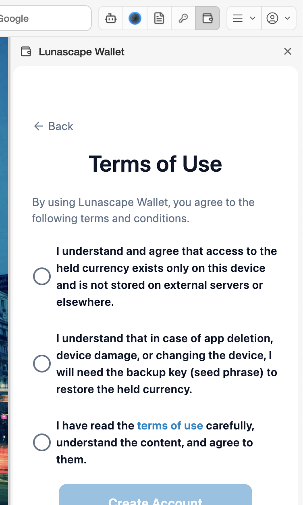
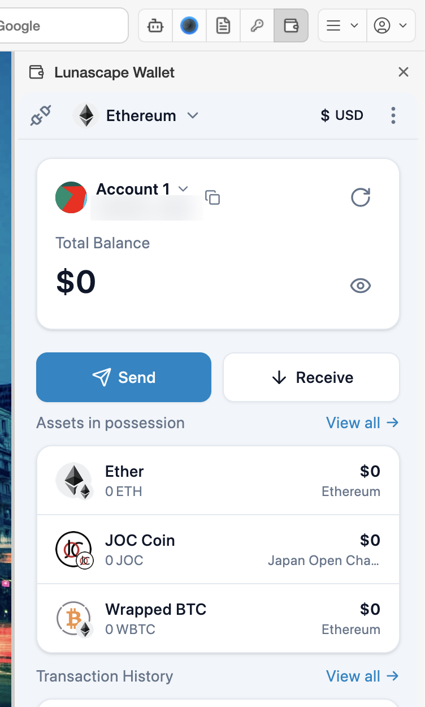

# Create a wallet

The steps for using Lunascape Wallet for the first time. It takes a few minutes.

## Steps

1. On **Create a local wallet**, choose **Create a new wallet** and press **Next**.

   

2. On **Registering a master password**, enter a password twice and press **Create**. Use at least 8 characters.

   

3. Read the three items on **Terms of Use**, tick all of them and press **Create Account**.

   

4. When the main wallet screen appears, you're done. An account named **Account 1** has been created.

   

> **Important:** The wallet does not show you the seed phrase on its own when it's created. Go straight on to [Back up your seed phrase](backup.md). If your computer breaks or the browser's data is deleted before you write it down, the wallet can never be restored.

## About the master password

- The master password unlocks the wallet **in this browser on this computer**.
- If you forget it, you can set the wallet up again with the seed phrase (and choose a new password). Without the seed phrase, no one can unlock it.
- Change it any time under **Settings** > **Security & Privacy** > **Change Master Password**.

## Read next

- [Back up your seed phrase](backup.md)
- [The wallet screen](screen.md)
- [Receive](../../../features/i18n/en/receive.md) — have crypto sent to your address
