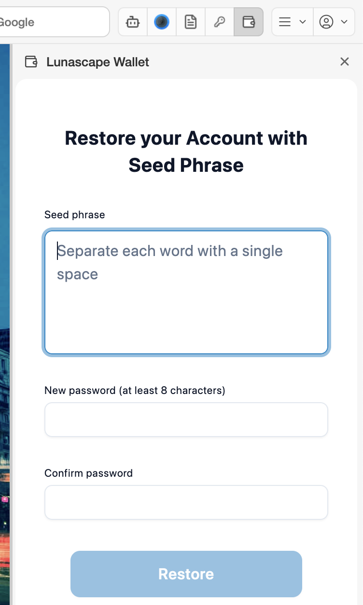

# Import a wallet

Bring in a wallet you used on another computer, in another browser or in another wallet app, using its 12-word seed phrase. The same seed phrase shows the same addresses and assets.

## When you first open the wallet

1. On **Create a local wallet**, choose **Import your wallet.** and press **Next**.
2. Follow the screens to enter the 12 words of the seed phrase (separated by single spaces) and a new master password (at least 8 characters).
3. Accept the terms of use, and the main screen appears.

## From the lock screen (setting it up again)

If you've forgotten the master password, or want to set the wallet up again, use **Restore Wallet** on the lock screen.

1. On the lock screen, press **Restore Wallet**.
2. On **Restore your Account with Seed Phrase**, enter the seed phrase and a new password (twice).
3. Press **Restore**.

## Notes

- If a single word is misspelled or out of order, the import fails (**Invalid secret recovery phrase**).
- Importing replaces the wallet that was in this browser. To keep that wallet, write down its seed phrase first.
- Only ever type your seed phrase into Lunascape Wallet itself. A website, email or chat that asks you to "enter your seed phrase" is a scam.

## Import just one account

You can also import a single account with its private key instead of the seed phrase. See [Manage accounts](../../../features/i18n/en/accounts.md).
