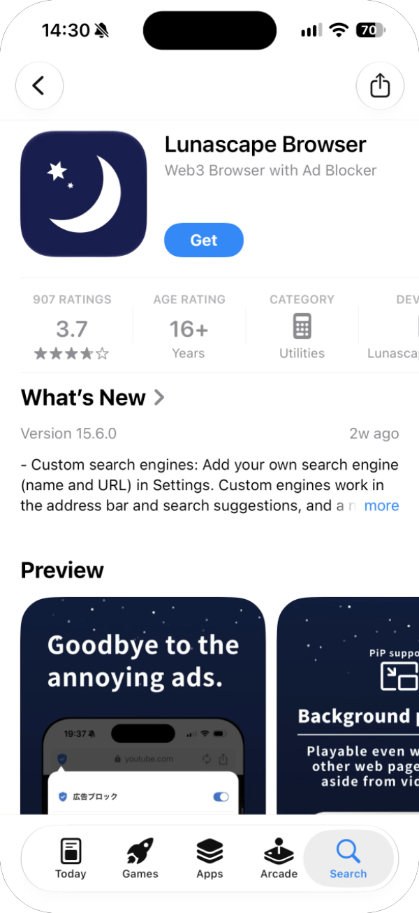
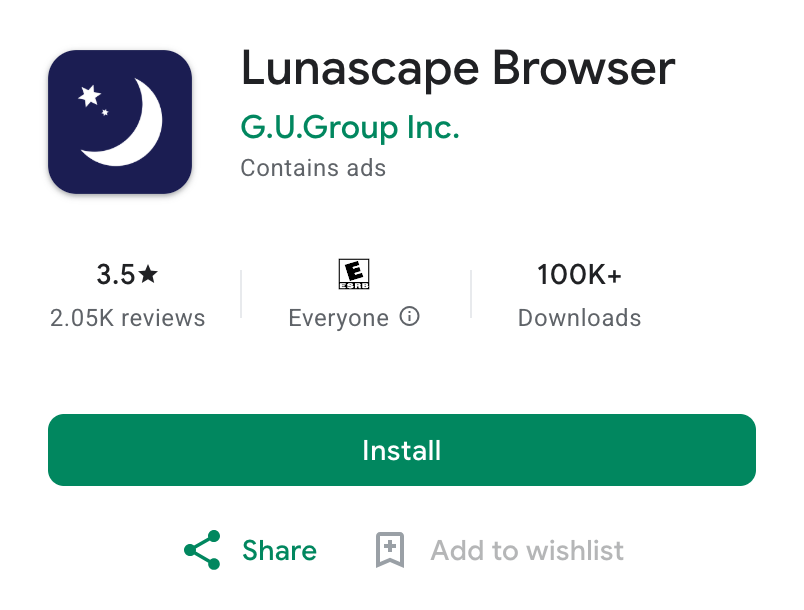
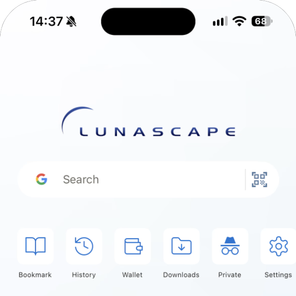
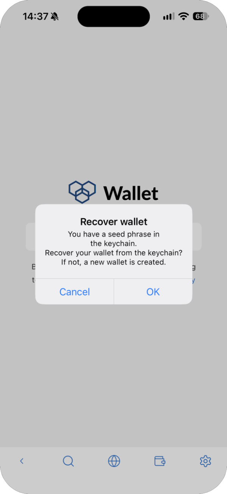
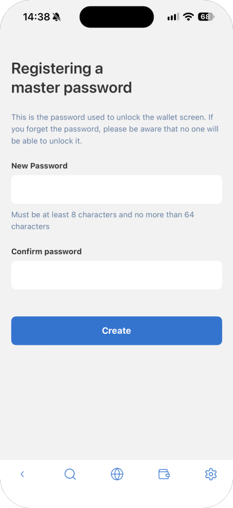
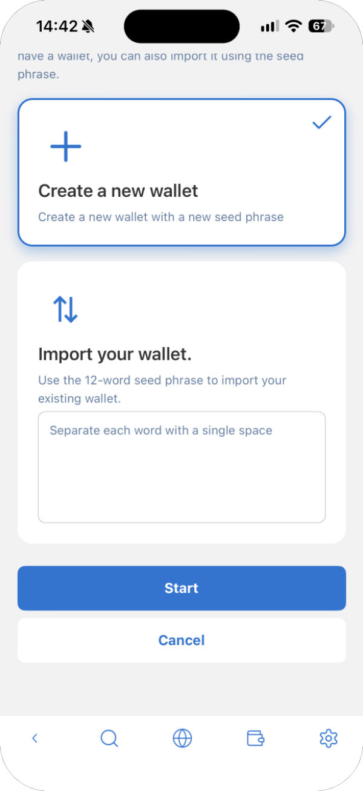
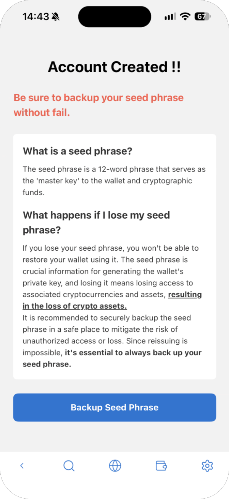
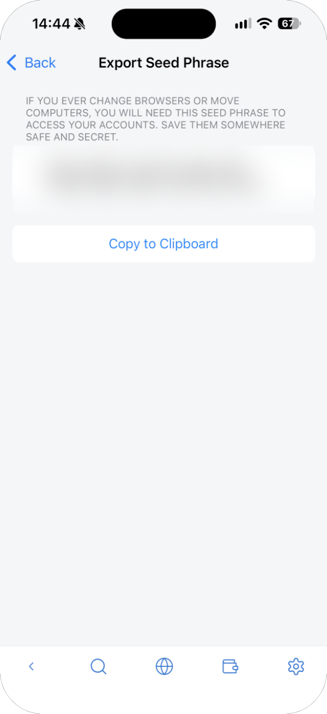
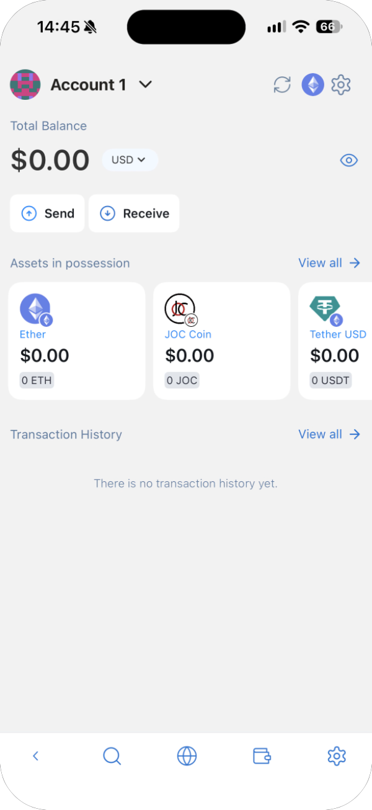
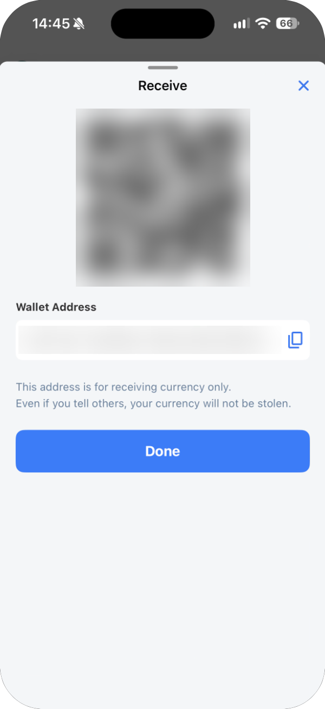

# Install and get started

Lunascape Wallet is free on both computers and smartphones. Pick one of the options below, depending on the device you'll use.

| Device | Option | Section |
| --- | --- | --- |
| A computer (Windows / Mac) with Google Chrome | Add the Chrome extension | "On a computer: Chrome extension" below |
| A computer (Windows / Mac) with Lunascape | Install Lunascape Desktop (the wallet is built in) | "On a computer: Lunascape Desktop" below |
| A smartphone (iPhone / Android) | Install the Lunascape Browser app (the wallet is built in) | "On a smartphone: Lunascape Browser" below |

Whichever you pick, go all the way to writing down your **seed phrase** (12 English words) on paper. The seed phrase is the only way to restore the wallet if, for example, your device breaks.

## On a computer: Chrome extension

**For:** Google Chrome on Windows / Mac

1. In Google Chrome, open [Lunascape Wallet (Chrome Web Store)](https://chromewebstore.google.com/detail/lunascape-wallet/nfinomegcaccbhchhgflladpfbajihdf).
2. Press **Add to Chrome**, then **Add extension** in the confirmation.
3. Press the extensions button (the puzzle piece) in Chrome's toolbar, then the pin next to Lunascape Wallet. The Lunascape Wallet button now stays in the toolbar, one click away.
4. When you open Lunascape Wallet, it shows the create screen. Follow [Create a wallet](create-wallet.md).
5. When that's done, be sure to write down your seed phrase by following [Back up your seed phrase](backup.md). On a computer, the wallet does not show the seed phrase screen on its own.

## On a computer: Lunascape Desktop

**For:** Windows / Mac

Lunascape Wallet is already part of Lunascape Desktop. There is no extension to add.

1. Download the Windows or Mac version from the [Lunascape download page](https://www.lunascape.org/en/download).
2. Open the downloaded file, follow the on-screen steps to install, and start Lunascape.
3. Press the Lunascape Wallet button (the wallet shape) in the toolbar. The wallet opens in a panel on the right of the window. Press the button again, or the **×** at the top right of the panel, to close it.

   

   If you can't find the button, check that Lunascape Wallet is on under **Settings** > **Extensions** > **System Extensions** in Lunascape.

4. The first time, the wallet shows the create screen. Follow [Create a wallet](create-wallet.md).
5. When that's done, be sure to write down your seed phrase by following [Back up your seed phrase](backup.md). On a computer, the wallet does not show the seed phrase screen on its own.

## On a smartphone: Lunascape Browser

**For:** iPhone / Android

Lunascape Wallet is built into the Lunascape Browser app.

- iPhone: [App Store](https://apps.apple.com/app/lunascape-browser/id380065805)
- Android: [Google Play](https://play.google.com/store/apps/details?id=jp.co.lunascape.android.ilunascape)

The screens below are from an iPhone. Android works the same way.

### 1. Install the app

Open the store from a link above and press **Get** (iPhone) or **Install** (Android).

### 2. Open the app

When you open the app, a few welcome screens appear first. Press **Next** to go through them.

### 3. Open the wallet

On the home screen, tap **Wallet**.

### 4. Start setting up the wallet

Tap **Set up wallet**. Tapping it means you agree to the Privacy Policy and Terms of Use.

**If "Recover wallet" appears:** this happens if you used Lunascape Wallet on this phone before. Press **OK** to keep using that wallet, or **Cancel** to create a new one. It doesn't appear the first time you use the wallet.

### 5. Register a master password

Enter the same password in **New Password** and **Confirm password**, then press **Create**. The password must be 8 to 64 characters.

On an iPhone, if a switch for unlocking with Face ID appears, turn it on to open the wallet with Face ID from then on.

> **Important:** If you forget the master password, no one can unlock the wallet. You would have to set the wallet up again with your seed phrase.

### 6. Choose how to manage keys

Check that **Self-Custody** is selected, then press **Start**.

### 7. Create a new wallet

Check that **Create a new wallet** is selected. Scroll down and press **Start**.

### 8. Read and agree

Read the three items, check all of them and press **Create Account**. You can't press **Create Account** until all three are checked.

### 9. Write down your seed phrase

When **Account Created !!** appears, your wallet is ready. Next, write down the seed phrase.

1. Press **Backup Seed Phrase**.

   

2. Press **Show Seed Phrase**. Make sure no one around you can see your screen first.

   

3. Copy the 12 English words onto paper, **in order**. When you're done, press **Back** at the top left.

   

> **Important:** Write the seed phrase on paper and keep it where no one else can see it. Don't use **Copy to Clipboard** or take a screenshot: it can stay in other apps or the cloud and be stolen. Anyone who knows your seed phrase can send away everything in your wallet.

### 10. Check your wallet address

The wallet's main screen appears. Press **Receive** to see your wallet address (a string starting with `0x`) and its QR code. You're ready.

Your wallet address is what you give others so they can send you crypto. Sharing it doesn't let anyone take your assets.

## After that

The wallet opens on the lock screen. Enter the master password you set when you created it to unlock it. If you turned on Face ID on an iPhone, you can unlock with Face ID.

If you've forgotten the password, see [Forgot your password](../../../troubleshooting/i18n/en/password.md).

## Read next

- [The wallet screen](screen.md)
- [Receive](../../../features/i18n/en/receive.md) — Have crypto sent to your address
- [Import a wallet](import-wallet.md) — Use a wallet from another computer or browser
