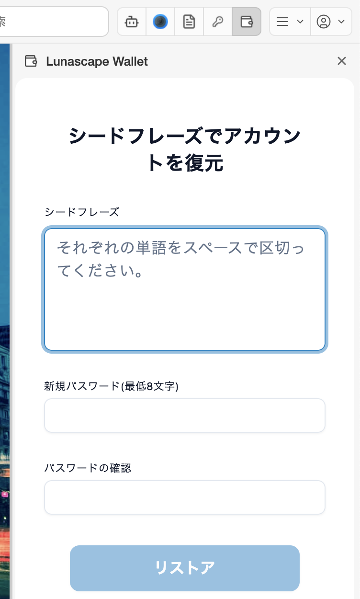

---
navigation:
  order: 300
---

# ウォレットをインポートする

別のパソコンやブラウザー、ほかのウォレットアプリで使っていたウォレットを、12 語のシードフレーズで取り込みます。同じシードフレーズからは、同じアドレスと資産が表示されます。ただし、秘密鍵や Ledger で追加したアカウントは、シードフレーズでは戻りません。

## はじめて開いたときに取り込む

1. **ローカルウォレットの作成** で **ウォレットをインポート** を選び、**次** を押します。
2. 画面の案内に従って、シードフレーズの 12 語（それぞれ半角スペースで区切る）と、新しいマスターパスワード（8 文字以上）を入力します。
3. 利用規約に同意すると、メイン画面が表示されます。

## ロック画面から取り込む（入れ直す）

マスターパスワードを忘れたときや、ウォレットを入れ直したいときは、ロック画面の **ウォレットを復元** から取り込めます。

1. ロック画面で **ウォレットを復元** を押します。
2. **シードフレーズでアカウントを復元** に、シードフレーズと新しいパスワード（2 回）を入力します。
3. **リストア** を押します。

## 注意

- シードフレーズは、単語のつづりと順番が 1 つでも違うと取り込めません（**無効なシークレットリカバリーフレーズ** と表示されます。シークレットリカバリーフレーズは、シードフレーズのことです）。
- 取り込むと、このブラウザーに入っていたウォレットは置き換わります。置き換える前のウォレットを残したいときは、先にそのシードフレーズを控えてください。
- シードフレーズを入力するのは、Lunascape Wallet の画面の中だけにしてください。サイトやメール、チャットで「シードフレーズを入力して」と求められたら詐欺です。

## 1 つのアカウントだけを取り込む

シードフレーズではなく、特定のアカウントの秘密鍵だけを取り込むこともできます。[アカウントを管理する](../features/accounts.md) を参照してください。
