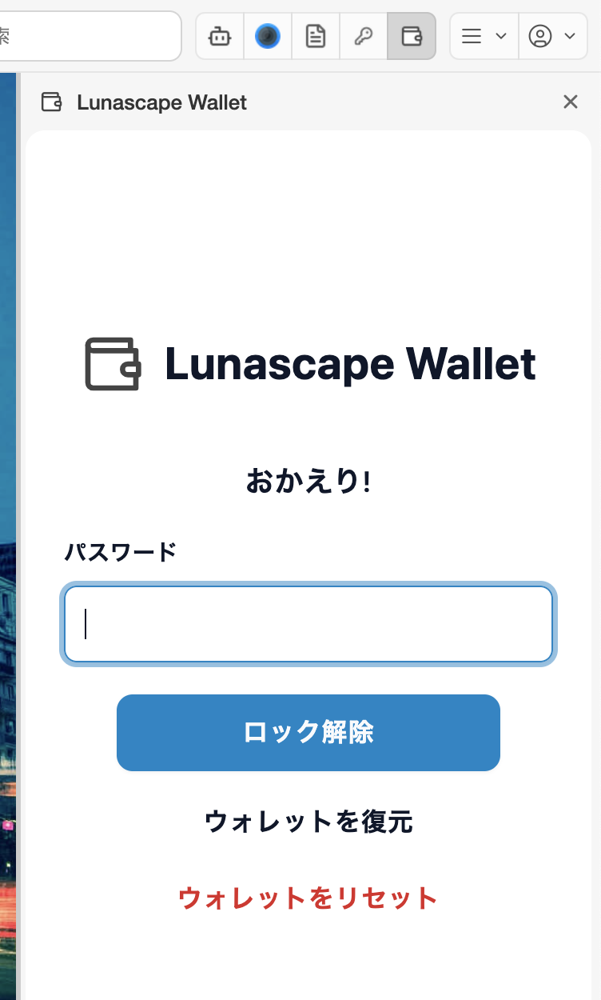

---
navigation:
  order: 100
---

# 入手して開く

## Lunascape Desktop で使う

Lunascape Desktop には、Lunascape Wallet が最初から入っています。インストールは不要です。

ツールバーの Lunascape Wallet のアイコン（財布の形）を押すと、ウィンドウの右側にウォレットのパネルが開きます。もう一度アイコンを押すか、パネル右上の **×** で閉じます。

アイコンが見つからないときは、Lunascape の **設定** > **拡張機能** の **システム拡張** で、Lunascape Wallet がオンになっているか確認してください。

## Chrome などのブラウザーで使う

Chrome ウェブストアから Lunascape Wallet を追加します。追加したら、ツールバーの拡張機能のボタン（パズルのアイコン）から Lunascape Wallet をピン留めしておくと、すぐに開けます。

## はじめて開いたとき

はじめて開くと、ウォレットの作成画面が表示されます。

- 新しく始める: [ウォレットを作成する](create-wallet.md)
- 別のパソコンやブラウザーで使っていたウォレットを使う: [ウォレットをインポートする](import-wallet.md)

## 2 回目からは

ウォレットを開くとロック画面（**おかえり!**）が表示されます。作成時に決めたマスターパスワードを入力して **ロック解除** を押します。ブラウザーを再起動したときなどにも、もう一度ロックされます。

パスワードを忘れたときは [パスワードを忘れた](../troubleshooting/password.md) を参照してください。
