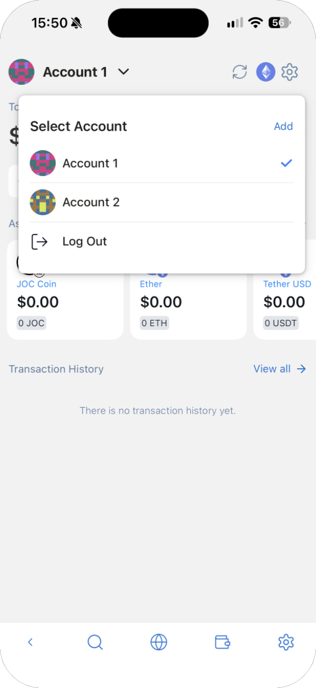
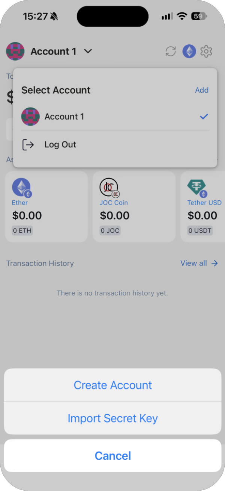
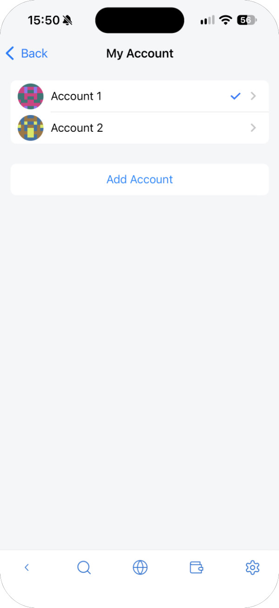
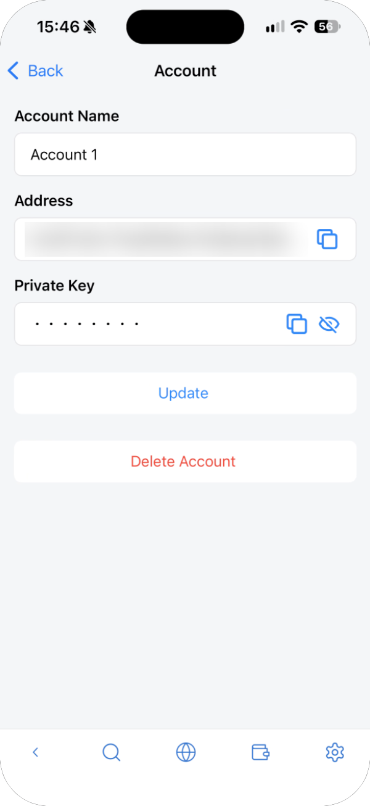
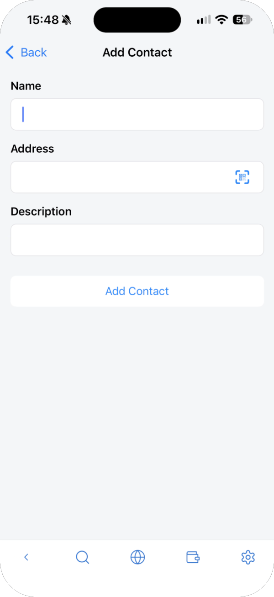
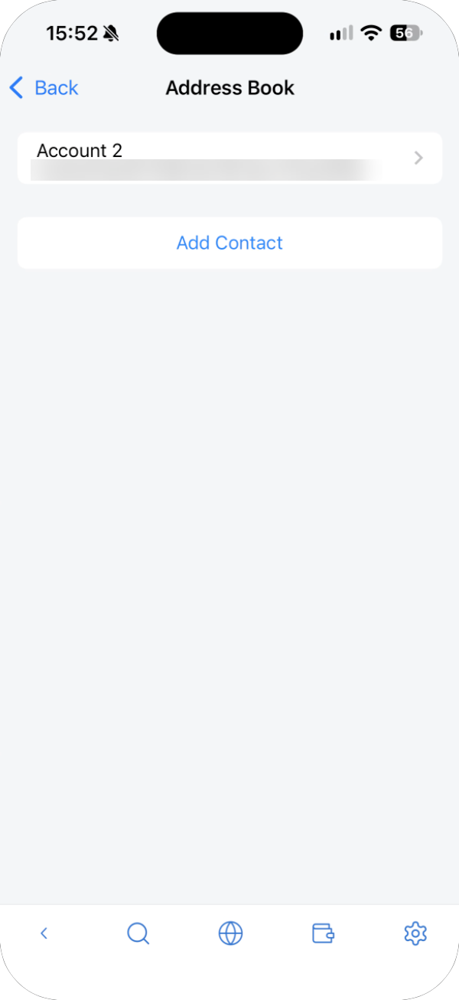
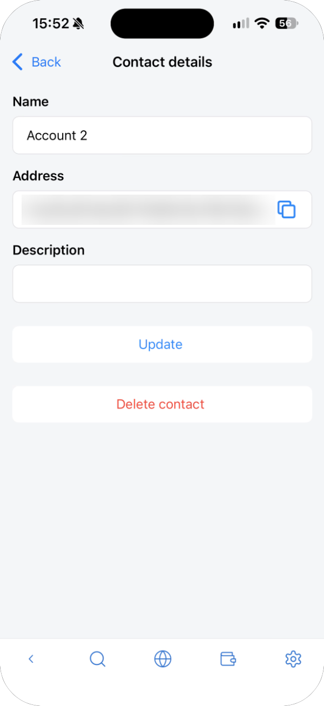

---
navigation:
  order: 600
---

# Accounts and address book

One wallet can hold several accounts, each with its own address.

## Switch or add accounts

Tap the account name at the top left of the main screen. **Select Account** lists your accounts; tap one to switch to it.

Tap **Add** and choose how to add an account.

| Option | What it does |
| --- | --- |
| Create Account | Creates a new account from your seed phrase. Restoring the seed phrase brings it back too |
| Import Secret Key | Adds an account from another wallet with its private key. It isn't restored by the seed phrase, so keep the private key safe separately |

**Log Out** locks the wallet. You need the master password to open it again.

## Manage accounts

In the wallet's settings, **Account** opens **My Account**, which lists your accounts and has **Add Account**.

Tap an account to open its details.

- **Account Name**: change the name and tap **Update**.
- **Address**: copy your address.
- **Private Key**: the eye icon shows it and the copy icon copies it.
- **Delete Account**: removes the account from this wallet.

> **Important:** Anyone who knows a private key can take everything in that account. Never send it to anyone or paste it into a website. Before deleting an account you imported with a private key, make sure you have a copy of the key.

## Address book

Save the addresses you send to, with a name. In the wallet's settings, open **Address Book** and tap **Add Contact**.

Saved contacts are listed with their addresses. Tap a contact to change its name or description (**Update**) or delete it (**Delete contact**).

When you send, the person icon next to **Send to** opens the address book.

> **Note:** A saved name doesn't prove the address is right. Check the address each time before you send.
