---
navigation:
  order: 400
---

# Check your assets

## The asset list

Tap **View all** next to **Assets in possession** on the main screen. The **Asset List** shows the tokens you hold, on every network.

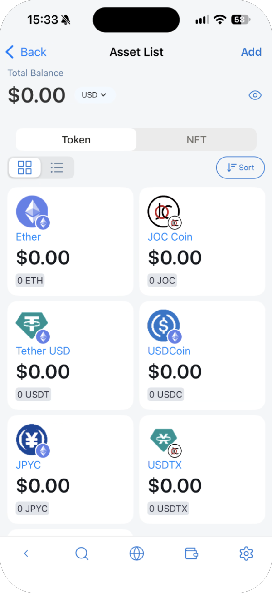

- The two icons on the left switch between card view and list view. List view also shows each token's network.
- **Sort** orders the list by **Default** (recently viewed first), **Alphabetically (A-Z)** or **Declining balance ($ high-low)**.

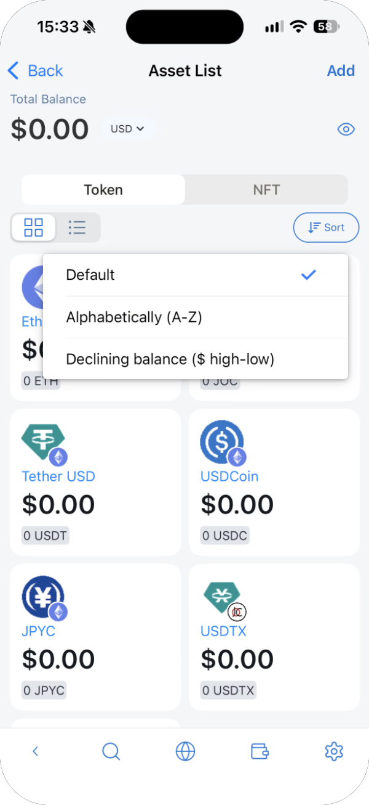

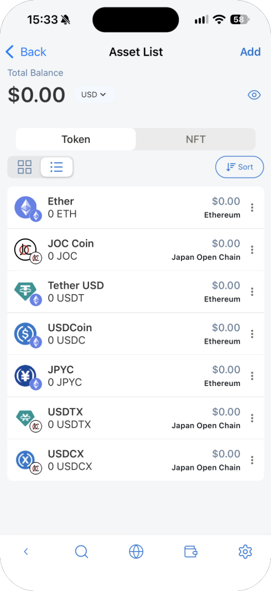

## Edit or remove a token

In list view, tap **⋮** next to a token and choose **Edit** or **Delete**.

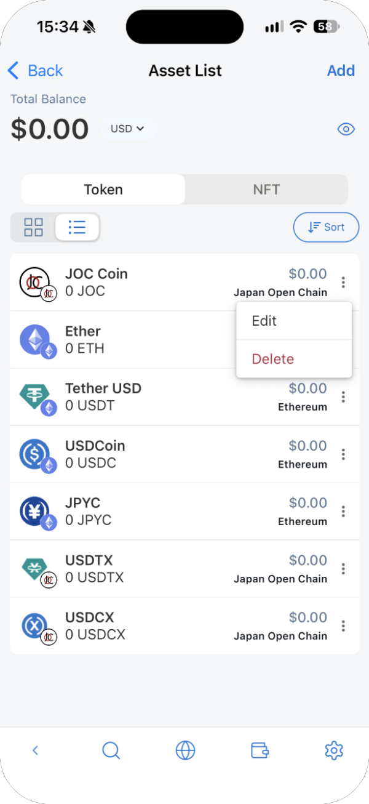

On the **Edit** screen you can change **Decimals for display** and the card **Color**. The token name, symbol and decimals can't be changed. **Delete Card** removes the token from the list.

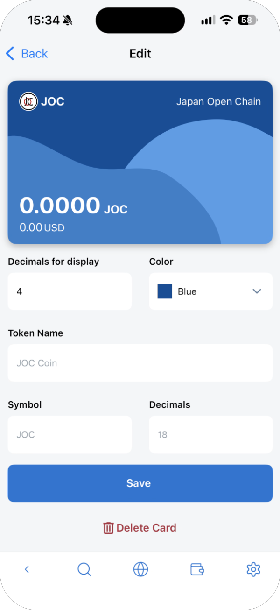

Removing a token only hides it from the list. It doesn't touch the token on the blockchain, and you can add it again later.

## Add tokens

Tap **Add** at the top right of the Asset List.

### Pick from the list

1. On the **Search** tab, search for the token, or scroll the list. Each token shows its network.
2. Select the tokens to add. You can select more than one.
3. Tap **Next**, check the list, and tap **Add Assets**.

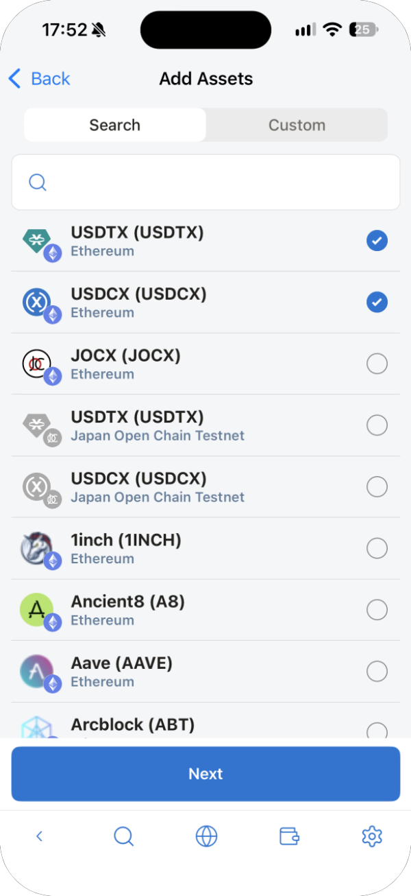

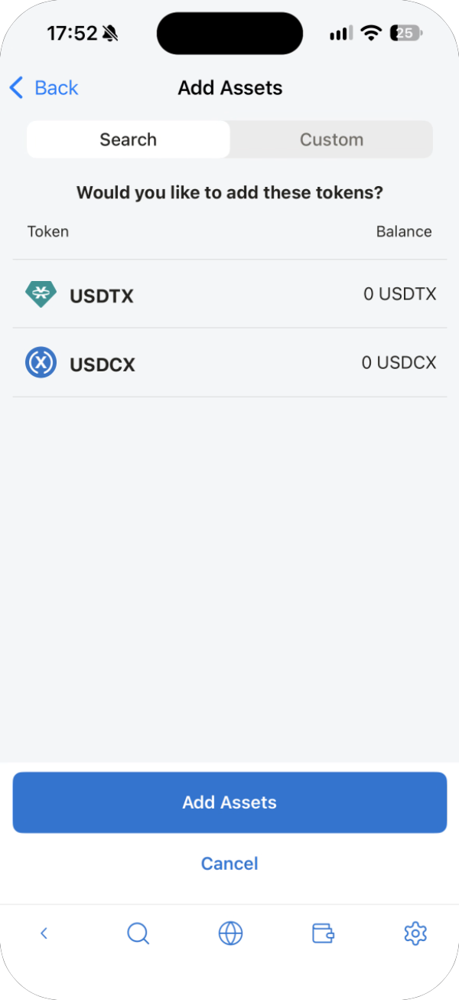

### Add a token that isn't listed

1. Open the **Custom** tab.
2. Choose the **Network**, and set **Token Type** to **ERC-20**. (**Base Currency** adds the network's own currency.)
3. Enter the token's contract address under **Address**, or scan it, and tap **Add Assets**.

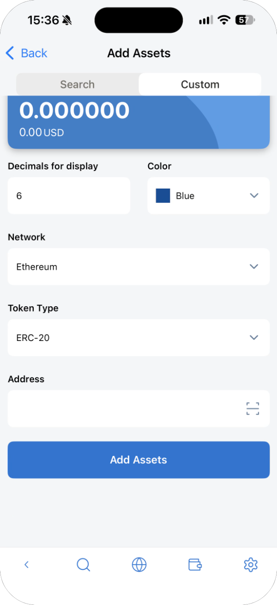

> **Caution:** Token names and logos can be faked. Check the contract address on the token's official site, and make sure it's for the network you chose.

## NFTs

The **NFT** tab shows the NFTs you hold. Use the network button on the right to switch networks.

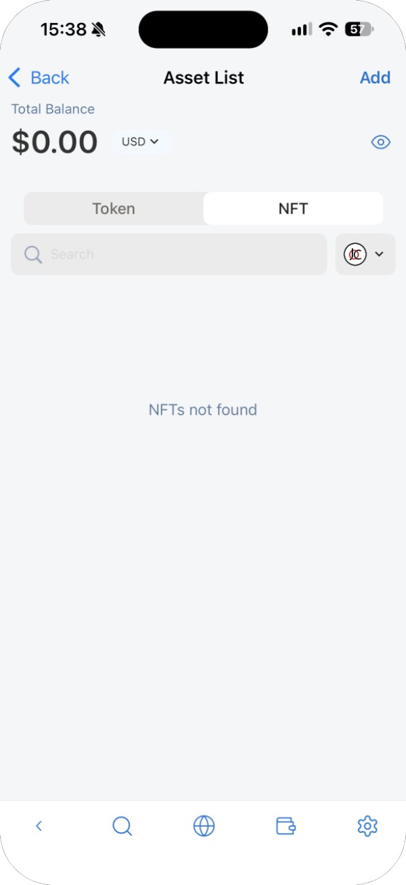

## Token details

Tap a token to see its balance, its network and its **Transaction History**. **Send** and **Receive** start sending or receiving this token, and **Edit** opens the edit screen.

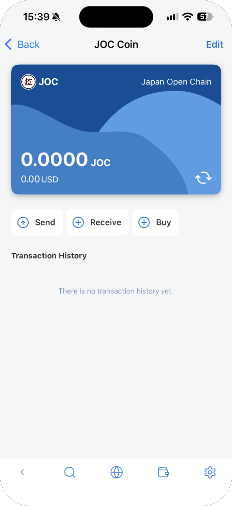

### Buy a token

**Buy** lists services where you can buy the token. Tapping one takes you to that service's site, where you check the fees and buy. Which services appear depends on your language and region.

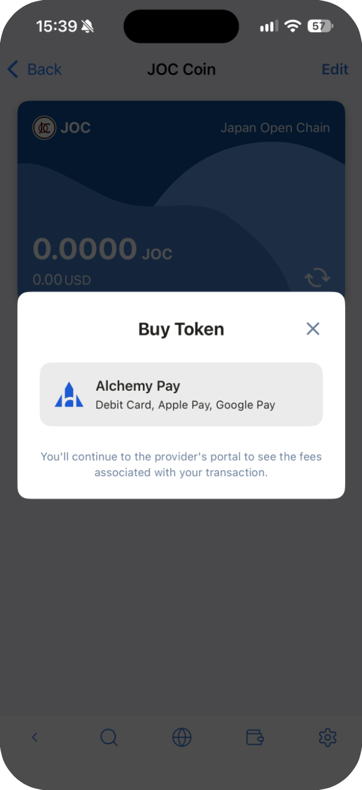
