---
navigation:
  order: 700
---

# Connect to sites

Open a Web3 site (DApp) in Lunascape Browser. When the site asks the wallet for something, a confirmation screen appears. Read it before you allow anything.

> **Important:** Connecting tells the site your address. A signature may give the site permissions, and a transaction moves assets and can't be reversed. Only approve requests from sites you trust, and never enter your seed phrase or private key on a website.

## Connect to a site

1. On the site, tap its connect button (such as **Connect Wallet**). If the site lists wallets, choose Lunascape, or MetaMask if Lunascape isn't listed.

   

2. The wallet shows **The site is requesting your wallet address**. Check the site's name and URL and the account, then tap **Approve**. Tap **Cancel** to refuse.

   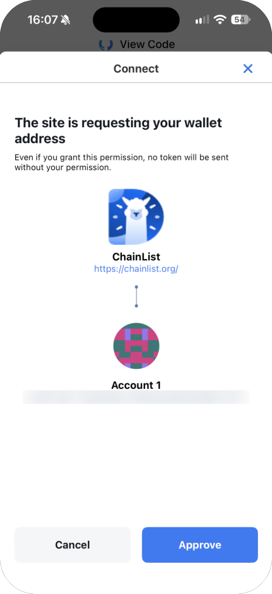

3. You return to the site, which now shows that it's connected. How it shows this depends on the site.

   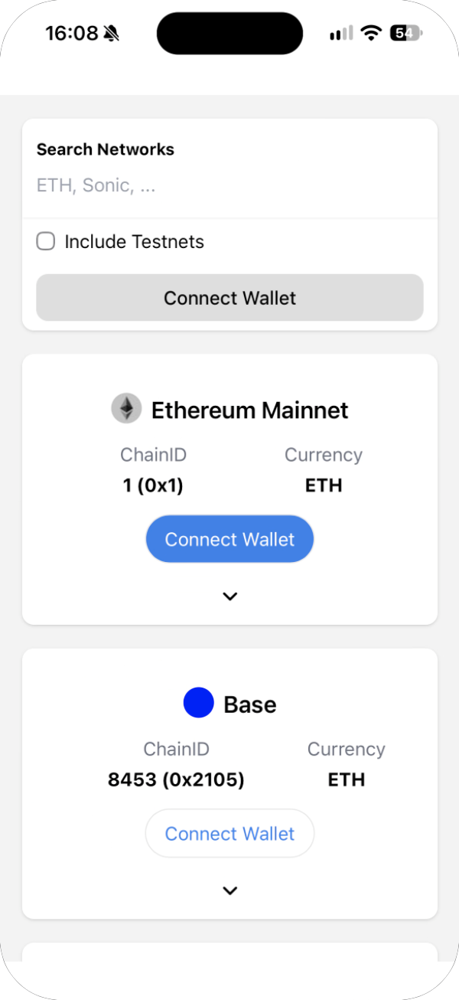

Connecting alone never sends any crypto.

## See or remove connected sites

In the wallet's settings, **Permitted websites** lists the sites you've allowed, by account.

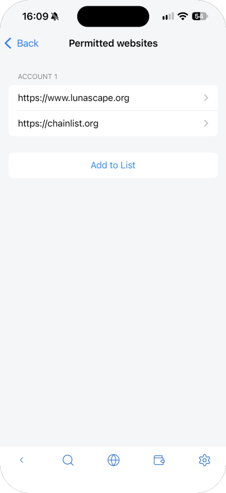

To disconnect a site, tap it, then tap **Delete Site** and **Delete**.

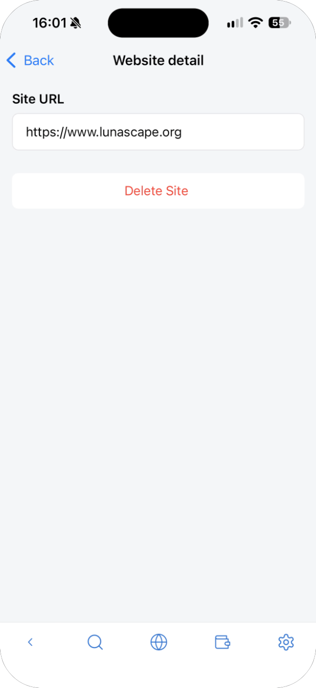

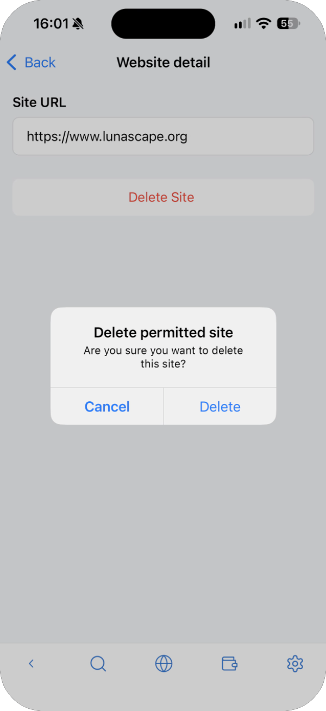

**Add to List** lets you allow a site in advance by entering its URL.

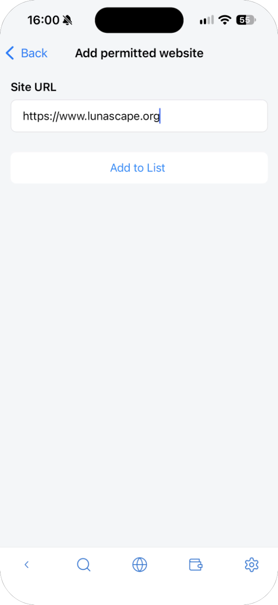

## Requests a site can send

### Signature request

The site asks you to sign a message, for example to prove you own the address. Signing doesn't send any crypto, but some signatures give a site permission to use your tokens. Tap **Sign** only if you understand the message and trust the site.

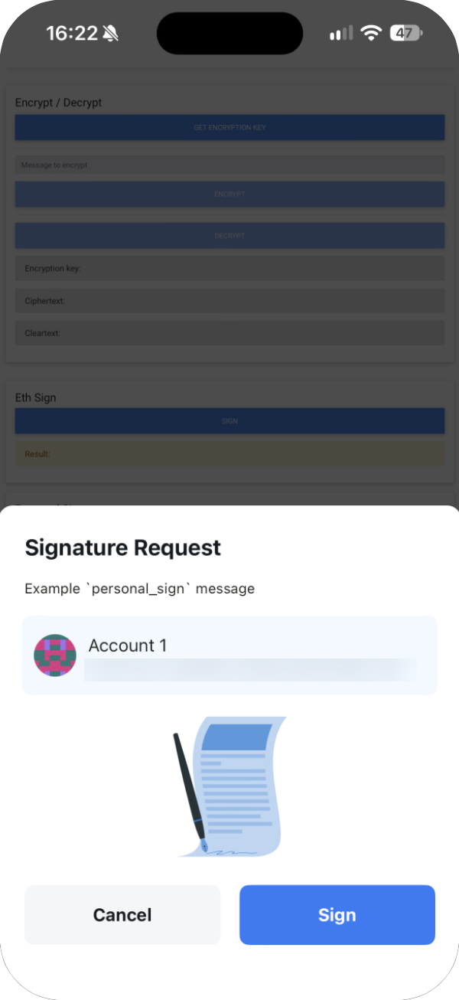

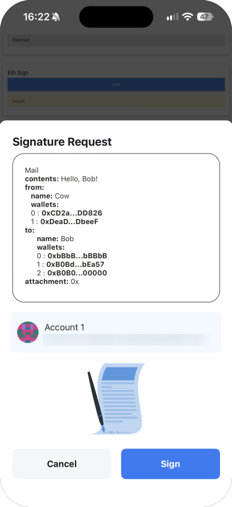

### Transaction approval

The site asks you to send a transaction (a payment, a swap and so on). Check the **Amount of payment**, the **Transaction Fee** and the site under **Client**, then tap **Approve**. If your balance isn't enough, **Insufficient balance** appears and you can't approve.

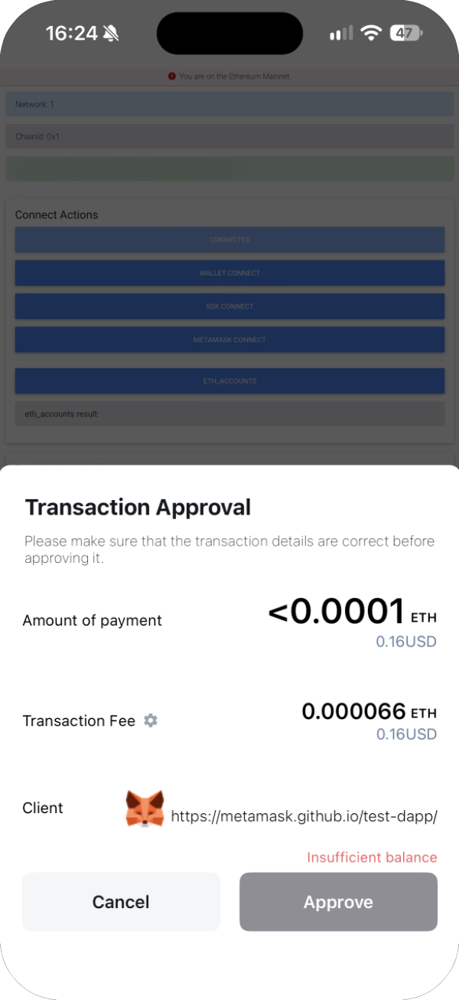

### Add tokens

The site suggests tokens to add to your asset list. Adding only shows them in the list. Tap **Add tokens** if the token is the one you expect.

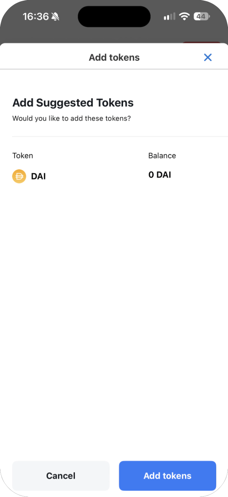

### Add or switch a network

The site asks to add a network to the wallet, or to switch to one. Check the chain name, chain ID and RPC URL, then tap **Approve**.

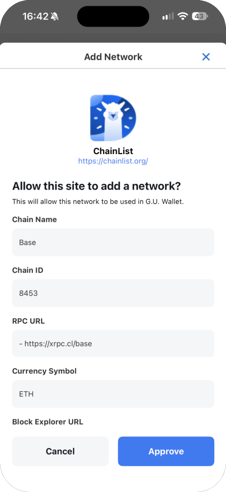

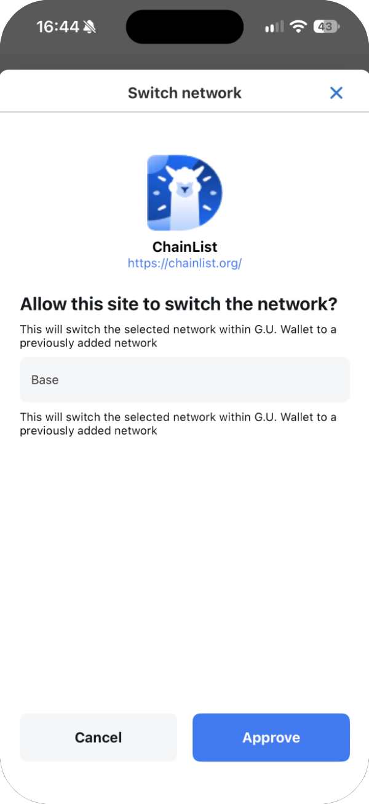

> **Note:** These two screens still show the wallet's former name, G.U. Wallet. It's the same wallet.

## MetaMask compatibility

Some sites only work with MetaMask. Turn on **Enable ethereum.isMetaMask** in the wallet's settings, reload the page, and choose MetaMask on the site. See [Settings](settings.md).
