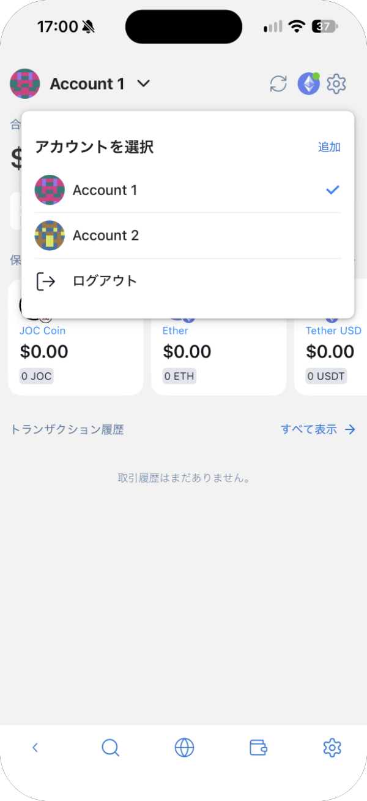
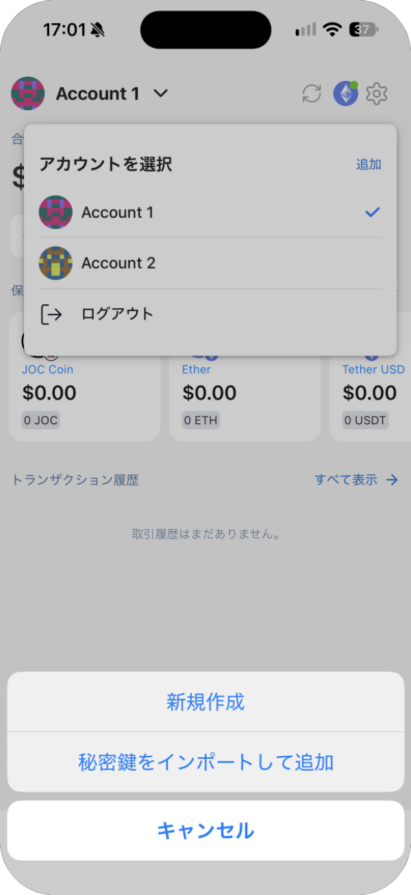
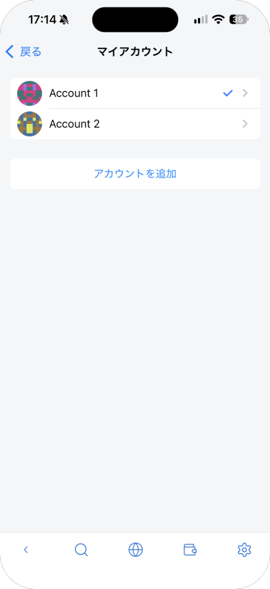
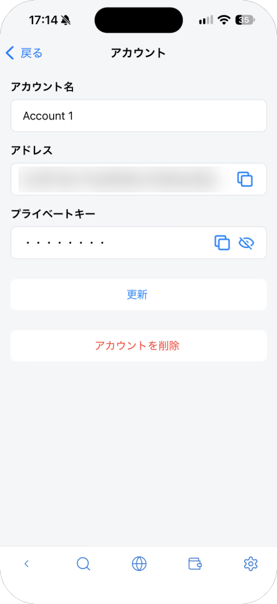
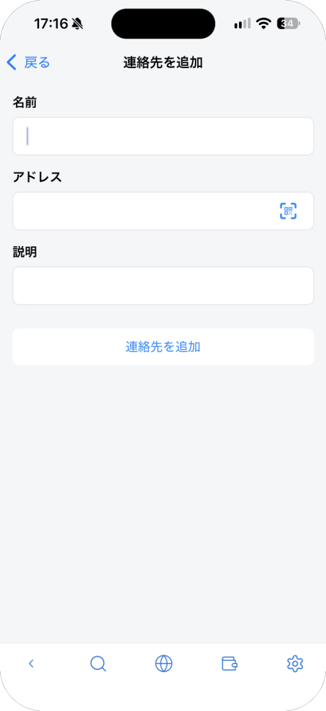
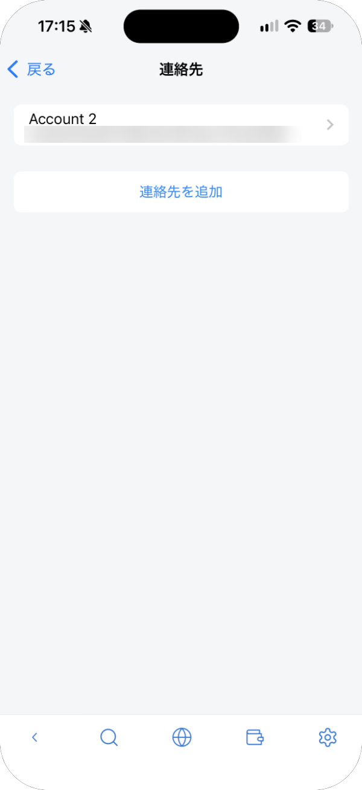
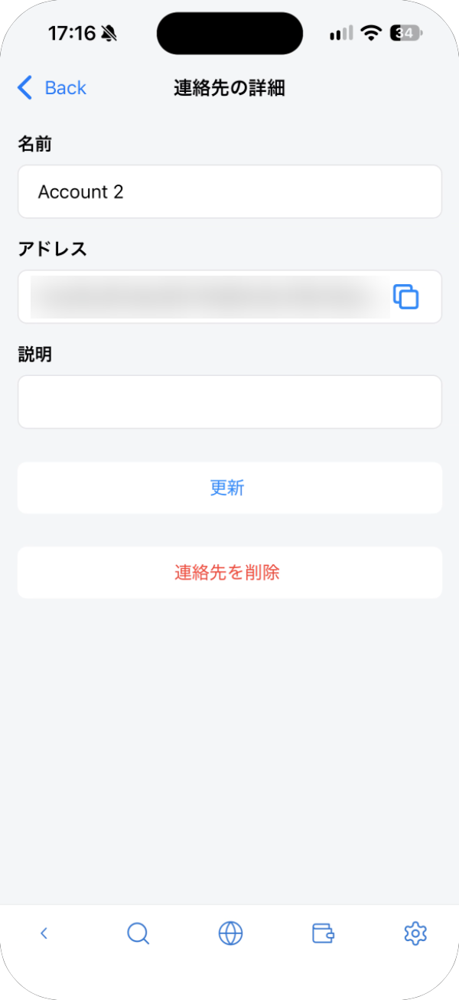

# アカウントと連絡先

1 つのウォレットに、複数のアカウントを持てます。アカウントごとにアドレスが別になります。

## 切り替える・追加する

メイン画面の左上のアカウント名をタップします。**アカウントを選択** にアカウントが並び、タップすると切り替わります。

**追加** をタップして、追加のしかたを選びます。

| 方法 | 説明 |
| --- | --- |
| 新規作成 | シードフレーズから新しいアカウントを作ります。シードフレーズで復元すると、このアカウントも戻ります |
| 秘密鍵をインポートして追加 | ほかのウォレットのアカウントを、秘密鍵（プライベートキー）で取り込みます。シードフレーズでは戻らないので、秘密鍵を別に保管してください |

**ログアウト** でウォレットをロックします。次に開くときはマスターパスワードが必要です。

## アカウントを管理する

ウォレット設定の **アカウント** で **マイアカウント** が開き、アカウントの一覧と **アカウントを追加** があります。

アカウントをタップすると、詳細が開きます。

- **アカウント名**: 名前を変えて **更新** をタップします。
- **アドレス**: アドレスをコピーします。
- **プライベートキー**: 目のアイコンで表示、コピーのアイコンでコピーします。
- **アカウントを削除**: このウォレットからアカウントを削除します。

> **重要:** 秘密鍵（プライベートキー）を知られると、そのアカウントの資産をすべて送金されてしまいます。誰にも送らず、サイトに貼り付けないでください。秘密鍵で取り込んだアカウントを削除する前に、秘密鍵を控えてあることを確かめてください。

## 連絡先（アドレス帳）

よく送る相手のアドレスを、名前を付けて保存できます。ウォレット設定の **連絡先** を開き、**連絡先を追加** をタップします。

保存した連絡先は、アドレスと一緒に並びます。連絡先をタップすると、名前や説明を変えたり（**更新**）、削除したり（**連絡先を削除**）できます。

送金するときは、**送信する** の横の人のアイコンで連絡先を開けます。

> **ヒント:** 保存した名前は、アドレスが正しいことを保証しません。送る前に、毎回アドレスを確かめてください。
