# 資産を確認する

## 資産リスト

メイン画面の「保有資産」の **すべて表示** をタップします。**資産リスト** に、すべてのネットワークの持っているトークンが並びます。

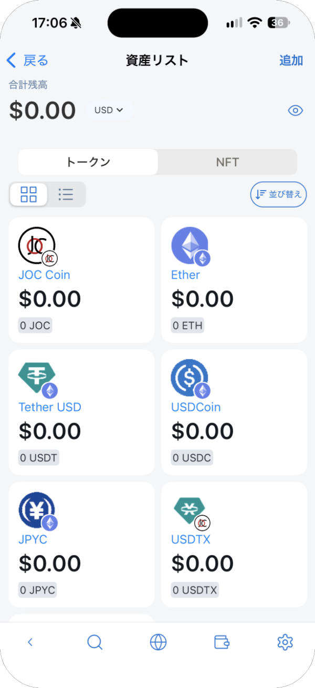

- 左の 2 つのアイコンで、カード表示とリスト表示を切り替えます。リスト表示では、トークンごとのネットワークも表示されます。
- **並び替え** で、**デフォルト**（最近見たものが上）、**アルファベット順 (A-Z)**、**残高の降順 ($ 高-低)** に並べ替えられます。

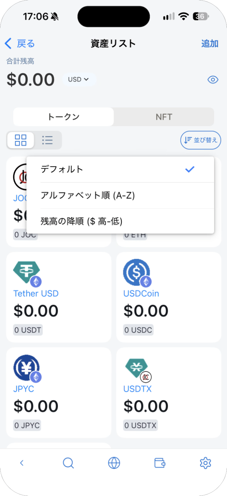

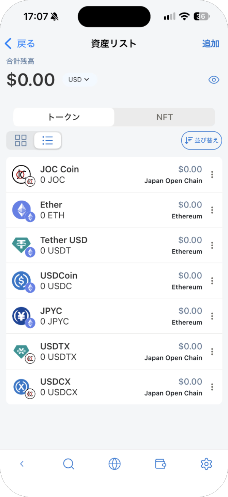

## トークンを編集・削除する

リスト表示で、トークンの右の **⋮** をタップし、**編集** または **削除** を選びます。

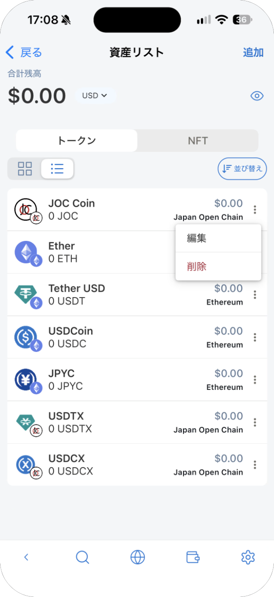

**編集** では、**表示用小数点以下桁数** とカードの **色** を変えられます。トークン名・シンボル・Decimals は変更できません。**カードの削除** で、一覧から削除します。

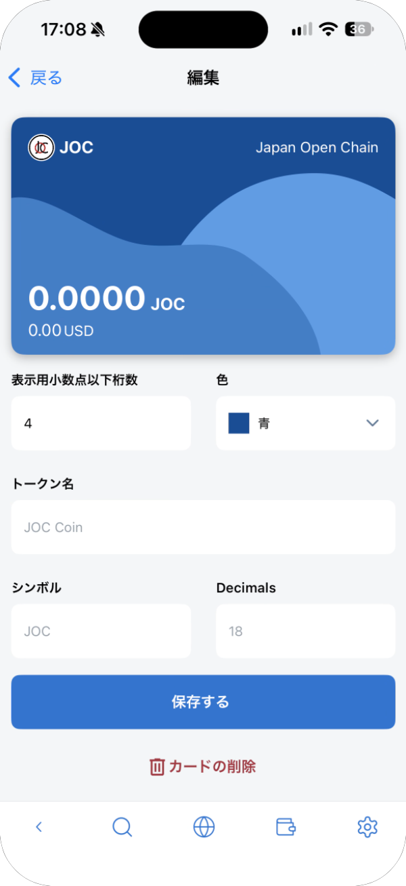

削除しても、一覧に表示されなくなるだけです。ブロックチェーン上のトークンはそのままで、あとから追加し直せます。

## トークンを追加する

資産リストの右上の **追加** をタップします。

### 一覧から選ぶ

1. **検索** タブで、トークンを検索するか、一覧から探します。トークンごとにネットワークが表示されます。
2. 追加するトークンを選びます。複数をまとめて選べます。
3. **次へ** をタップし、内容を確かめて **資産を追加** をタップします。

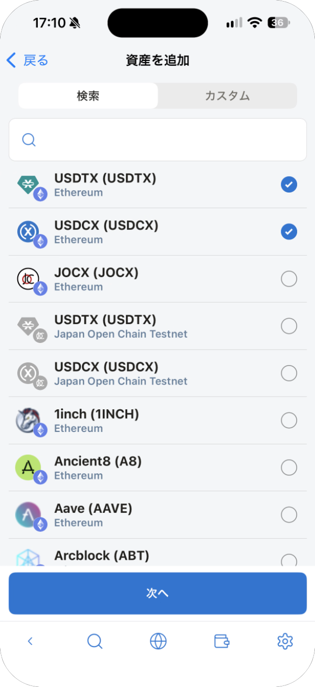

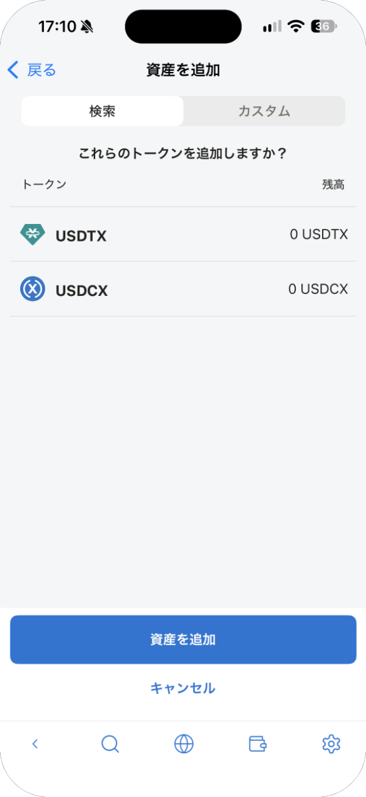

### 一覧にないトークンを追加する

1. **カスタム** タブを開きます。
2. **ネットワーク** を選び、**トークンタイプ** を **ERC-20** にします（**Base Currency** は、そのネットワークの基本の通貨を追加します）。
3. **アドレス** にトークンのコントラクトアドレスを入力するか読み取って、**資産を追加** をタップします。

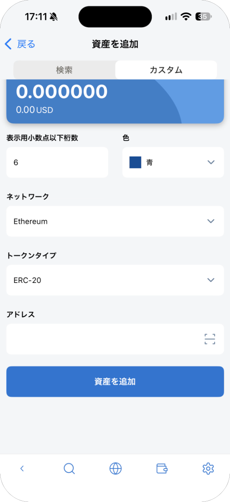

> **注意:** トークンの名前やロゴは偽装できます。コントラクトアドレスは、トークンの公式サイトで確かめ、選んだネットワーク用のものであることを確認してください。

## NFT

**NFT** タブに、持っている NFT が表示されます。右のボタンでネットワークを切り替えます。

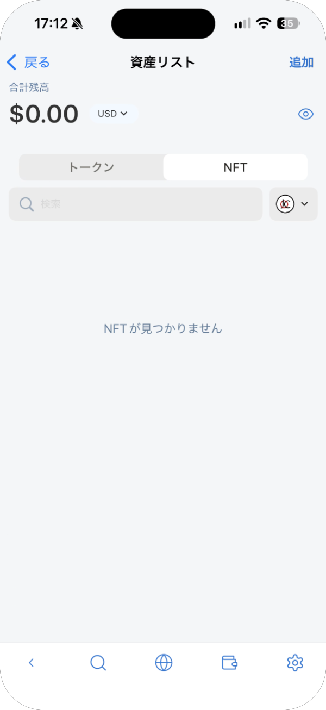

## トークンの詳細

トークンをタップすると、残高、ネットワーク、**トランザクション履歴** が表示されます。**送る** と **受け取る** で、このトークンの送金と受け取りを始められます。**編集** で編集画面を開きます。

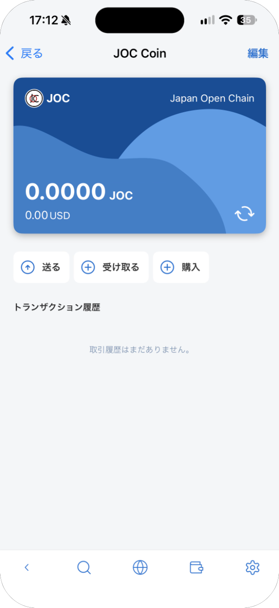

### トークンを購入する

**購入** をタップすると、そのトークンを買えるサービスが表示されます。選ぶとそのサービスのサイトに移り、手数料を確かめて購入します。表示されるサービスは、言語や地域によって異なります。

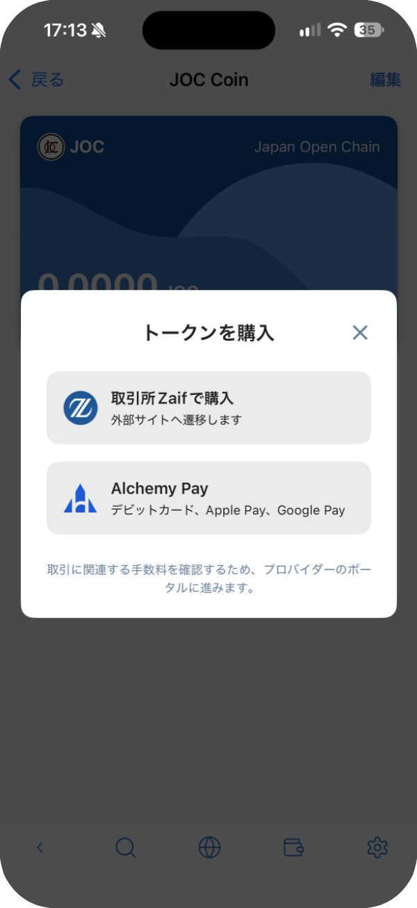
