# サイトとつなぐ

Lunascape Browser で Web3 サイト（DApp）を開きます。サイトからウォレットに依頼が届くと、確認画面が表示されます。許可する前に、必ず内容を読んでください。

> **重要:** 接続すると、サイトにアドレスが伝わります。署名はサイトに権限を与える場合があり、取引は資産を動かし、取り消せません。信頼できるサイトの依頼だけを許可し、シードフレーズや秘密鍵をサイトに入力しないでください。

## サイトと接続する

1. サイトの接続ボタン（**Connect Wallet** など）をタップします。ウォレットの一覧が出たら Lunascape を、なければ MetaMask を選びます。

   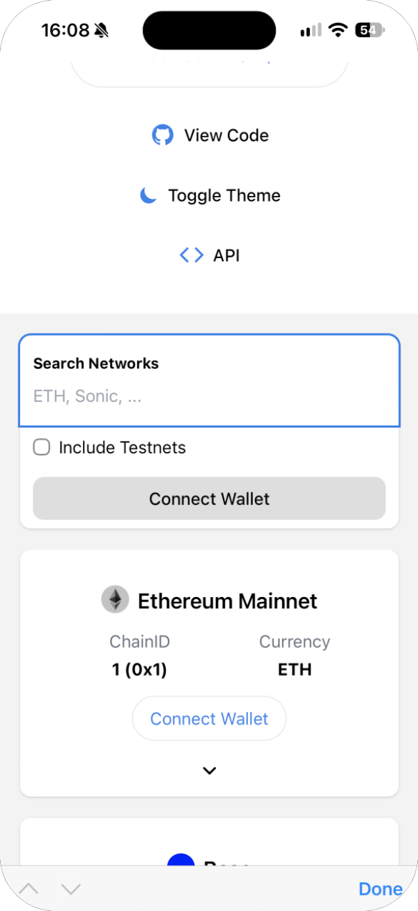

2. ウォレットに「サイトがお使いのウォレットのアドレスを要求しています」と表示されます。サイトの名前と URL、アカウントを確かめて **許可する** をタップします。断るときは **キャンセル** をタップします。

   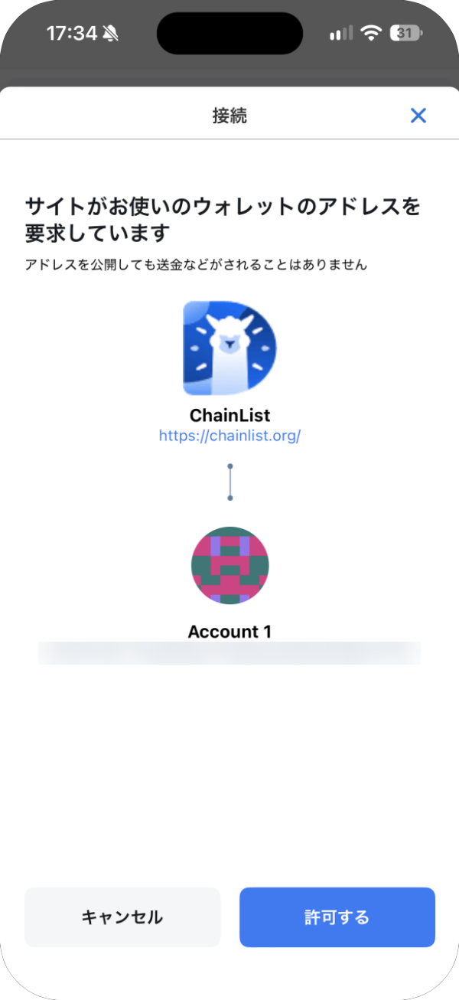

3. サイトに戻り、接続した状態になります。表示のしかたはサイトによって異なります。

   

接続しただけで送金されることはありません。

## 接続したサイトを確認・解除する

ウォレット設定の **許可されたウェブサイトリスト** に、接続を許可したサイトがアカウントごとに並びます。

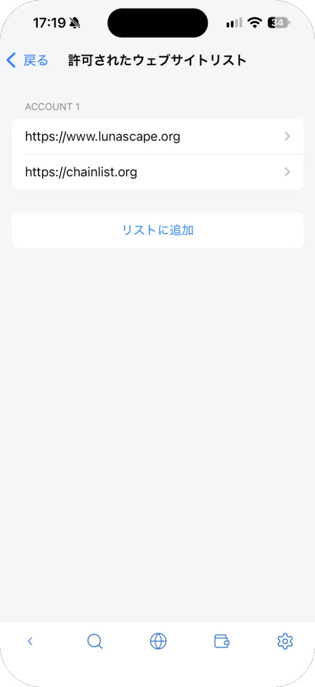

接続を解除するには、サイトをタップし、**サイトをリストから削除** → **消去** をタップします。

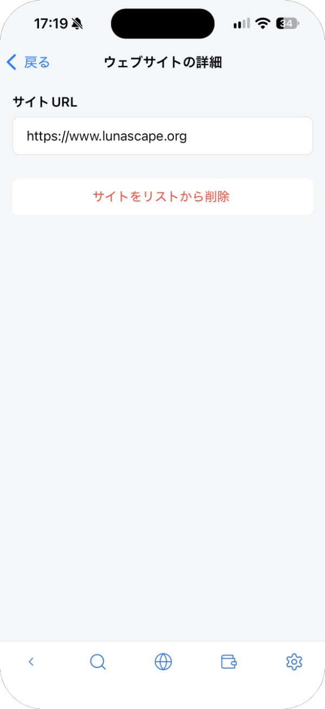

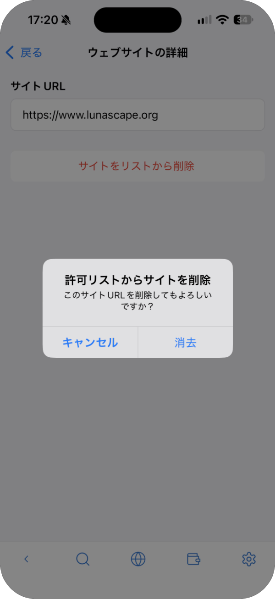

**リストに追加** で、URL を入力して前もって許可しておくこともできます。

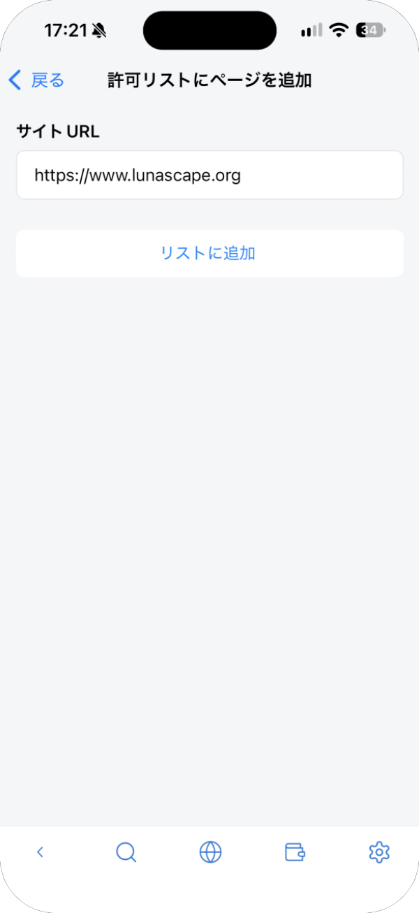

## サイトから届く依頼

### 署名リクエスト

アドレスの持ち主であることの証明などのために、メッセージへの署名を求められます。署名しても送金はされませんが、トークンを使う権限をサイトに与える署名もあります。内容がわかり、サイトを信頼できる場合だけ **署名** をタップしてください。

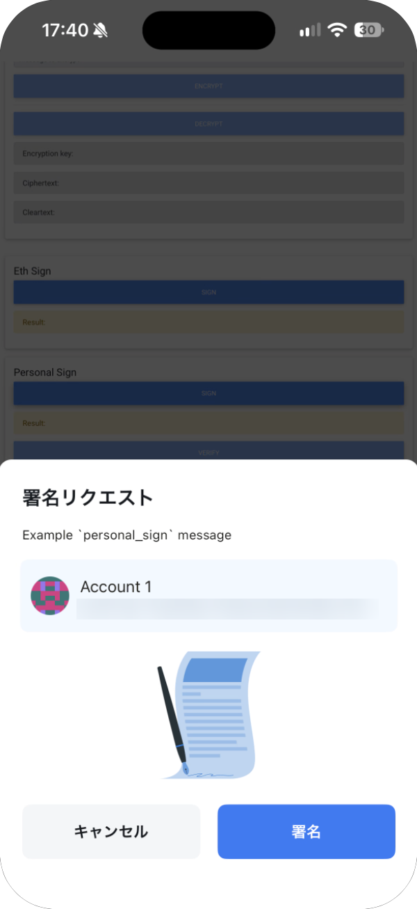

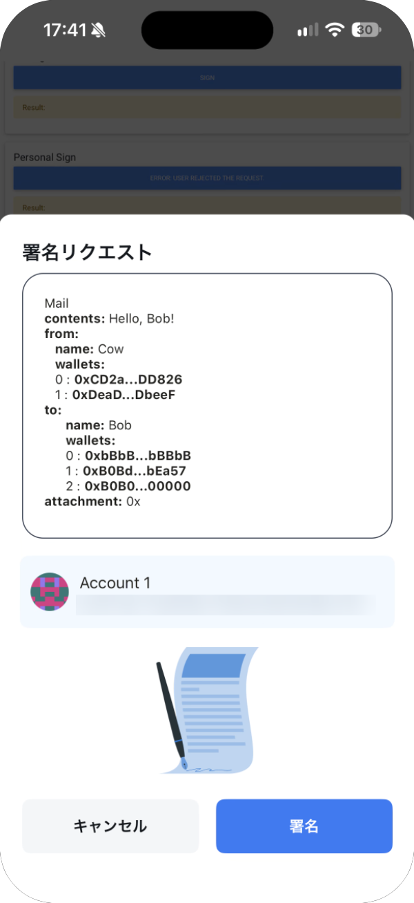

### 取引承認

送金やトークンの交換などの取引を求められます。**支払額**、**取引手数料**、**クライアント**（依頼しているサイト）を確かめて、**承認する** をタップします。残高が足りないと「残高が不足しています」と表示され、承認できません。

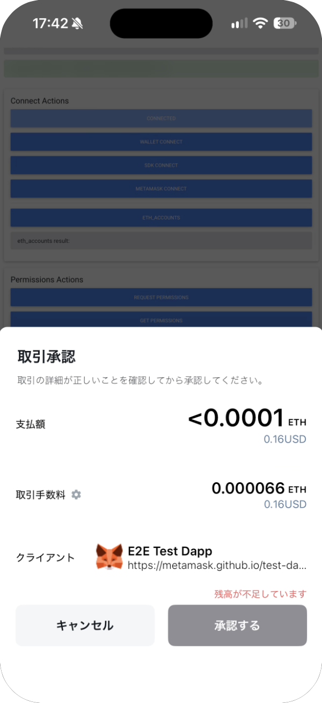

### トークンの追加

資産リストへのトークンの追加を求められます。追加しても、一覧に表示されるだけです。思ったとおりのトークンなら **トークンを追加する** をタップします。

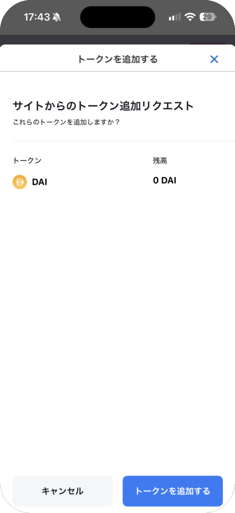

### ネットワークの追加・切り替え

ウォレットへのネットワークの追加や、切り替えを求められます。チェーン名、チェーン ID、RPC URL を確かめて、**許可する** をタップします。

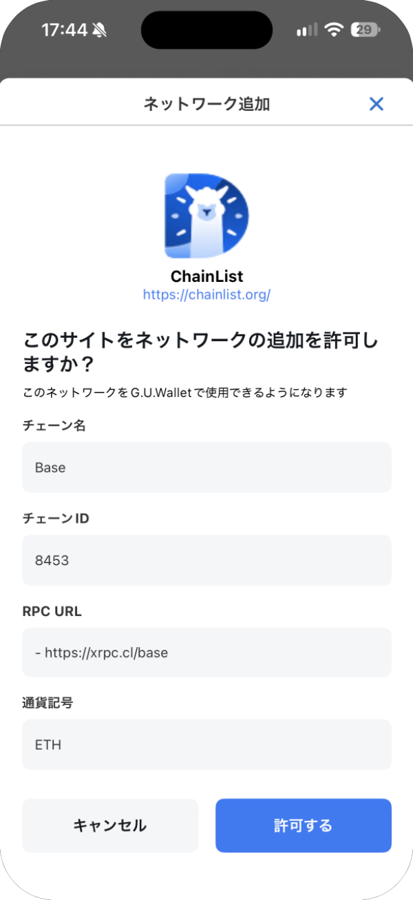

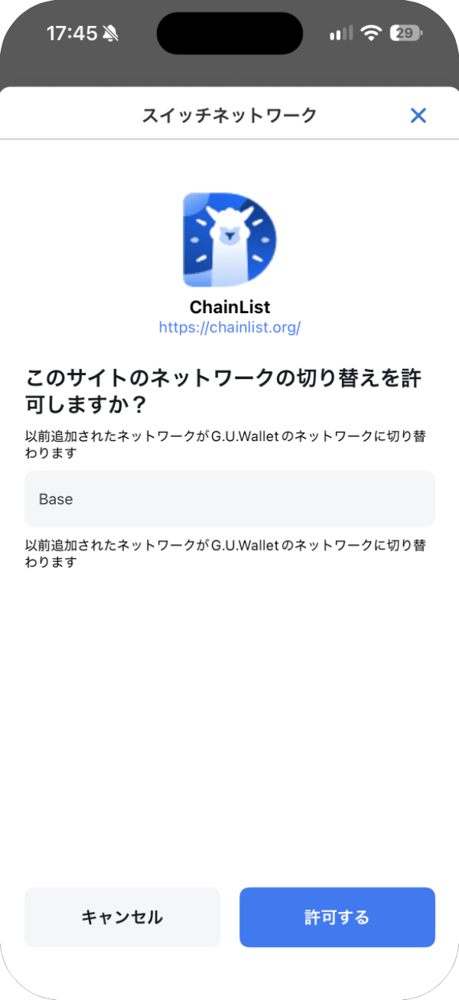

> **ヒント:** この 2 つの画面には、ウォレットの以前の名前「G.U.Wallet」が表示されます。同じウォレットです。

## MetaMask にしか対応していないサイト

MetaMask にしか対応していないサイトでは、ウォレット設定の **ethereum.isMetaMaskを有効にします** をオンにし、ページを再読み込みして、サイトで MetaMask を選んでください。[設定](settings.md) を参照してください。
