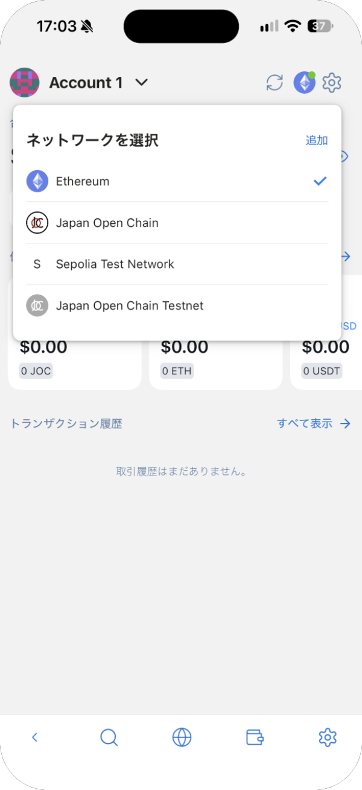
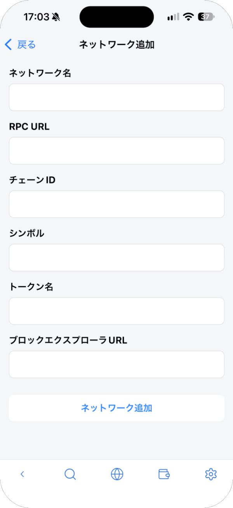
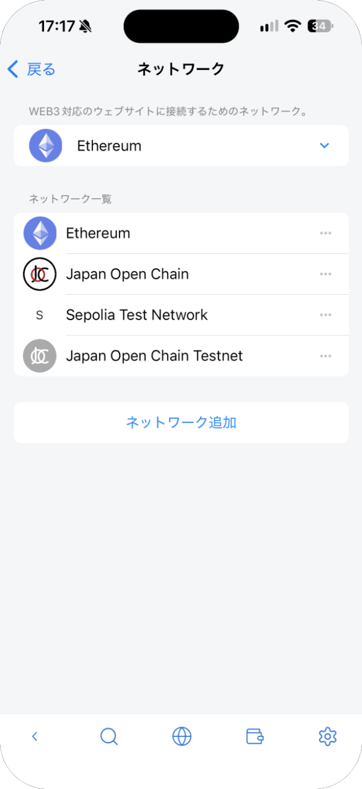
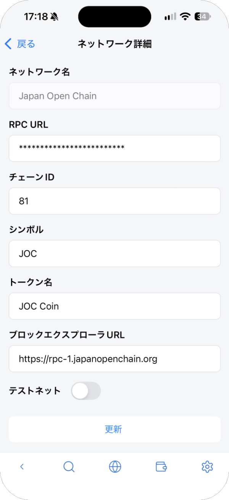
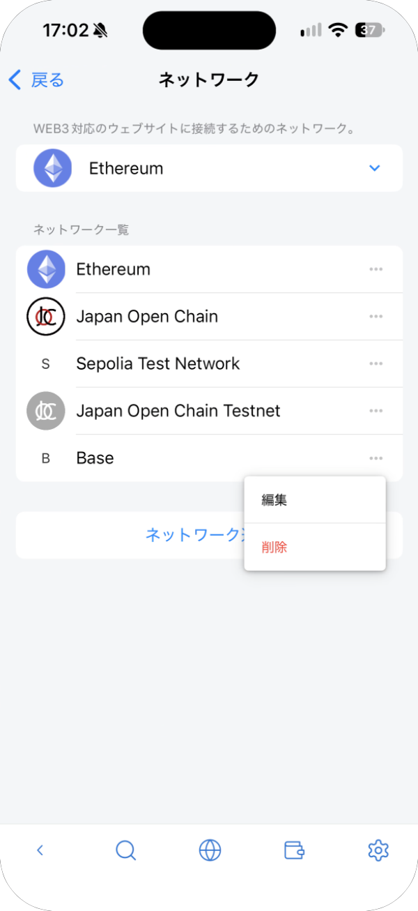
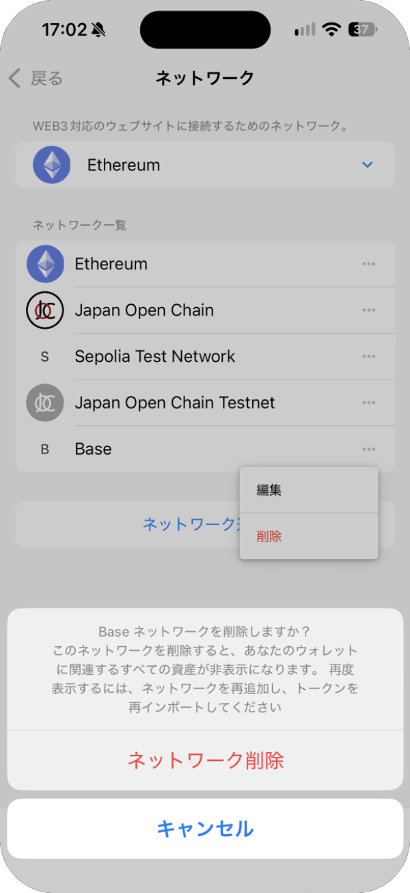

# ネットワーク

選んだネットワークは、サイトと接続するときに使われます。資産リストには、選んだネットワークに関係なく、すべてのネットワークのトークンが表示されます。

## 切り替える

メイン画面の右上のネットワークのアイコンをタップし、**ネットワークを選択** から選びます。今のネットワークにはチェックが付きます。

| ネットワーク | 種類 |
| --- | --- |
| Ethereum | メインネット |
| Japan Open Chain | メインネット |
| Sepolia Test Network | テストネット（練習用。資産に価値はありません） |
| Japan Open Chain Testnet | テストネット（練習用。資産に価値はありません） |

ウォレット設定の **ネットワーク** でも選べます。

## 追加する

**ネットワークを選択** の **追加**（またはウォレット設定の **ネットワーク** の **ネットワーク追加**）をタップし、項目を入力して **ネットワーク追加** をタップします。

| 項目 | 入力する内容 |
| --- | --- |
| ネットワーク名 | 一覧に表示する名前 |
| RPC URL | ネットワークの RPC URL。ネットワークの公式サイトで確かめてください |
| チェーン ID | ネットワークのチェーン ID |
| シンボル / トークン名 | 手数料に使う通貨（ETH など） |
| ブロックエクスプローラ URL | 取引を確認するサイト（省略できます） |

接続したサイトから、ネットワークの追加や切り替えを求められることもあります。[サイトとつなぐ](dapps.md) を参照してください。

## 編集・削除する

ウォレット設定の **ネットワーク** で、ネットワークの右の **⋯** をタップします。

- **編集** で **ネットワーク詳細** を開きます。ネットワーク名以外を変えて、**更新** をタップします。
- **削除** は、自分で追加したネットワークだけに表示されます。最初から入っているネットワークは、編集だけできます。

ネットワークを削除すると、そのネットワークの資産はウォレットに表示されなくなります。資産が消えるわけではなく、ネットワークとトークンを追加し直すと、また表示されます。

