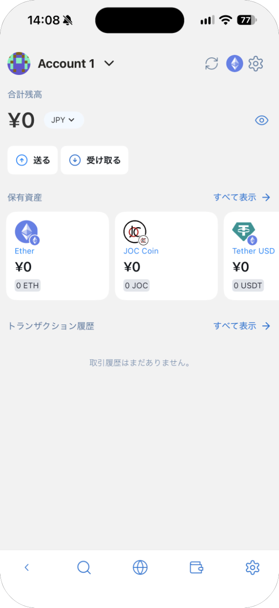

# 画面の見かた

Lunascape Browser のホーム画面で **ウォレット** をタップすると、ウォレットが開きます。メイン画面は次の要素でできています。

| 名称 | 説明 |
| --- | --- |
| アカウント名 | タップすると、アカウントの切り替えや追加ができます。[アカウントと連絡先](accounts.md) を参照してください |
| 更新のアイコン | 残高を読み込み直します |
| ネットワークのアイコン | サイトと接続するときに使うネットワーク（チェーン）を切り替えます。[ネットワーク](networks.md) を参照してください |
| 設定のアイコン（歯車） | ウォレットの設定を開きます。[設定](settings.md) を参照してください |
| 合計残高 | 資産の合計額です。通貨を押すと表示する通貨を変えられ、目のアイコンで金額を隠せます |
| **送る** / **受け取る** | [送金と受け取り](send-receive.md) を参照してください |
| 保有資産 | 持っているトークンと残高です。**すべて表示** で資産リストを開きます。[資産を確認する](assets.md) を参照してください |
| トランザクション履歴 | このアカウントから送った記録です。**すべて表示** で一覧を開きます |

画面下のツールバー（戻る・検索・ブラウザー・ウォレット・設定）は、Lunascape Browser のものです。
