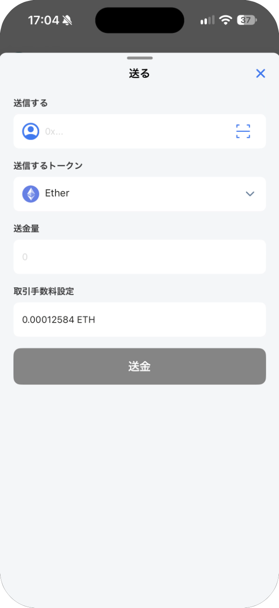
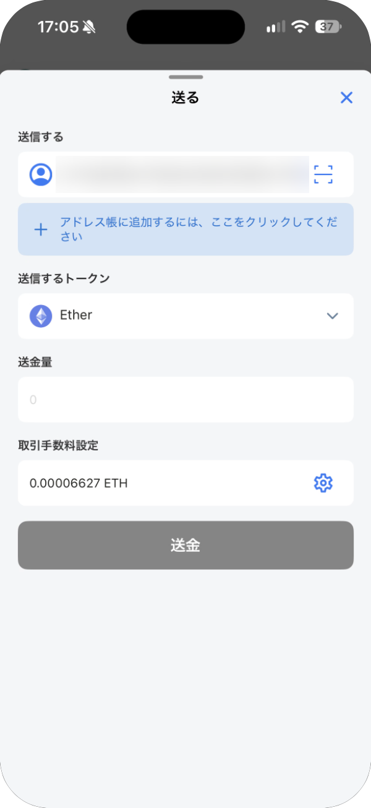
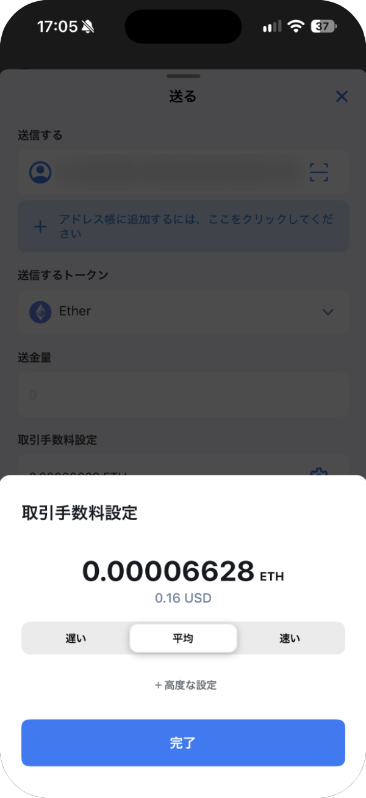
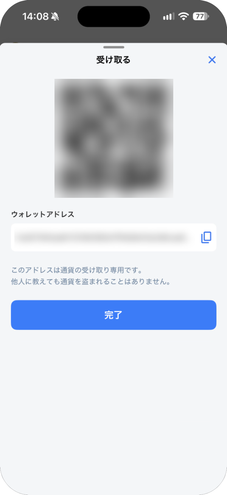

# 送金と受け取り

## 送金する

送った取引は取り消せません。送金先・トークン・金額をよく確かめてください。

1. メイン画面の **送る** をタップします。
2. **送信する** に、送金先のアドレス（`0x` で始まる 42 文字）を貼り付けます。
   - 左の人のアイコンで、連絡先（アドレス帳）を開けます。
   - 右のスキャンのアイコンで、QR コードからアドレスを読み取れます。
3. **送信するトークン** でトークンを選び、**送金量** を入力します。
4. **取引手数料設定** の手数料を確かめて、**送金** をタップします。

連絡先にないアドレスを入れると、下に「アドレス帳に追加するには、ここをクリックしてください」と表示されます。タップすると、そのアドレスを連絡先に保存できます。

### 手数料を変える

アドレスを入れると、手数料の横に歯車のアイコンが出ます。タップすると **遅い**・**平均**・**速い** から選べます。初めは **平均** です。**＋高度な設定** では、ガスの上限や価格を自分で入力できます。意味がわからない場合は、変えないでください。

手数料は、送るトークンとは別に、そのネットワークの基本の通貨で払います（Ethereum では ETH、Japan Open Chain では JOC）。足りないと送金できません。

> **重要:** 初めての相手には、少額を送って届いたことを確かめてから、残りを送ってください。アドレスは手で入力せず、コピーと貼り付けか QR コードを使い、最初と最後の数文字を見比べてください。

## 受け取る

1. メイン画面の **受け取る** をタップします。
2. QR コードを相手に見せるか、コピーのボタンでアドレスをコピーして相手に伝えます。
3. **完了** で閉じます。

アドレスはどのネットワークでも同じですが、資産はネットワークごとに別々です。相手がどのネットワークで送るかを確かめておいてください。
