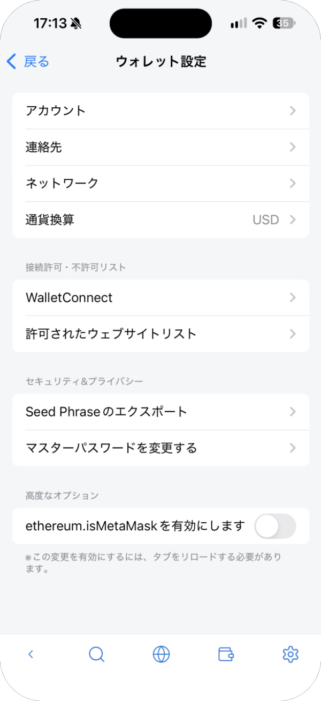
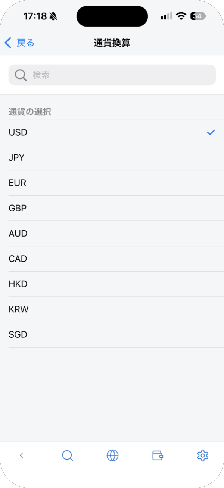
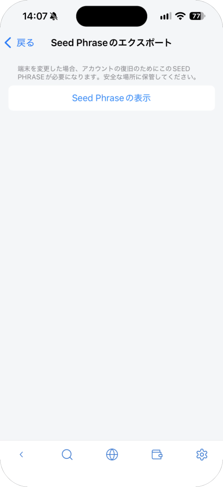
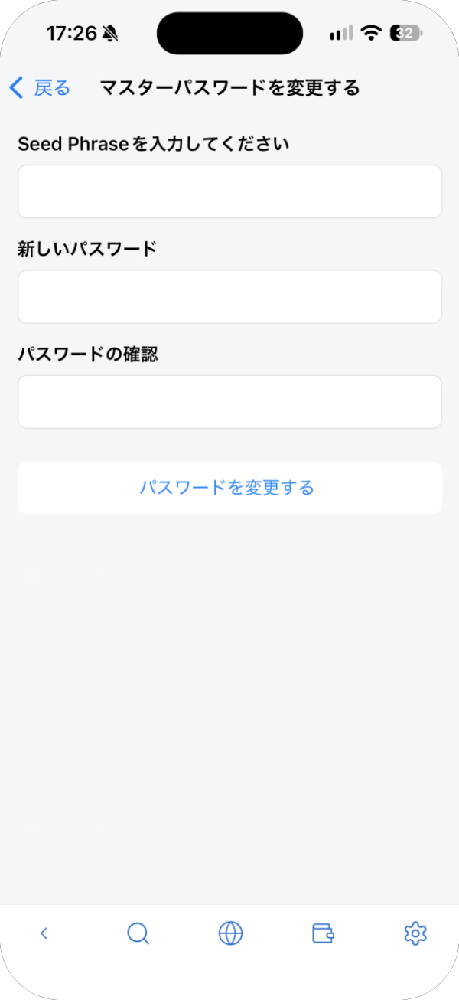

# 設定

メイン画面の右上の歯車のアイコンをタップすると、**ウォレット設定** が開きます。

| 項目 | 内容 | 参照先 |
| --- | --- | --- |
| アカウント | アカウントの追加、名前の変更、削除 | [アカウントと連絡先](accounts.md) |
| 連絡先 | よく送るアドレスの保存 | [アカウントと連絡先](accounts.md) |
| ネットワーク | ネットワークの選択、追加、編集、削除 | [ネットワーク](networks.md) |
| 通貨換算 | 残高を表示する通貨（USD、JPY、EUR、GBP、AUD、CAD、HKD、KRW、SGD） | — |
| WalletConnect | QR コードでの接続と、セッションの管理 | [WalletConnect](walletconnect.md) |
| 許可されたウェブサイトリスト | 接続を許可したサイト | [サイトとつなぐ](dapps.md) |
| Seed Phrase のエクスポート | シードフレーズの表示 | 下記 |
| マスターパスワードを変更する | パスワードの変更 | 下記 |
| ethereum.isMetaMaskを有効にします | サイトに MetaMask として認識させます。初めはオフです。変えたら、ページを再読み込みしてください | — |

## Seed Phrase のエクスポート

**Seed Phrase のエクスポート** → **Seed Phrase の表示** をタップし、12 個の英単語を順番どおりに紙に書き写します。パスワードを聞かれずにすぐ表示されるので、周りから画面が見えないことを確かめてから表示してください。

## マスターパスワードを変更する

**シードフレーズ** と、新しいパスワードを 2 回入力して、**パスワードを変更する** をタップします。シードフレーズがないと、パスワードは変えられません。

