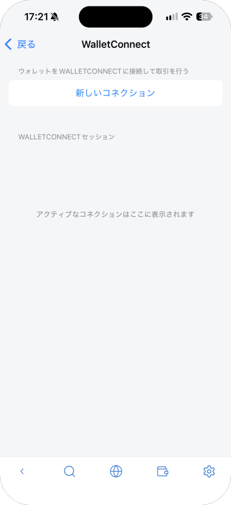
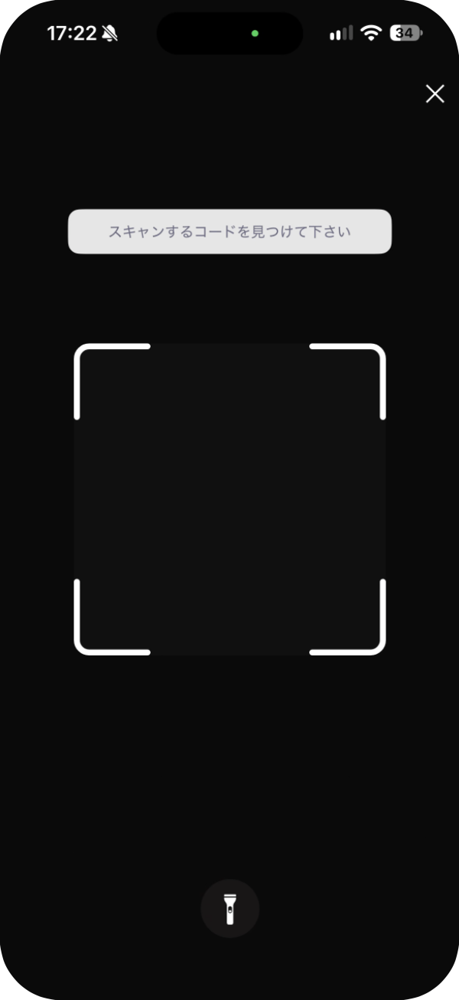
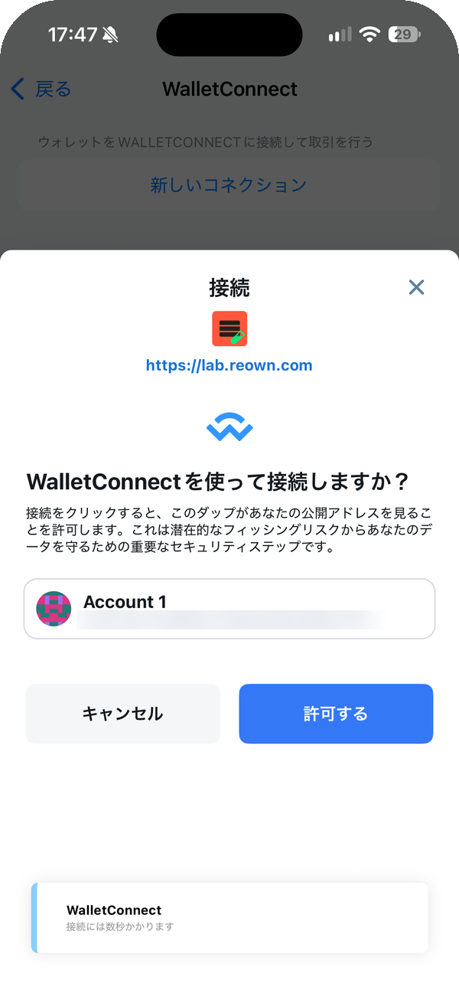
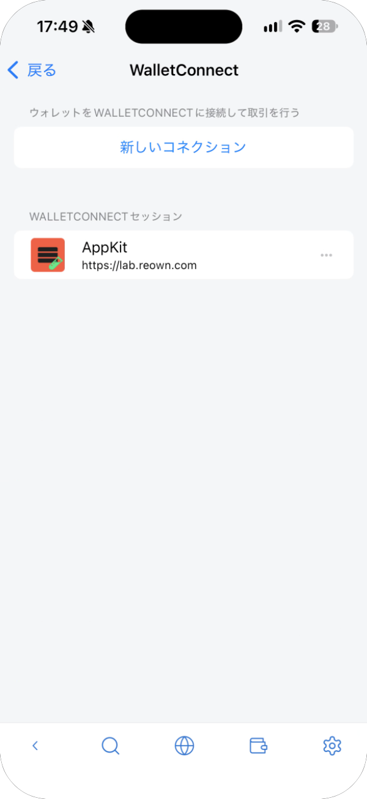
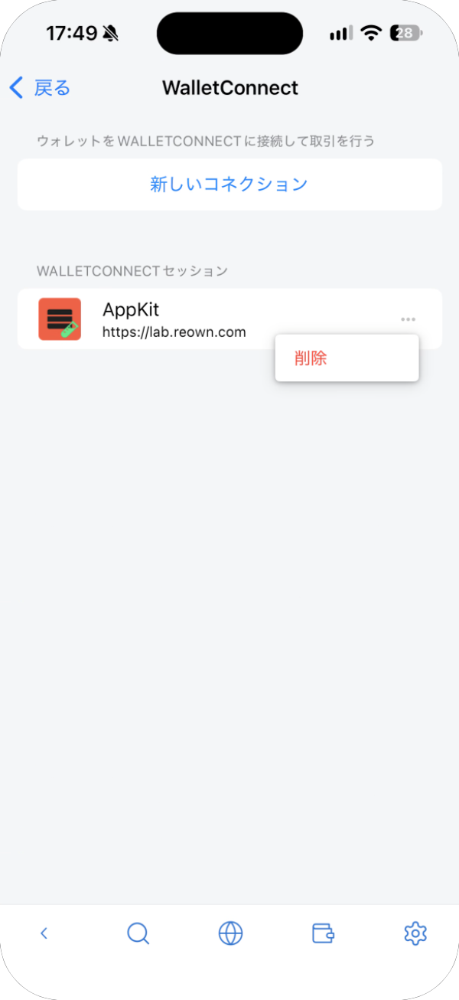

# WalletConnect

WalletConnect は、QR コードでウォレットとサイトを接続するしくみです。パソコンなど、別の端末で開いたサイトと接続するときに使います。

## 接続する

1. サイトで WalletConnect を選び、QR コードを表示させます。
2. ウォレット設定の **WalletConnect** を開き、**新しいコネクション** をタップします。

   

3. 初めてのときは、iPhone がカメラの使用の許可を求めます。**許可** をタップします。
4. サイトの QR コードにカメラを向けます。

   

5. 「WalletConnect を使って接続しますか？」と表示されます。サイトの URL とアカウントを確かめて、**許可する** をタップします。

   

## セッションを確認・切断する

接続したサイトは **WALLETCONNECT セッション** に並びます。切断するには、サイトの右の **⋯** をタップし、**削除** を選びます。

使わなくなったサイトや、覚えのないサイトは切断してください。
