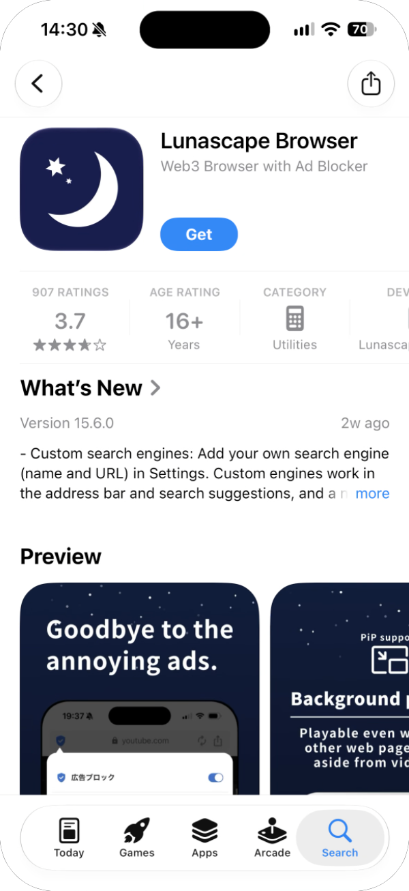
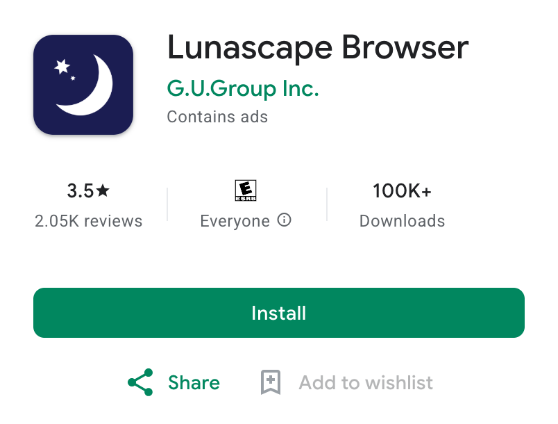
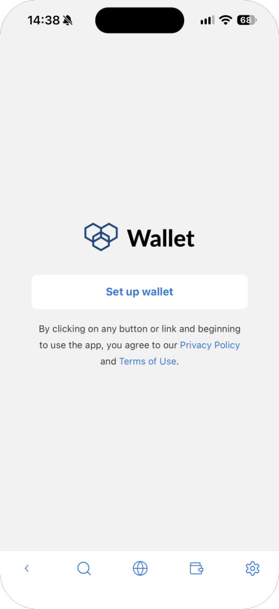
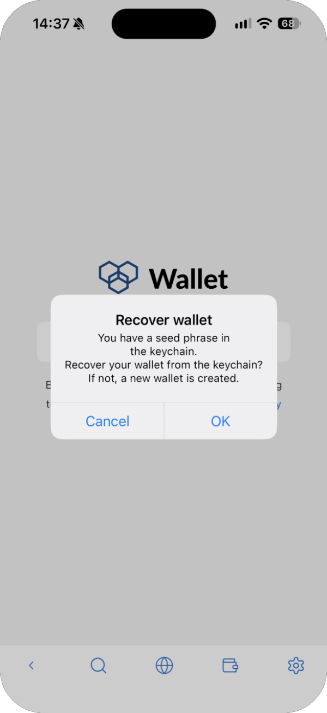
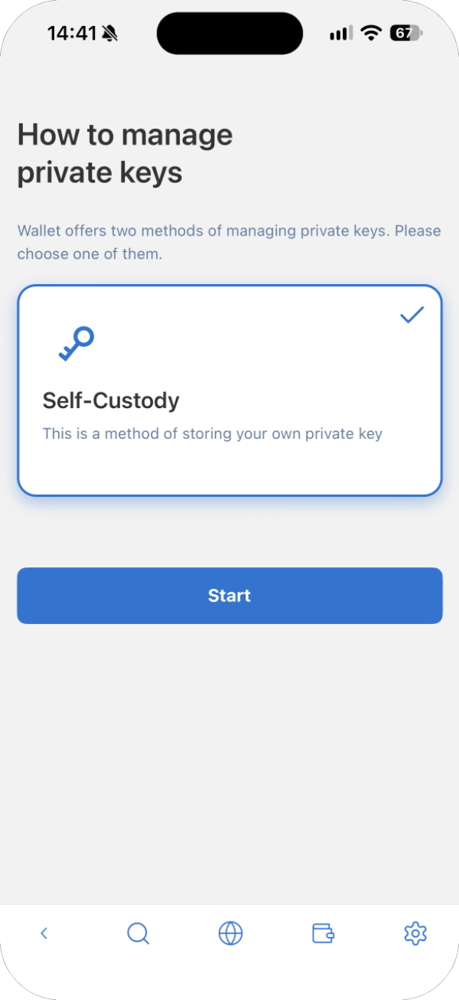
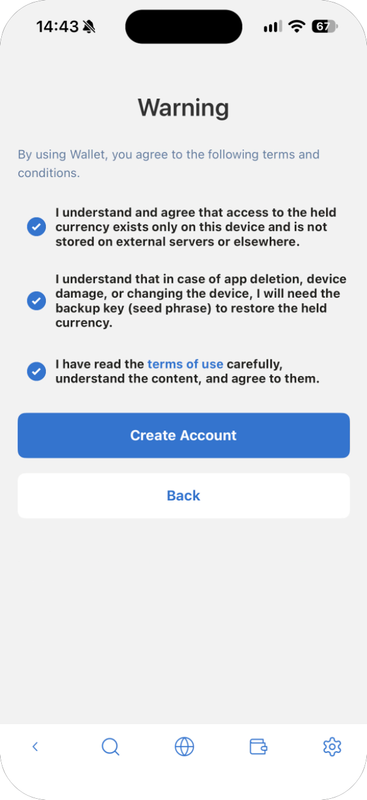
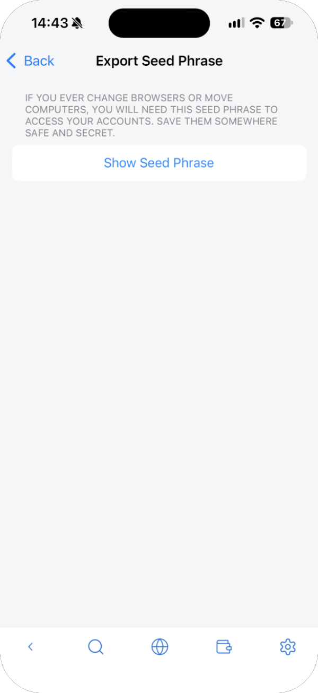

---
navigation:
  order: 100
---

# Install and get started

**For:** iPhone / Android

Lunascape Wallet is built into the Lunascape Browser app.

- iPhone: [App Store](https://apps.apple.com/app/lunascape-browser/id380065805)
- Android: [Google Play](https://play.google.com/store/apps/details?id=jp.co.lunascape.android.ilunascape)

The screens below are from an iPhone. Android works the same way.

## 1. Install the app

Open the store from a link above and press **Get** (iPhone) or **Install** (Android).

## 2. Open the app

When you open the app, a few welcome screens appear first. Press **Next** to go through them.

## 3. Open the wallet

On the home screen, tap **Wallet**.

## 4. Start setting up the wallet

Tap **Set up wallet**. Tapping it means you agree to the Privacy Policy and Terms of Use.

**If "Recover wallet" appears:** this happens if you used Lunascape Wallet on this phone before. Press **OK** to keep using that wallet, or **Cancel** to create a new one. It doesn't appear the first time you use the wallet.

## 5. Register a master password

Enter the same password in **New Password** and **Confirm password**, then press **Create**. The password must be 8 to 64 characters.

On an iPhone, if a switch for unlocking with Face ID appears, turn it on to open the wallet with Face ID from then on.

> **Important:** If you forget the master password, no one can unlock the wallet. You would have to set the wallet up again with your seed phrase.

## 6. Choose how to manage keys

Check that **Self-Custody** is selected, then press **Start**.

## 7. Create a new wallet

Check that **Create a new wallet** is selected. Scroll down and press **Start**.

## 8. Read and agree

Read the three items, check all of them and press **Create Account**. You can't press **Create Account** until all three are checked.

## 9. Write down your seed phrase

When **Account Created !!** appears, your wallet is ready. Next, write down the seed phrase.

1. Press **Backup Seed Phrase**.

   

2. Press **Show Seed Phrase**. Make sure no one around you can see your screen first.

   

3. Copy the 12 English words onto paper, **in order**. When you're done, press **Back** at the top left.

   

> **Important:** Write the seed phrase on paper and keep it where no one else can see it. Don't use **Copy to Clipboard** or take a screenshot: it can stay in other apps or the cloud and be stolen. Anyone who knows your seed phrase can send away everything in your wallet.

## 10. Check your wallet address

The wallet's main screen appears. Press **Receive** to see your wallet address (a string starting with `0x`) and its QR code. You're ready.

Your wallet address is what you give others so they can send you crypto. Sharing it doesn't let anyone take your assets.

## After that

The wallet opens on the lock screen. Enter the master password you set when you created it to unlock it. If you turned on Face ID on an iPhone, you can unlock with Face ID.

If you've forgotten the password, you'll have to set the wallet up again with your seed phrase.
