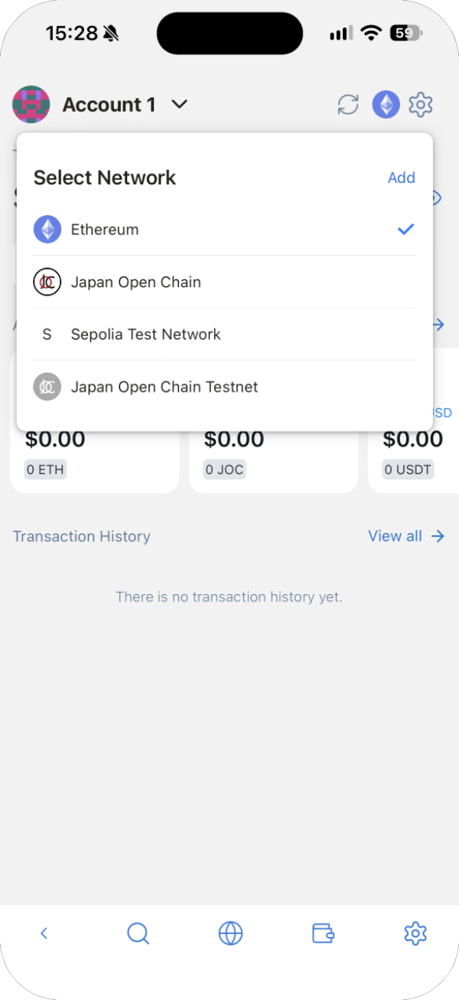
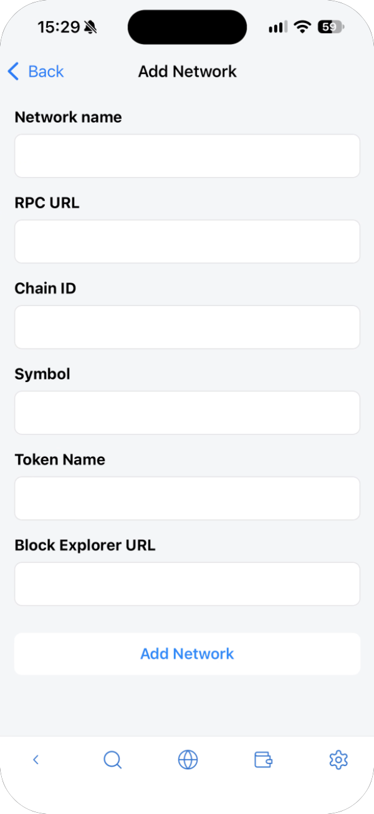
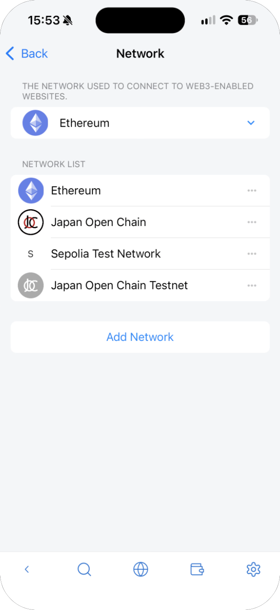
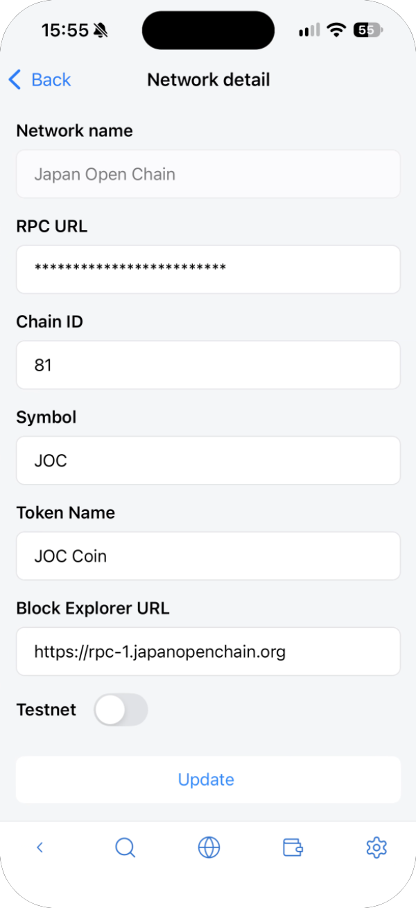
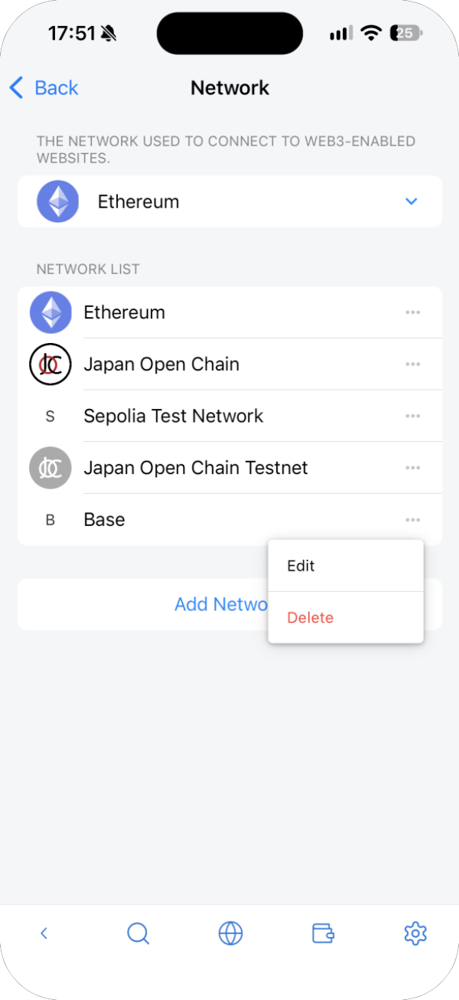
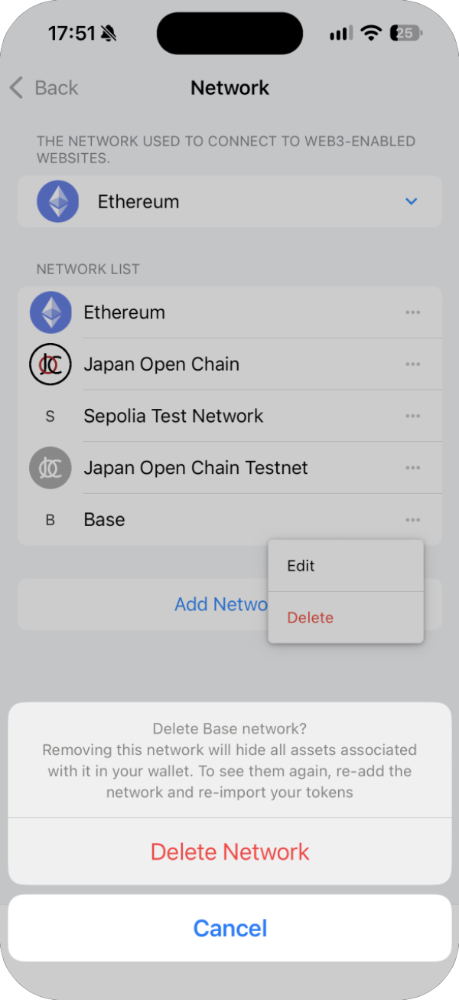

---
navigation:
  order: 500
---

# Networks

The network you choose is the one used when you connect to sites. The asset list shows tokens on every network, whichever one you choose.

## Switch networks

Tap the network icon at the top right of the main screen and choose a network under **Select Network**. A check mark shows the current one.

| Network | Kind |
| --- | --- |
| Ethereum | Mainnet |
| Japan Open Chain | Mainnet |
| Sepolia Test Network | Testnet (for practice; its assets have no value) |
| Japan Open Chain Testnet | Testnet (for practice; its assets have no value) |

You can also choose the network under **Network** in the wallet's settings.

## Add a network

Tap **Add** under **Select Network** (or **Add Network** under **Network** in the settings), fill in the fields and tap **Add Network**.

| Field | What to enter |
| --- | --- |
| Network name | The name shown in the list |
| RPC URL | The network's RPC URL. Check it on the network's official site |
| Chain ID | The network's chain ID |
| Symbol / Token Name | The currency used for fees (such as ETH) |
| Block Explorer URL | The site for checking transactions (optional) |

A site you connect to may also ask to add or switch a network. See [Connect to sites](dapps.md).

## Edit or delete a network

Under **Network** in the wallet's settings, tap **⋯** next to a network.

- **Edit** opens **Network detail**. You can change everything except the network name, then tap **Update**.
- **Delete** is available only for networks you added. The built-in networks can only be edited.

When you delete a network, the assets on it are hidden from your wallet. They aren't lost: add the network and the tokens again to see them.

