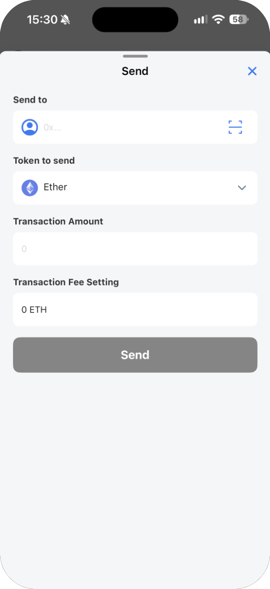
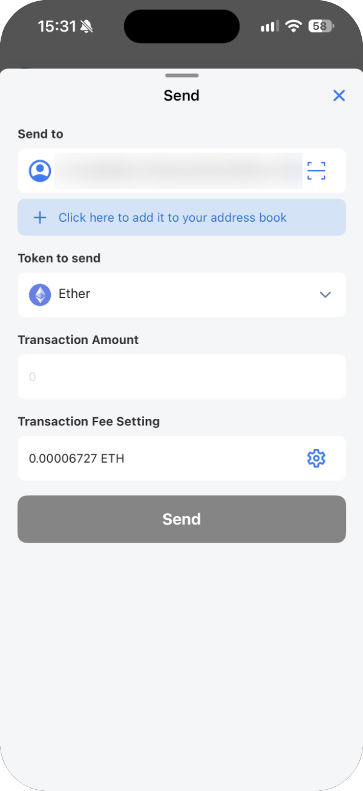
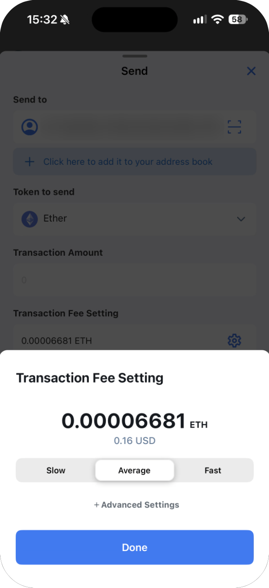

---
navigation:
  order: 300
---

# Send and receive

## Send

A transaction you've sent cannot be reversed. Check the recipient, token and amount carefully.

1. Tap **Send** on the main screen.
2. Under **Send to**, paste the recipient's address (42 characters starting with `0x`).
   - The person icon on the left opens your address book.
   - The scan icon on the right reads the address from a QR code.
3. Under **Token to send**, choose the token, and enter the **Transaction Amount**.
4. Check the fee under **Transaction Fee Setting**, then tap **Send**.

When you enter an address that isn't in your address book, **Click here to add it to your address book** appears below it. Tap it to save the address as a contact.

### Change the fee

Once an address is entered, a gear icon appears next to the fee. Tap it to choose **Slow**, **Average** or **Fast**. **Average** is selected at first. **+ Advanced Settings** lets you enter the gas limit and gas price yourself; leave it alone unless you know what these values mean.

The fee is paid in the network's own currency (ETH on Ethereum, JOC on Japan Open Chain), separately from the token you send. If you don't have enough, the wallet can't send.

> **Important:** For a new recipient, send a small amount first and confirm it arrived. Don't type an address by hand — copy and paste it or scan its QR code, and compare the first and last few characters.

## Receive

1. Tap **Receive** on the main screen.
2. Show the QR code to the sender, or copy your address with the copy button and send it to them.
3. Tap **Done** to close.

Your address is the same on every network, but assets are kept per network. Ask the sender which network they'll use.
