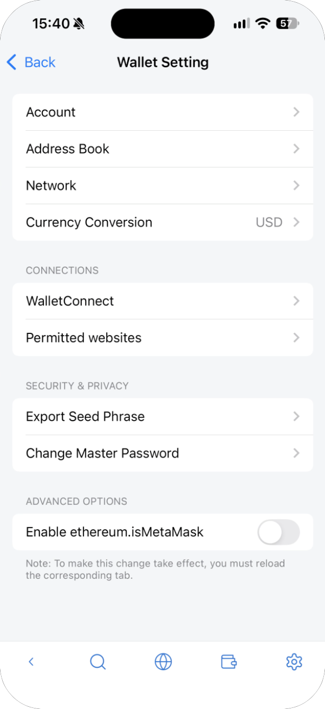
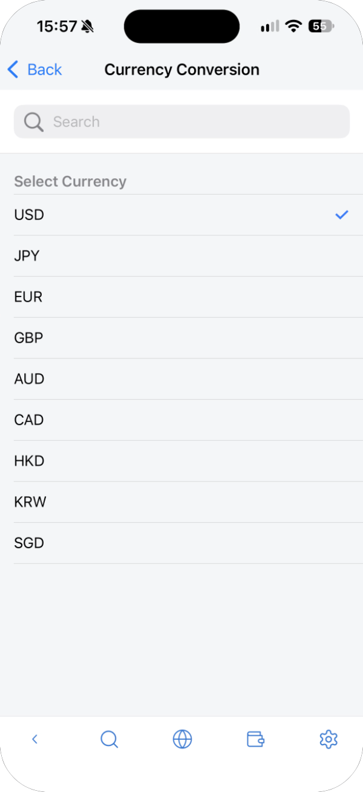
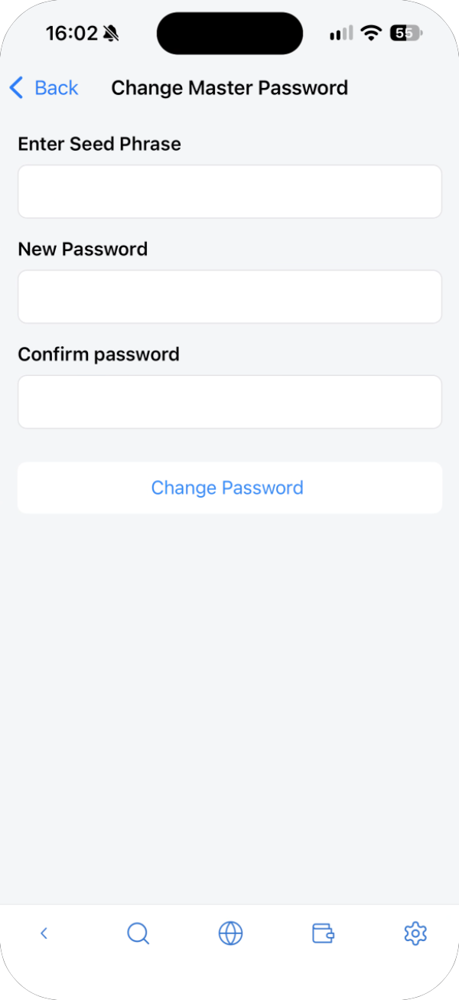

---
navigation:
  order: 900
---

# Settings

Tap the gear icon at the top right of the main screen to open **Wallet Setting**.

| Item | What it does | See |
| --- | --- | --- |
| Account | Add, rename and delete accounts | [Accounts and address book](accounts.md) |
| Address Book | Save addresses you send to | [Accounts and address book](accounts.md) |
| Network | Choose, add, edit and delete networks | [Networks](networks.md) |
| Currency Conversion | The currency for balances (USD, JPY, EUR, GBP, AUD, CAD, HKD, KRW, SGD) | — |
| WalletConnect | Connect with a QR code, and manage sessions | [WalletConnect](walletconnect.md) |
| Permitted websites | Sites allowed to connect | [Connect to sites](dapps.md) |
| Export Seed Phrase | Show the seed phrase | Below |
| Change Master Password | Change the password | Below |
| Enable ethereum.isMetaMask | Lets sites treat the wallet as MetaMask. Off at first. Reload the page after changing it | — |

## Export Seed Phrase

Tap **Export Seed Phrase**, then **Show Seed Phrase**, and write the 12 words on paper in order. The seed phrase is shown right away, without asking for your password, so make sure no one can see your screen.

## Change Master Password

Enter your **seed phrase**, then the new password twice, and tap **Change Password**. You can't change the password without the seed phrase.

