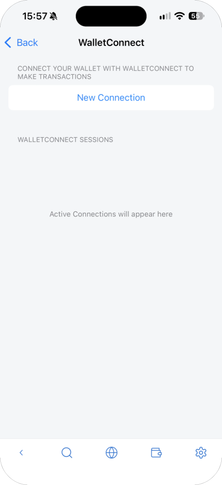
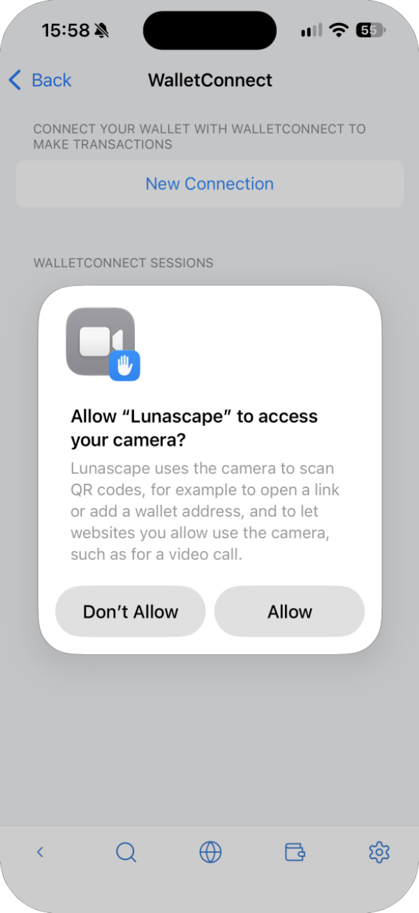
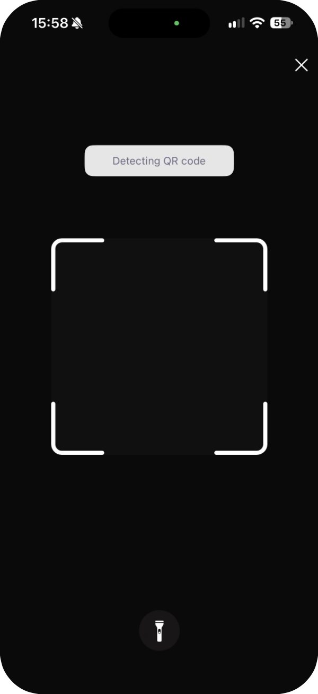
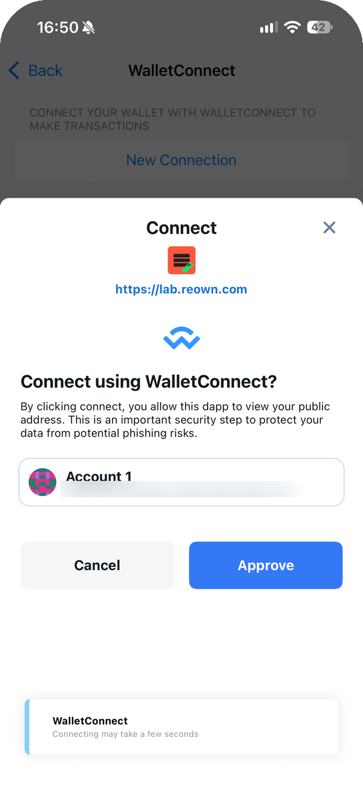
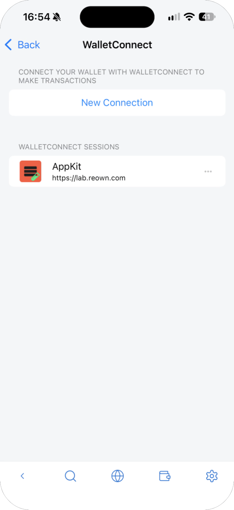
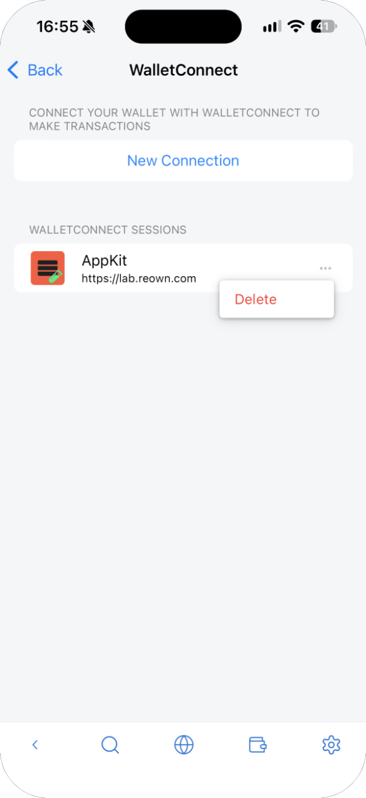

---
navigation:
  order: 800
---

# WalletConnect

WalletConnect connects the wallet to a site with a QR code. Use it when the site is open on another device, such as a computer.

## Connect

1. On the site, choose WalletConnect so that it shows a QR code.
2. In the wallet's settings, open **WalletConnect** and tap **New Connection**.

   

3. The first time, iOS asks for permission to use the camera. Tap **Allow**.

   

4. Point the camera at the QR code on the site.

   

5. **Connect using WalletConnect?** appears. Check the site's URL and the account, then tap **Approve**.

   

## Check or end sessions

Connected sites are listed under **WalletConnect Sessions**. To disconnect, tap **⋯** next to the site and choose **Delete**.

Disconnect sites you no longer use, and any you don't recognize.
