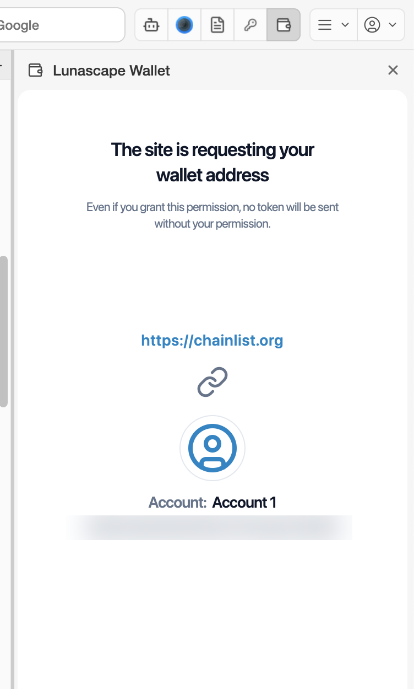
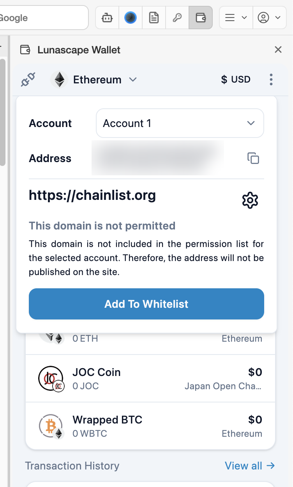
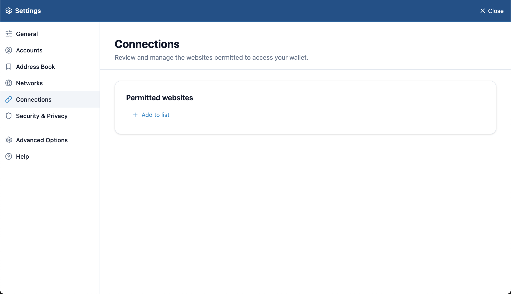

---
navigation:
  order: 100
---

# Connect to a site

When you press **Connect Wallet** or a similar button on a Web3 site (DApp), the wallet shows a confirmation screen.

## Allow the connection

1. Press the site's connect button. Some sites ask you to choose a wallet — pick Lunascape Wallet (or a browser wallet such as MetaMask).
2. The wallet shows **The site is requesting your wallet address**.
3. Check the site's URL and the account to connect, then press **Approve**. To stop, press **Cancel**.

Connecting tells the site only your account's address. Connecting alone never sends any crypto.

## Requests a site can make

A connected site may ask for the following. In every case, check the details before you allow it.

| Request | What it is | If you allow it |
| --- | --- | --- |
| Signature Request / Sign In With Ethereum | A signature proving you own the address | Nothing is sent and your private key isn't shared |
| Transaction approval | Sending, swapping tokens, buying NFTs and so on | The transaction runs and costs a fee (gas). It cannot be reversed |
| Add or switch a network | Adds or selects the network the site uses | The wallet's network changes |
| Add a token | Adds the site's token to your list | It only appears in the list |

> **Note:** Don't approve a signature you don't understand, or a request from a site you don't trust. A warning that the sign-in domain doesn't match the site, or that the address doesn't match your account, may mean a fake site.

## Check the connection status

Press the plug icon at the top left of the wallet to see the connection status of the current site. For a site that isn't connected, **Add To Whitelist** allows it to connect.

## Disconnect a site

Sites you've allowed are listed by account under the wallet's **Settings** > **Connections**. Remove sites you no longer use here with **Delete from list**.

## Using other wallet extensions alongside it

If another wallet extension such as MetaMask is installed, Lunascape Wallet doesn't work (it shows **Lunascape Wallet has detected another Ethererum wallet.**). Turn one of them off.

Many sites see Lunascape Wallet as MetaMask (**Settings** > **Advanced Options** > **Enable ethereum.is MetaMask**). If a site doesn't list Lunascape Wallet, choosing MetaMask may work.
