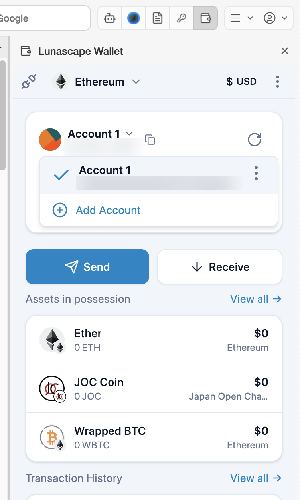
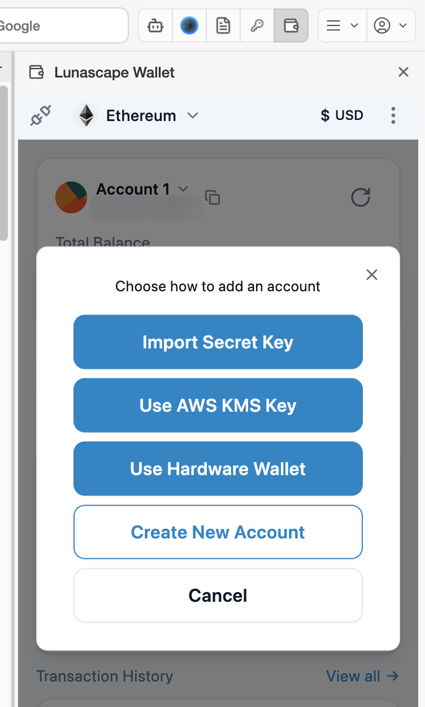
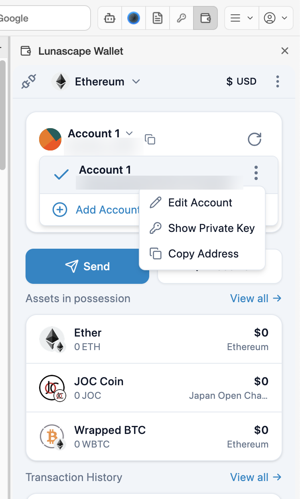

---
navigation:
  order: 500
---

# Manage accounts

One wallet can hold several accounts. Each account has its own address, so you can keep them for different purposes (everyday and savings, for example).

## Switch or add accounts

Press **∨** next to the account name on the main screen to open the list of accounts. Press an account to switch to it.

Press **Add Account** to choose how to add one.

| Option | What it does |
| --- | --- |
| Create New Account | Creates a new account from the same seed phrase. Restoring from the seed phrase brings this account back too |
| Import Secret Key | Imports an account from another wallet with its private key. It isn't restored from the seed phrase, so keep a separate copy of the private key |
| Use Hardware Wallet | Uses a Ledger connected by USB (below) |
| Use AWS KMS Key | An advanced feature for using keys managed in AWS KMS, mainly for businesses |

### Connect a Ledger

1. Connect the Ledger to your computer by USB and unlock it.
2. Open the Ethereum app on the Ledger.
3. Press **Use Hardware Wallet** and follow the screens to choose the Ledger.
4. Choose the accounts to import.

Sending or signing with a Ledger account needs approval on the Ledger itself. The hardware wallet connection talks to external servers, so your IP address and similar information may be sent to them.

## The account menu

In the account list, press **⋮** to the right of an account for these options.

- **Edit Account**: rename the account.
- **Show Private Key**: shows this account's private key. You need the master password. As with the seed phrase, never tell anyone.
- **Copy Address**: copies the address.

You can also see and add accounts under the wallet's **Settings** > **Accounts**.

## Address book

Save the addresses of people you often send to, with a name. When choosing a recipient, pick them from **Your Contacts**.

1. Under the wallet's **Settings** > **Address Book**, press **Add Contact**.
2. Enter a name, the address and, if you like, a description, and save.

After you send to an address that isn't in the address book, the wallet may ask whether to add it as a contact.
