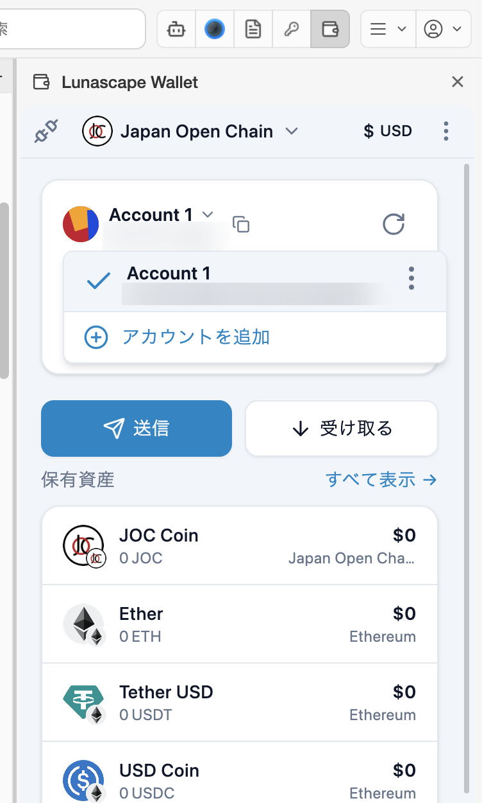
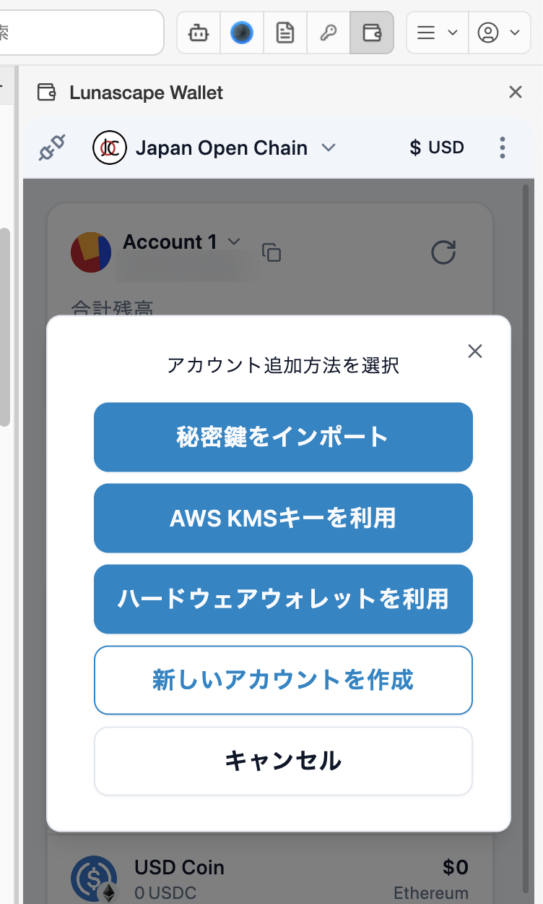

# アカウントを管理する

1 つのウォレットに、複数のアカウントを持てます。アカウントごとにアドレスが別になるので、用途で使い分けられます（普段用と保管用など）。

## 切り替える・追加する

メイン画面のアカウント名の横の **∨** を押すと、アカウントの一覧が開きます。使うアカウントを押すと切り替わります。

**アカウントを追加** を押すと、追加のしかたを選べます。

| 方法 | 説明 |
| --- | --- |
| 新しいアカウントを作成 | 同じシードフレーズから、新しいアカウントを作ります。シードフレーズで復元すると、このアカウントも戻ります |
| 秘密鍵をインポート | ほかのウォレットのアカウントを、秘密鍵で取り込みます。シードフレーズからは復元されないので、秘密鍵も別に控えてください |
| ハードウェアウォレットを利用 | Ledger を USB で接続して使います（下記） |
| AWS KMSキーを利用 | 企業などで、AWS KMS で管理する鍵を使うための上級者向けの機能です |

### Ledger をつなぐ

1. Ledger を USB でパソコンにつなぎ、ロックを解除します。
2. Ledger で Ethereum アプリを開きます。
3. **ハードウェアウォレットを利用** を押し、画面の案内に従って Ledger を選びます。
4. 取り込むアカウントを選びます。

Ledger のアカウントで送金や署名をするときは、Ledger 本体での承認が必要です。ハードウェアウォレットとの連携では、外部のサーバーと通信するため、IP アドレスなどが送られる場合があります。

## アカウントのメニュー

アカウント一覧で、アカウントの右の **⋮** を押すと次の操作ができます。

- **アカウントを編集**: アカウント名を変えます。
- **秘密鍵を表示**: このアカウントの秘密鍵を表示します。マスターパスワードが必要です。シードフレーズと同じく、誰にも教えないでください。
- **アドレスをコピー**: アドレスをコピーします。

ウォレットの **設定** > **アカウント** でも、アカウントの一覧の確認と追加ができます。

## アドレス帳

よく送る相手のアドレスを、名前を付けて保存できます。送金先を選ぶときに、**あなたの連絡先** から選べます。

1. ウォレットの **設定** > **アドレス帳** で **連絡先を追加** を押します。
2. 名前とアドレス、必要なら説明を入力して保存します。

アドレス帳にないアドレスへ送ると、送金のあとに連絡先へ追加するかを尋ねられることがあります。
