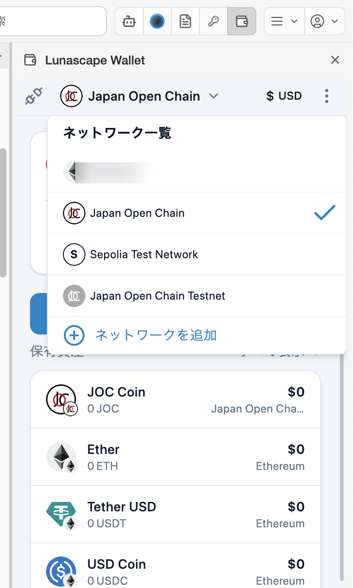
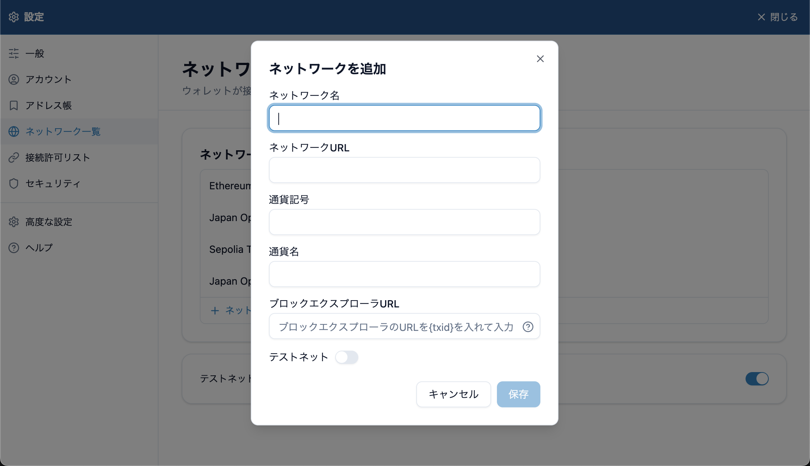

# ネットワークを切り替える

ネットワーク（チェーン）は、暗号資産がやり取りされるブロックチェーンです。Lunascape Wallet は EVM 互換のネットワークに対応しています。Bitcoin や Solana など、EVM 互換でないネットワークには対応していません。

画面上で選ぶネットワークは、主にサイトと接続するときに使うネットワークです。保有資産と送信のトークンは、選んだネットワークに関係なく、すべてのネットワークの分が表示されます（トークンごとにネットワーク名が表示されます）。

## 切り替える

画面上のネットワーク名を押し、**ネットワーク一覧** から選びます。選んでいるネットワークにはチェックが付きます。

最初から使えるネットワークは次のとおりです。

| ネットワーク | 種類 |
| --- | --- |
| Ethereum | メインネット |
| Japan Open Chain | メインネット |
| Sepolia Test Network | テストネット（練習用） |
| Japan Open Chain Testnet | テストネット（練習用） |

テストネットは、ウォレットの **設定** > **ネットワーク一覧** の **テストネットを表示** がオンのときだけ一覧に出ます。テストネットの資産には価値がありません。

> **注意:** ネットワークを切り替えると、送信中（保留中）の取引はすべてキャンセルされます。送金の完了を待ってから切り替えてください。

## ネットワークを追加する

一覧にないネットワークを使うときは、追加します。

1. ネットワーク一覧の **ネットワークを追加** を押します（ウォレットの **設定** > **ネットワーク一覧** からも追加できます）。
2. 次の項目を入力して **保存** を押します。

| 項目 | 内容 |
| --- | --- |
| ネットワーク名 | 一覧に表示する名前です |
| ネットワーク URL | RPC URL です。ネットワークの公式サイトで確かめてください |
| 通貨記号 / 通貨名 | 手数料に使う通貨（ETH など）です |
| ブロックエクスプローラ URL | 取引を確認するサイトの URL です。`{txid}` と書いたところに取引 ID が入ります。書かないと末尾に付きます |
| テストネット | テストネットのときにオンにします |

信頼できない RPC URL を登録すると、残高が正しく表示されないなどの問題が起きることがあります。

## サイトからネットワークの追加や切り替えを求められたとき

Web3 サイトが、ネットワークの追加や切り替えを求めてくることがあります。確認画面が開くので、ネットワーク名やチェーン ID を確かめてから許可してください。[サイトと接続する](../../../dapps/i18n/ja/connect.md) を参照してください。

## ネットワークを編集・削除する

ウォレットの **設定** > **ネットワーク一覧** で、ネットワークを押すと編集・削除できます。最初から入っているネットワークは削除できません。
