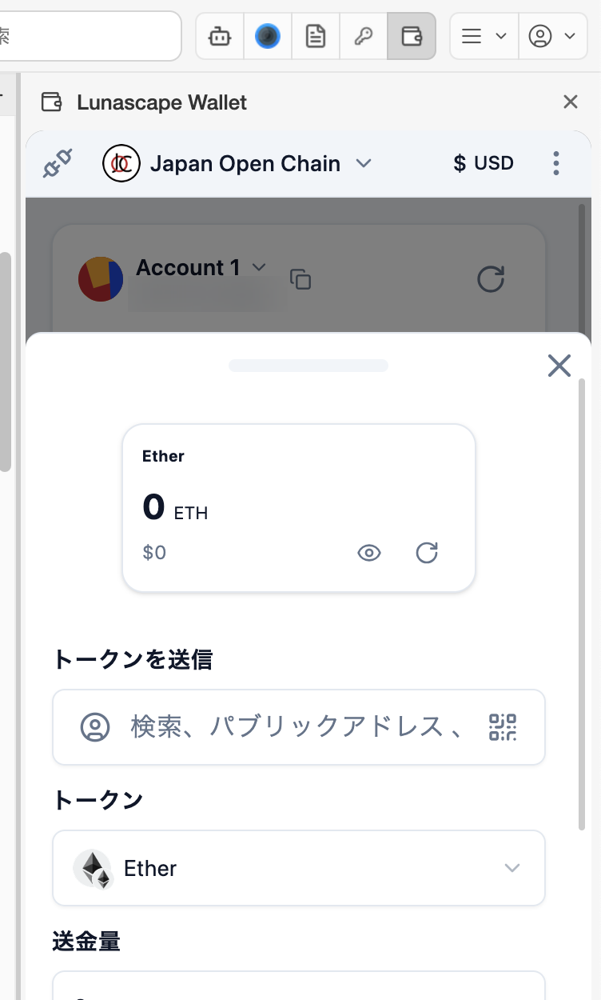

# 送金する

暗号資産を、ほかのアドレスへ送ります。送った取引は取り消せないので、送金先とネットワークをよく確かめてください。

## 手順

1. [保有資産](assets.md) で、送りたいトークンのネットワーク名（各行の右下）を確認します。送金は、そのトークンのネットワークで行われます（画面上で選んでいるネットワークとは関係ありません）。
2. メイン画面の **送信** を押します。トークンの詳細画面の **送信** からも始められます。
3. **トークンを送信** に送金先を入力します。

   - アドレス（`0x` で始まる 42 文字）を貼り付けます。
   - 人のアイコンで [アドレス帳](accounts.md#アドレス帳) を開き、保存した連絡先を選べます。ここから連絡先を追加することもできます。
   - QR コードのアイコンで、相手のアドレスの QR コードをカメラで読み取れます。
   - ENS 名（`name.eth` など）も入力できます。ENS に対応していないネットワークでは使えません。

4. **トークン** で送るトークンを選び、**送金量** を入力します。
5. **送信** を押し、送金先・金額・手数料（ガス代）を確認して確定します。

送金が終わると通知が表示され、[利用履歴](assets.md#利用履歴) に記録されます。

## 手数料（ガス代）について

ブロックチェーンに取引を送るには、手数料（ガス代）がかかります。手数料は、送るトークンとは別に、そのネットワークの基本の通貨で支払います。

| ネットワーク | 手数料に使う通貨 |
| --- | --- |
| Ethereum | ETH |
| Japan Open Chain | JOC |

たとえば Ethereum で USDC を送るときも、ETH が少し必要です。足りないと **手数料（ガス代）が不足しています** と表示され、送れません。送るトークンそのものの残高が足りないときは、**資金が不足しています** と表示されます。

## 送る前に確かめること

- **ネットワーク**: 相手が受け取るネットワークと同じですか。違うネットワークに送ると、相手は受け取れないことがあります。
- **アドレス**: 1 文字でも違うと、別の人に届きます。手入力せず、コピーと貼り付けか QR コードを使ってください。最初の数文字と最後の数文字を見比べると安心です。
- **金額**: 小数点の位置を確かめてください。

初めての相手には、少額を送って届いたことを確かめてから、残りを送ると安全です。

## うまくいかないとき

[送金・取引のトラブル](../../../troubleshooting/i18n/ja/transactions.md) を参照してください。
