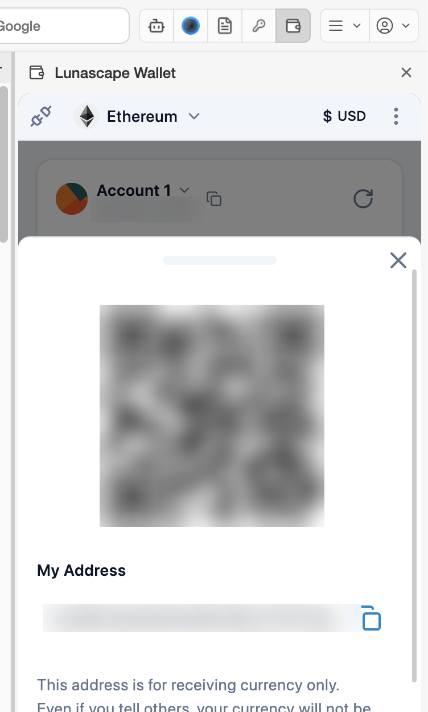

---
navigation:
  order: 200
---

# Receive

Give someone your address so they can send you crypto. It's fine for others to know your address — they can't take your assets with it.

## Steps

1. Find out which network (Ethereum, Japan Open Chain and so on) the sender will use.
2. Press **Receive** on the main screen.
3. Let the sender scan the QR code, or press the copy icon next to **My Address** and send them the address.
4. Press **Done** to close.

You can also copy your address with the copy icon next to the account name on the main screen.

## Check that it arrived

- Tokens you receive appear in [Assets in possession](assets.md). If they don't, press the refresh icon at the top right.
- If you received a token that isn't in the list, [add the token](assets.md#add-a-token) and it will appear.
- To follow a transaction, ask the sender for the transaction ID (transaction hash) and look it up in a block explorer such as Etherscan.

## Notes

Your address is the same string on Ethereum and on Japan Open Chain, but assets are kept separately on each network. The asset list shows the network for each token (USDT on Ethereum and USDT on Japan Open Chain are different assets).

Assets on testnets (such as Sepolia Test Network) are for practice and have no value.
