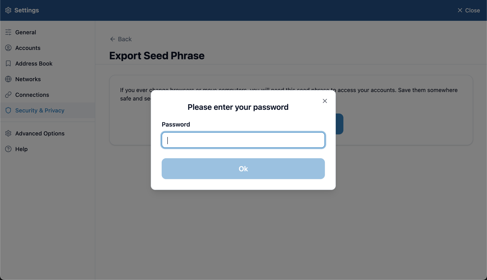

---
navigation:
  order: 400
---

# Back up your seed phrase

The seed phrase is 12 English words that act as the master key to your wallet and assets. Use it to restore the wallet when your computer breaks, when you move to another computer, or when you forget the password.

Write it down as soon as you create the wallet. Lunascape Wallet does not show you the seed phrase automatically when you create the wallet.

## How to write it down

1. Press **⋮** at the top right of the wallet panel and choose **Settings**. The wallet's settings open in a tab.
2. Choose **Security & Privacy** on the left, then press **Export Seed Phrase**.

   

3. Press **Show Seed phrase**, enter your master password and press **Ok**.

   

4. Copy the 12 words onto paper, in order.

## Keeping it safe

- Write it on paper and keep it somewhere safe that only you know. Storing copies in more than one place protects against loss and disasters.
- Don't keep it in a screenshot, photo, cloud note, email or chat. If your computer or account is taken over, you could lose your assets.
- Never tell anyone. Lunascape support will never ask for your seed phrase.
- A seed phrase cannot be reissued.

## Seed phrase, private key and password

| Name | What it's for | If you lose it |
| --- | --- | --- |
| Seed phrase (12 words) | Restores the wallet and the accounts created from the seed phrase | The wallet cannot be restored |
| Private key | Imports one account only | An account created from the seed phrase can be restored with the seed phrase. An account imported with a private key cannot |
| Master password | Unlocks the wallet in this browser | Set the wallet up again with the seed phrase and choose a new one |
