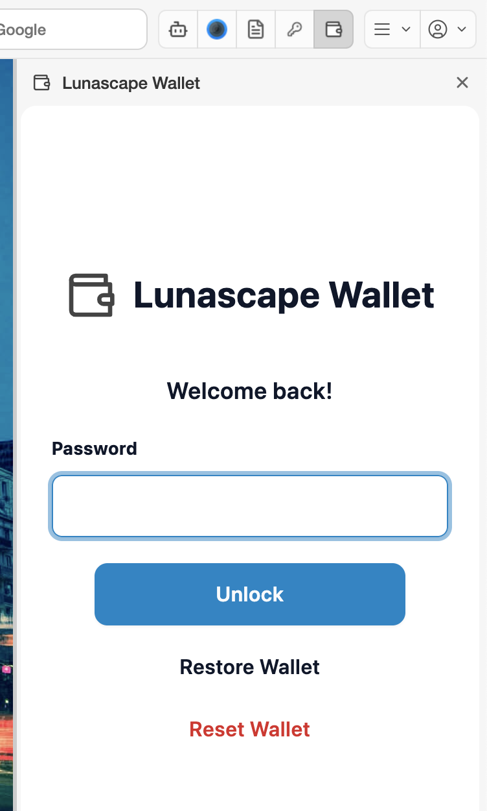

# Use it in Lunascape Desktop

**For:** Windows / Mac

Lunascape Wallet is already part of Lunascape Desktop. There is no extension to add.

1. Download the Windows or Mac version from the [Lunascape download page](https://www.lunascape.org/en/download).
2. Open the downloaded file, follow the on-screen steps to install, and start Lunascape.
3. Press the Lunascape Wallet button (the wallet shape) in the toolbar. The wallet opens in a panel on the right of the window. Press the button again, or the **×** at the top right of the panel, to close it.

   

   If you can't find the button, check that Lunascape Wallet is on under **Settings** > **Extensions** > **System Extensions** in Lunascape.

4. The first time, the wallet shows the create screen. Follow [Create a wallet](create-wallet.md).
5. When that's done, be sure to write down your seed phrase by following [Back up your seed phrase](backup.md). On a computer, the wallet does not show the seed phrase screen on its own.

## Settings only in Lunascape Desktop

**Settings** > **Wallet** in Lunascape shows the wallet extension's **Current Version** and lets you change its **Extension Source**. Leave it on the default — **Chrome Web Store (recommended)** with **Enable auto-update** on.

To stop using Lunascape Wallet, turn it off under **Settings** > **Extensions** > **System Extensions**.

The wallet's screens and operations are the same as when you add it to Chrome.

## Read next

- [The wallet screen](screen.md)
- [Receive](../../../features/i18n/en/receive.md) — Have crypto sent to your address
