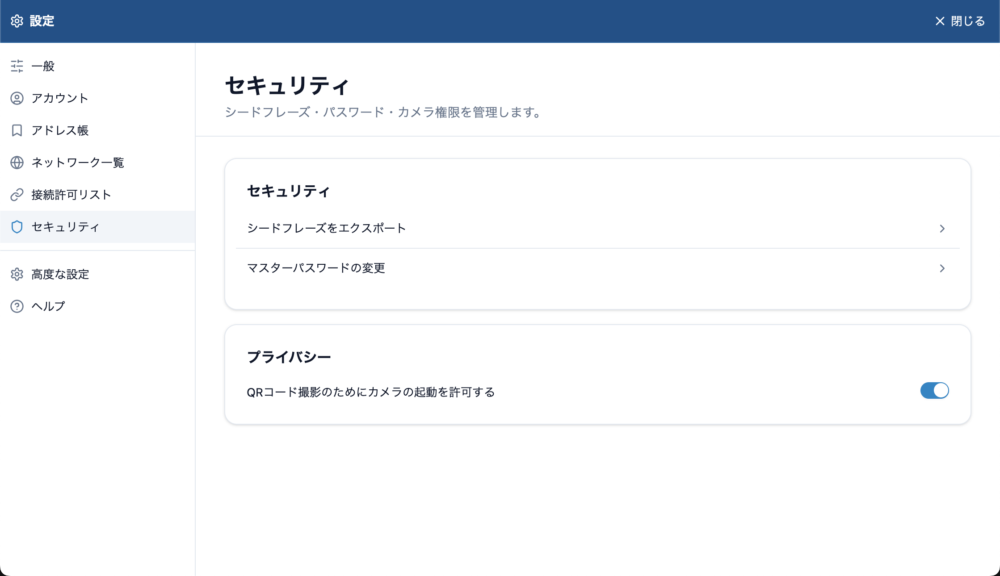

# シードフレーズをバックアップする

シードフレーズは、ウォレットと資産の「マスターキー」となる 12 語の英単語です。パソコンが壊れたとき、別のパソコンで使うとき、パスワードを忘れたときに、このフレーズでウォレットを復元します。

ウォレットを作成したら、すぐに控えてください。Lunascape Wallet は作成時にシードフレーズを自動では表示しません。

## 控えかた

1. ウォレットのパネル右上の **⋮** を押し、**設定** を選びます。ウォレットの設定がタブで開きます。
2. 左のメニューで **セキュリティ** を選び、**シードフレーズをエクスポート** を押します。

   

3. **シードフレーズを表示** を押し、マスターパスワードを入力して **Ok** を押します。

   

4. 表示された 12 語を、順番どおりに紙に書き写します。

## 保管のしかた

- 紙に書いて、自分だけがわかる安全な場所にしまいます。複数の場所に分けて保管すると、紛失や災害に備えられます。
- スクリーンショット、写真、クラウドのメモ、メール、チャットには残さないでください。パソコンやアカウントが乗っ取られると、資産を失うおそれがあります。
- 誰にも教えないでください。Lunascape のサポートがシードフレーズを尋ねることはありません。
- シードフレーズは再発行できません。

## シードフレーズと秘密鍵とパスワードの違い

| 名前 | 何のためのものか | なくしたら |
| --- | --- | --- |
| シードフレーズ（12 語） | ウォレットと、シードフレーズから作ったアカウントを復元する | 復元できません |
| 秘密鍵 | 1 つのアカウントだけを取り込む | シードフレーズから作ったアカウントなら、シードフレーズで復元できます。秘密鍵でインポートしたアカウントは復元できません |
| マスターパスワード | このブラウザーでロックを解除する | シードフレーズで入れ直し、新しく決め直します |
