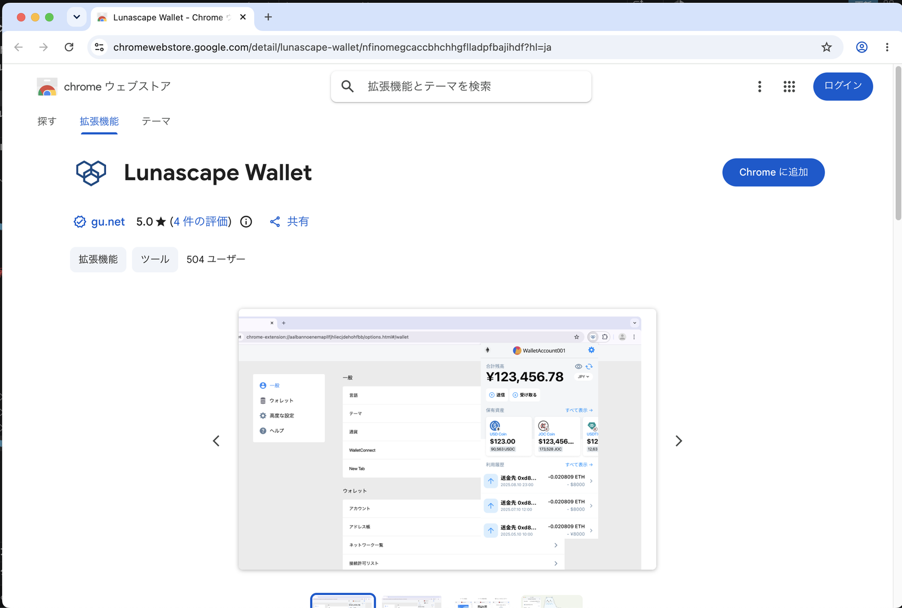
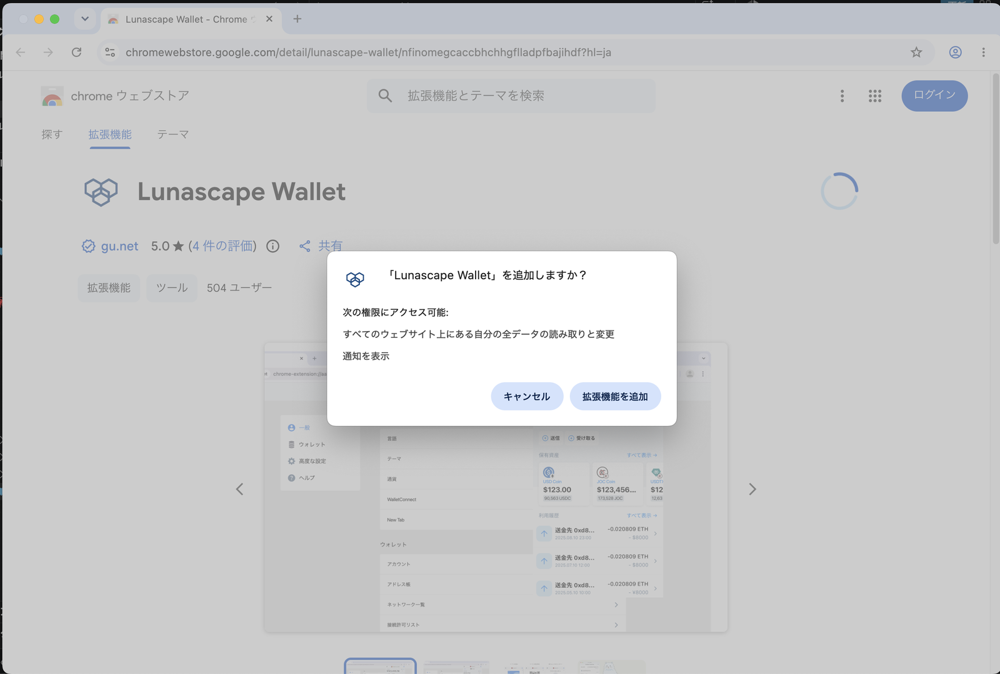
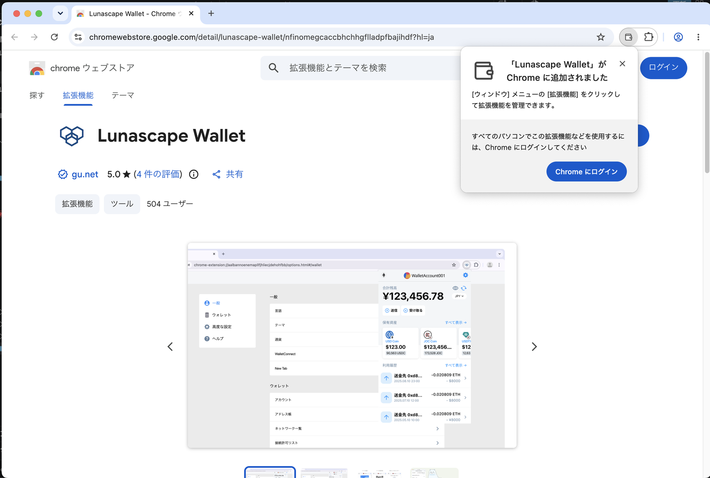
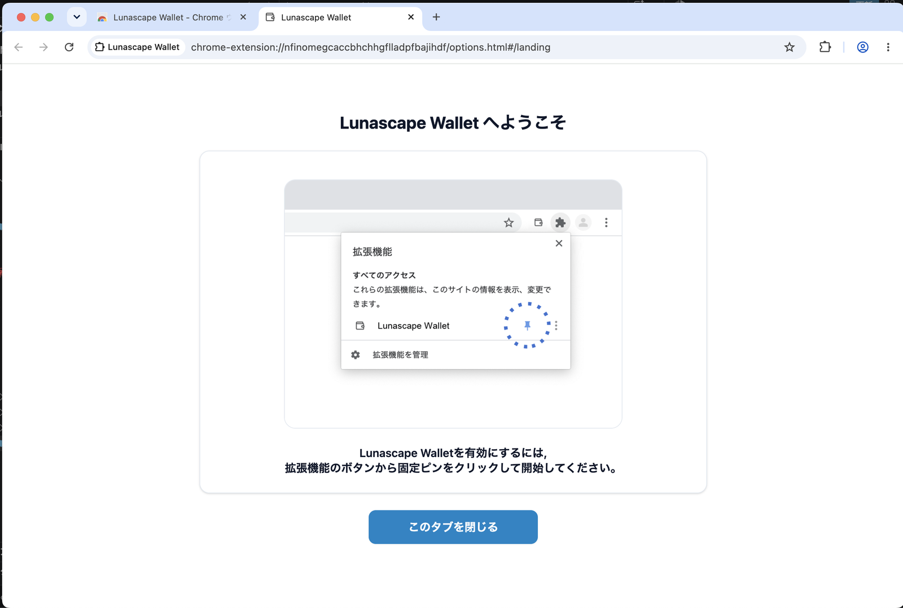
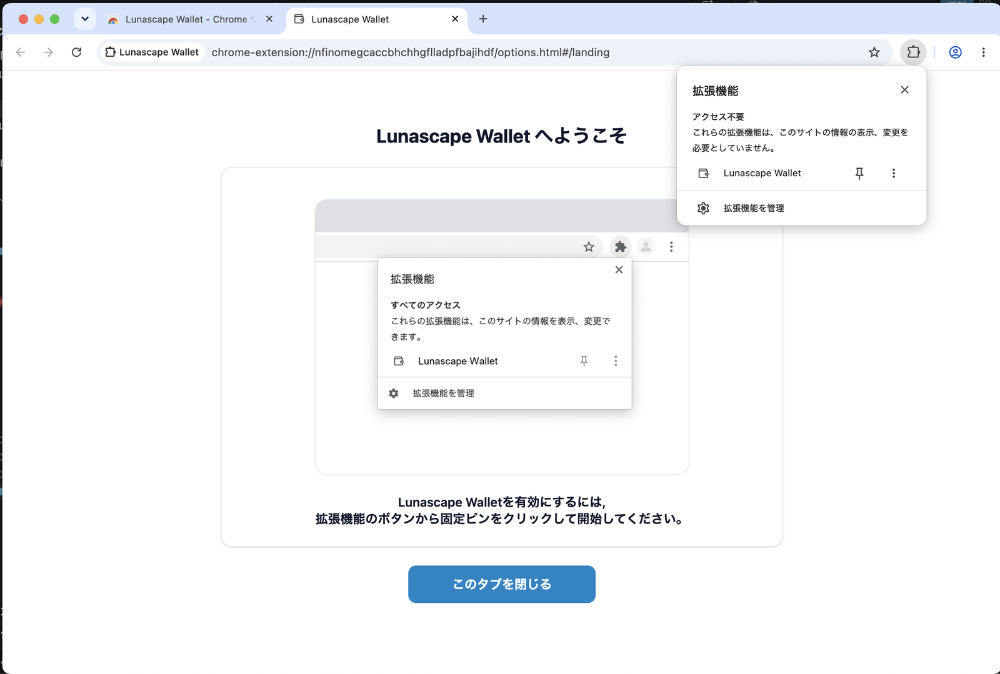
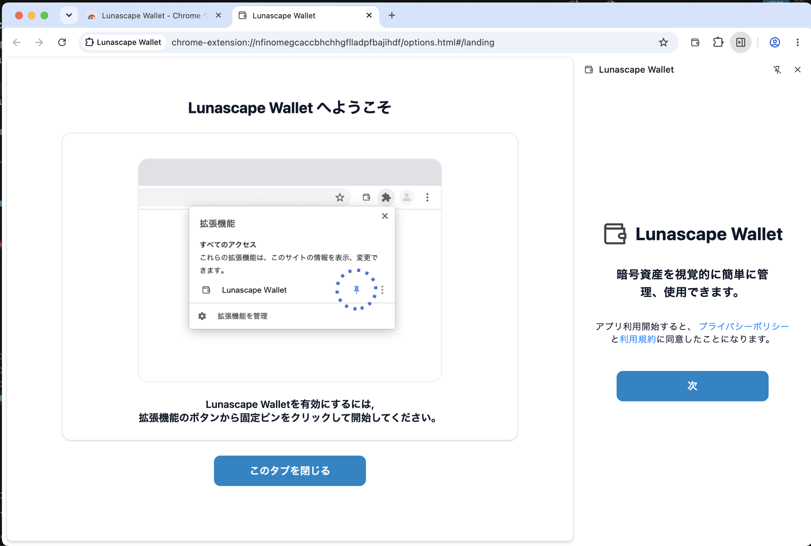

# Chrome に追加する

**対象：** Windows / Mac の Google Chrome

以下の画面は Mac の Chrome のものです。Windows でも同じ流れで進められます。

## 1. Chrome ウェブストアのページを開く

Google Chrome で [Lunascape Wallet（Chrome ウェブストア）](https://chromewebstore.google.com/detail/lunascape-wallet/nfinomegcaccbhchhgflladpfbajihdf) を開き、**Chrome に追加** を押します。

## 2. 拡張機能を追加する

「「Lunascape Wallet」を追加しますか？」と、拡張機能ができることが表示されます。**拡張機能を追加** を押します。

ウォレットは、Web3 サイトと接続するために、ページの内容を読み取ります。許可なく送金などをすることはありません。

## 3. 追加されたことを確かめる

右上に「「Lunascape Wallet」が Chrome に追加されました」と表示されます。Chrome へのログインは不要です。**×** で閉じてください。

**Lunascape Wallet へようこそ** のタブも開き、ツールバーへのピン留めのしかたが表示されます。

## 4. ツールバーにピン留めする

Chrome のツールバーにある拡張機能のボタン（パズルのアイコン）を押し、**Lunascape Wallet** の横のピンを押します。

ツールバーに Lunascape Wallet のアイコン（財布の形）が表示されるようになります。

## 5. ウォレットを開く

ツールバーの Lunascape Wallet のアイコンを押すと、右側のサイドパネルにウォレットが開きます。**次** を押して始めます。

**次** を押すと、画面に表示されているプライバシーポリシーと利用規約に同意したことになります。

## 6. ウォレットを作成する

1. **新しいウォレットを作成** を選び、**次** を押します。

   

2. マスターパスワード（8 文字以上）を 2 回入力し、**作成** を押します。忘れると、誰にも解除できません。

   

3. 3 つの項目を読み、すべてにチェックを入れて **アカウントを作成** を押します。

   

4. ウォレットのメイン画面が表示されたら完了です。

   

すでに持っているウォレットを使う場合は、**ウォレットをインポート** を選びます。[ウォレットをインポートする](import-wallet.md) を参照してください。

## 7. シードフレーズを控える

パソコン版では、シードフレーズを控える画面は自動では表示されません。必ずここで控えてください。

1. ウォレットの右上の **⋮** を押し、**設定** を選びます。
2. **セキュリティ** を選び、**シードフレーズをエクスポート** を押します。
3. **シードフレーズを表示** を押し、マスターパスワードを入力して、12 個の英単語を順番どおりに紙に書き写します。

> **重要:** シードフレーズは紙に書いて、誰にも見せずに保管してください。スクリーンショットやクラウドへの保存は避けてください。シードフレーズを知られると、ウォレットの資産をすべて送金されてしまいます。[シードフレーズをバックアップする](backup.md) も参照してください。

## 次に読む

- [画面の見かた](screen.md)
- [受け取る](../../../features/i18n/ja/receive.md) — 自分のアドレスに暗号資産を送ってもらう
- [サイトと接続する](../../../dapps/i18n/ja/connect.md)
