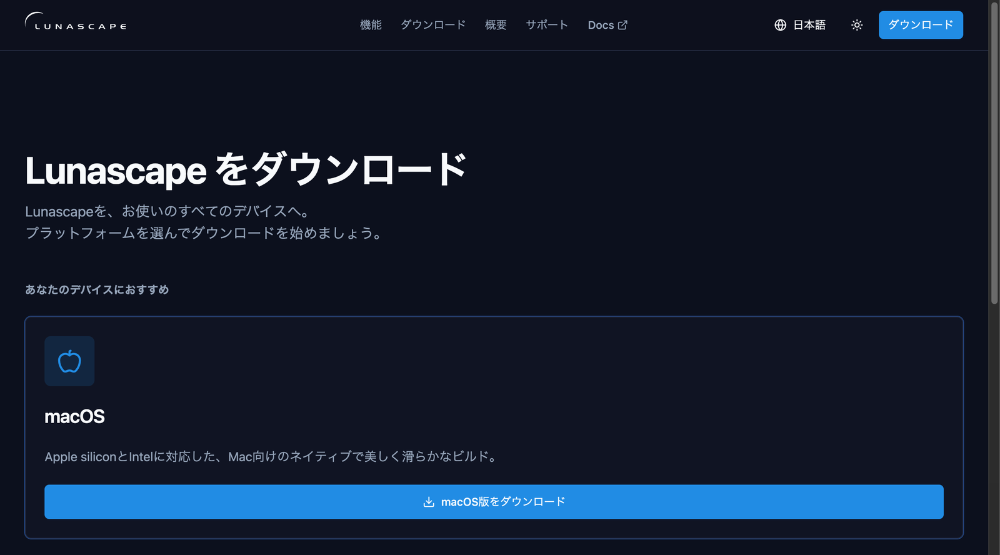
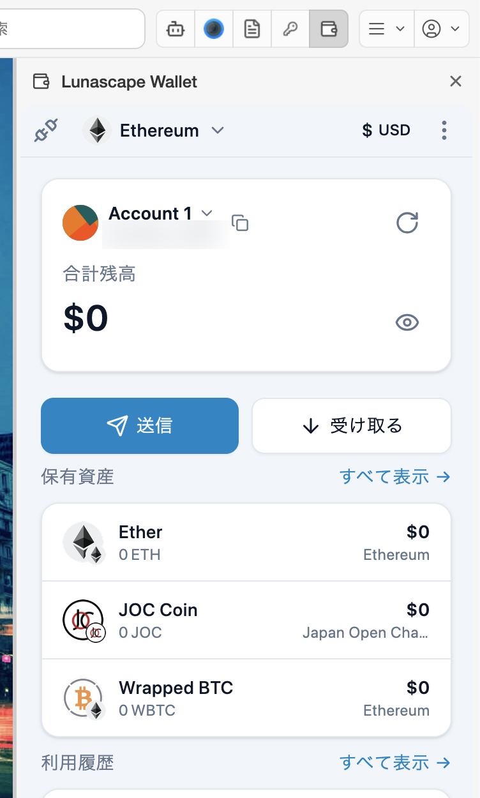

# Lunascape Desktop で使う

**対象：** Windows / Mac

Lunascape Desktop には Lunascape Wallet が最初から入っています。拡張機能を追加する必要はありません。

## 1. Lunascape Desktop をダウンロードする

[Lunascape のダウンロードページ](https://www.lunascape.org/ja/download) を開き、お使いのパソコン用をダウンロードします。ページには、お使いの端末に合ったものがおすすめとして表示されます。

## 2. インストールして起動する

- **Windows:** ダウンロードした `Setup.exe` をダブルクリックします。インストールが終わると、Lunascape が自動で起動します。
- **Mac:** ダウンロードした `.dmg` を開き、**Lunascape** を **アプリケーション** フォルダにドラッグして、そこから起動します。

くわしくは、Lunascape Desktop ユーザガイドの [インストール](https://docs.lunascape.org/github/gu-corp/lunascape-user-guide/desktop/getting-started/install.md) を参照してください。

## 3. ウォレットを開く

ツールバーの Lunascape Wallet のアイコン（財布の形）を押します。ウィンドウの右側にウォレットのパネルが開きます。もう一度アイコンを押すか、パネル右上の **×** で閉じます。

アイコンが見つからないときは、Lunascape の **設定** > **拡張機能** の **システム拡張** で、Lunascape Wallet がオンになっているか確認してください。

はじめて開くと、ウォレットの作成画面が表示されます。

## 4. ウォレットを作成する

1. **新しいウォレットを作成** を選び、**次** を押します。

   

2. マスターパスワード（8 文字以上）を 2 回入力し、**作成** を押します。忘れると、誰にも解除できません。

   

3. 3 つの項目を読み、すべてにチェックを入れて **アカウントを作成** を押します。

   

4. ウォレットのメイン画面が表示されたら完了です。

   

すでに持っているウォレットを使う場合は、**ウォレットをインポート** を選びます。[ウォレットをインポートする](import-wallet.md) を参照してください。

## 5. シードフレーズを控える

パソコン版では、シードフレーズを控える画面は自動では表示されません。必ずここで控えてください。

1. ウォレットの右上の **⋮** を押し、**設定** を選びます。
2. **セキュリティ** を選び、**シードフレーズをエクスポート** を押します。
3. **シードフレーズを表示** を押し、マスターパスワードを入力して、12 個の英単語を順番どおりに紙に書き写します。

> **重要:** シードフレーズは紙に書いて、誰にも見せずに保管してください。スクリーンショットやクラウドへの保存は避けてください。シードフレーズを知られると、ウォレットの資産をすべて送金されてしまいます。[シードフレーズをバックアップする](backup.md) も参照してください。

## Lunascape Desktop だけの設定

Lunascape の **設定** > **ウォレット** で、ウォレット拡張機能の **現在のバージョン** を確認し、**拡張機能のソース** を変更できます。通常は既定のまま（**Chrome Web Store（推奨）** で **自動更新を有効にする** がオン）で使います。

Lunascape Wallet を使わないときは、**設定** > **拡張機能** の **システム拡張** でオフにできます。

ウォレットの画面と操作は、Chrome に追加した場合と同じです。

## 次に読む

- [画面の見かた](screen.md)
- [受け取る](../../../features/i18n/ja/receive.md) — 自分のアドレスに暗号資産を送ってもらう
- [サイトと接続する](../../../dapps/i18n/ja/connect.md)
