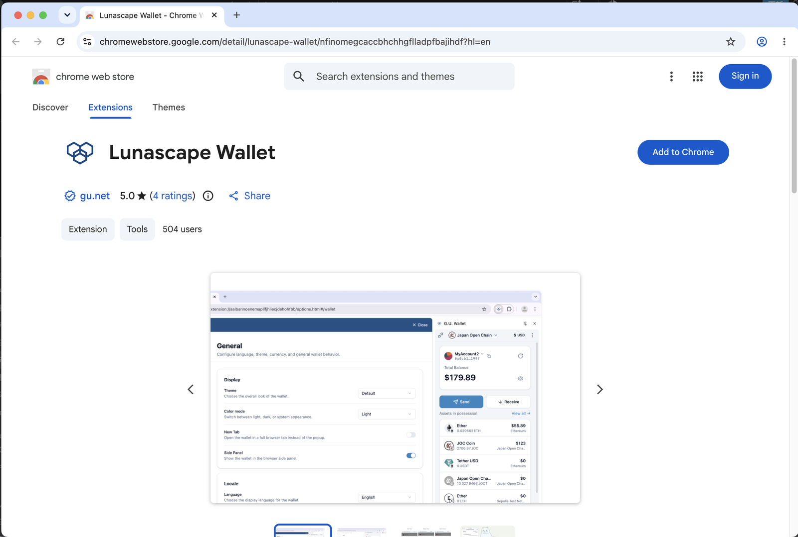
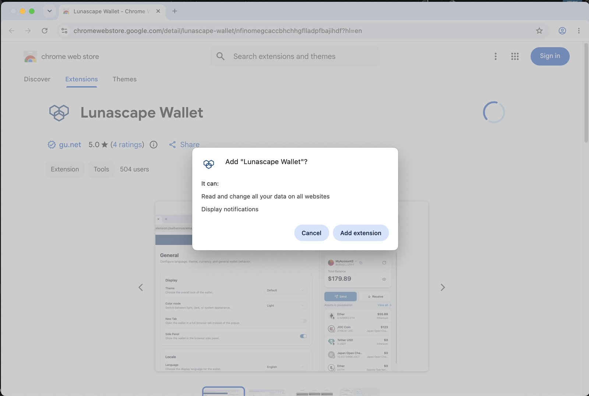
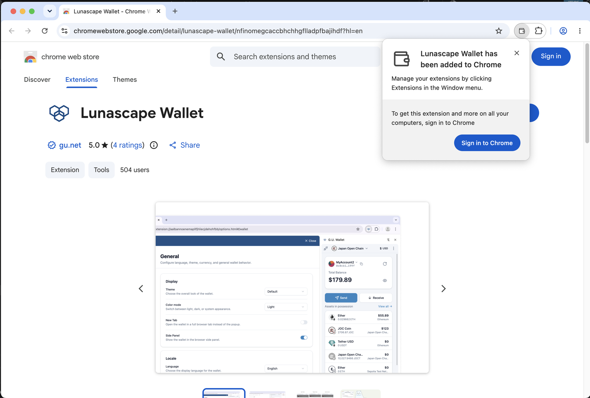
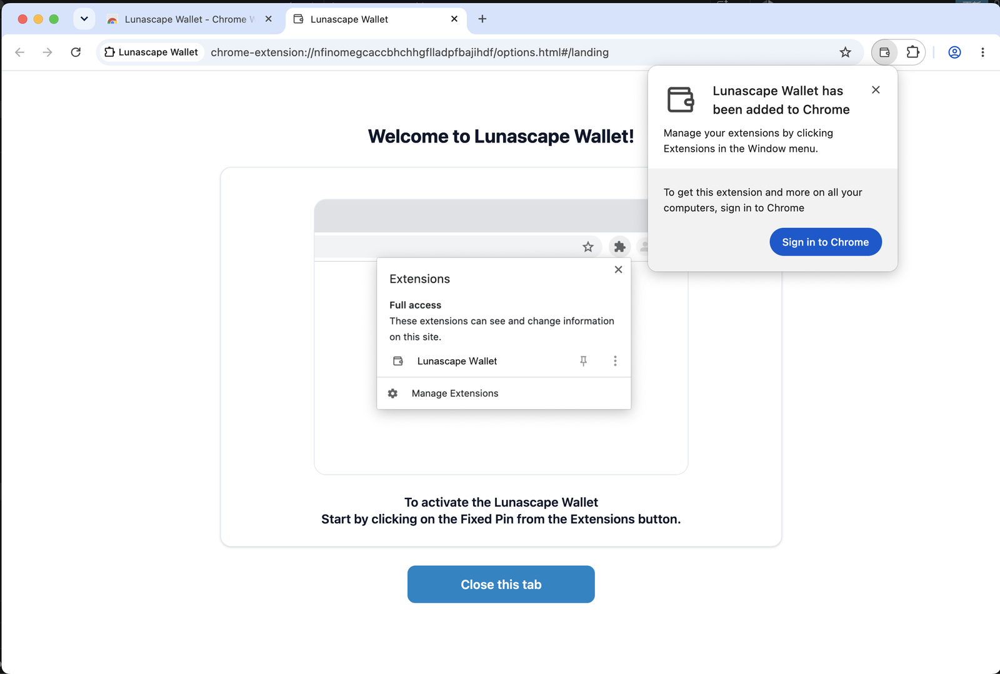
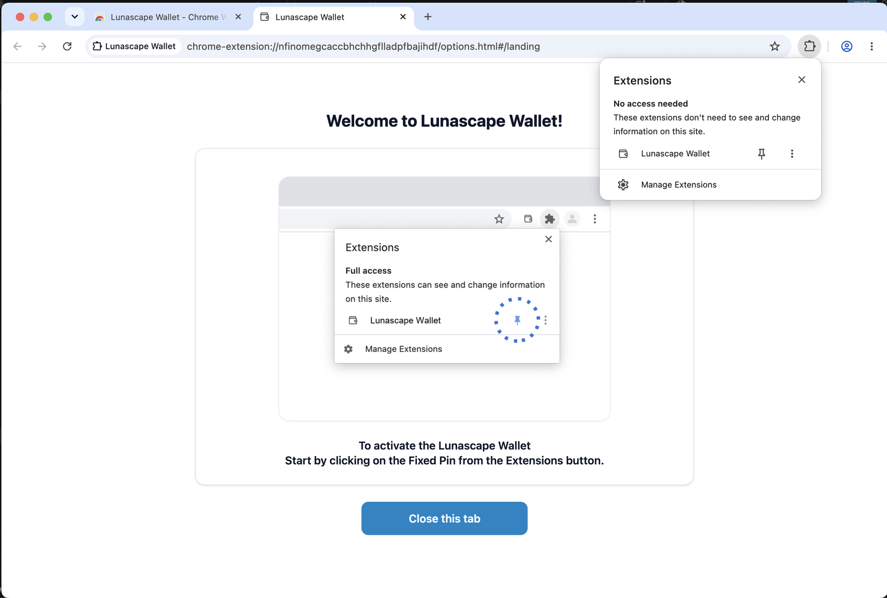
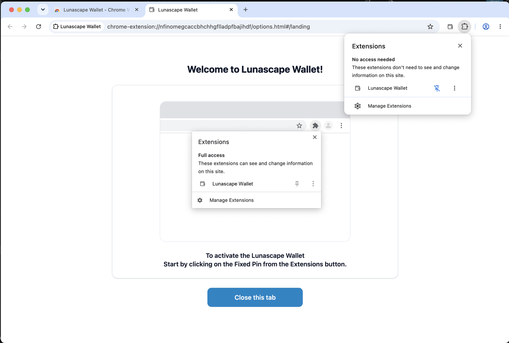
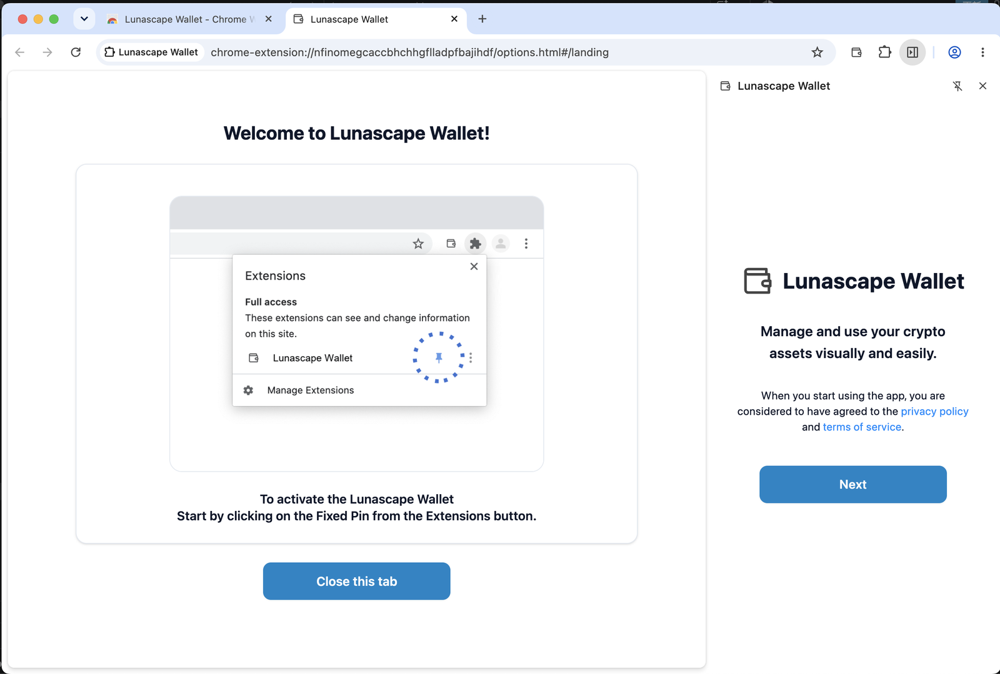
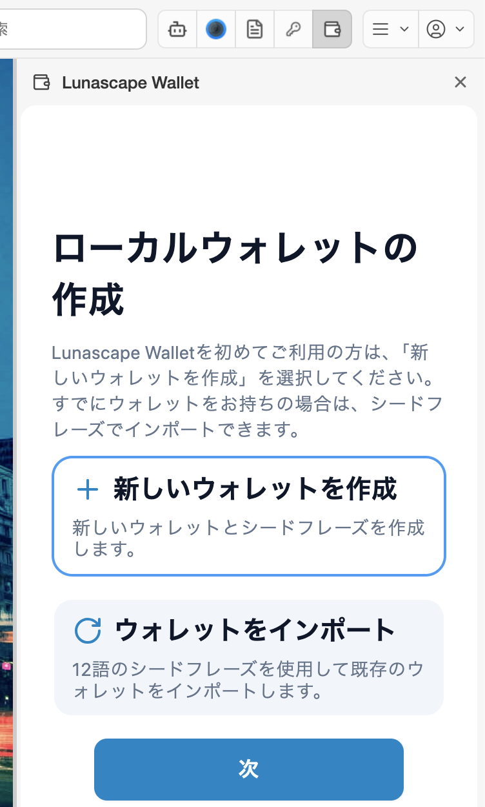
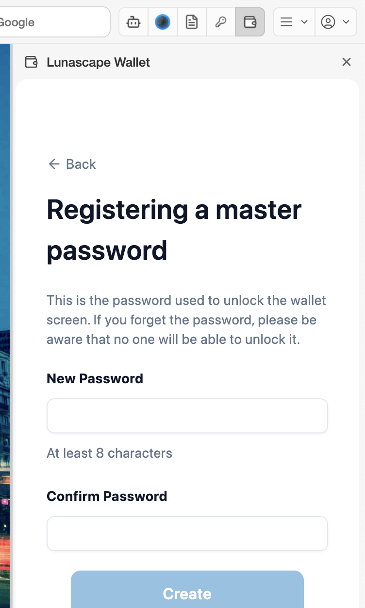
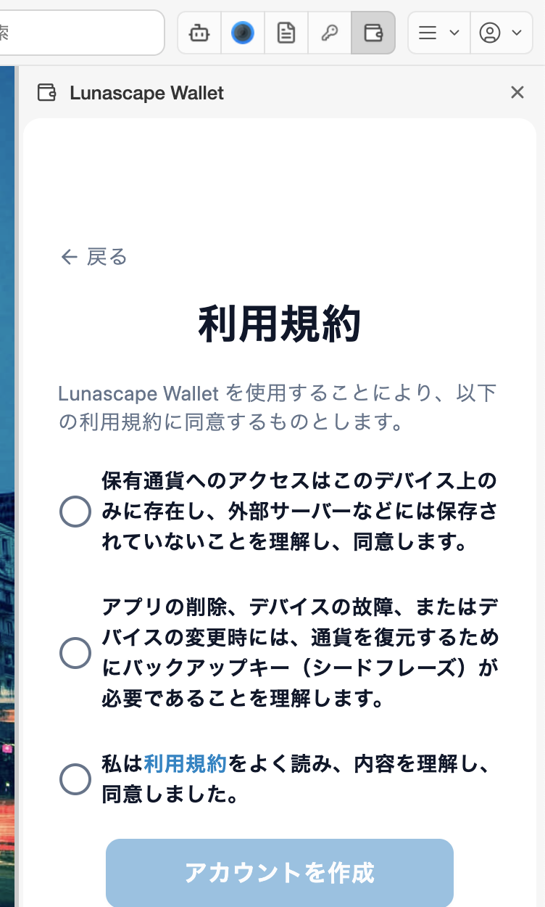

---
navigation:
  order: 100
---

# Add to Chrome

**For:** Google Chrome on Windows / Mac

The screens below are from Chrome on a Mac. Windows works the same way.

## 1. Open the Chrome Web Store page

In Google Chrome, open [Lunascape Wallet (Chrome Web Store)](https://chromewebstore.google.com/detail/lunascape-wallet/nfinomegcaccbhchhgflladpfbajihdf), and press **Add to Chrome**.

## 2. Add the extension

Chrome asks **Add "Lunascape Wallet"?** and lists what the extension can do. Press **Add extension**.

The wallet needs to read web pages so that it can connect to Web3 sites. It never sends anything without your approval.

## 3. Check that it was added

**Lunascape Wallet has been added to Chrome** appears at the top right. You don't need to sign in to Chrome; close the message with **×**.

A **Welcome to Lunascape Wallet!** tab also opens, showing how to pin the wallet to the toolbar.

## 4. Pin the wallet to the toolbar

Press the extensions button (the puzzle piece) in Chrome's toolbar, then the pin next to **Lunascape Wallet**.

The Lunascape Wallet button (the wallet shape) now stays in the toolbar.

## 5. Open the wallet

Press the Lunascape Wallet button in the toolbar. The wallet opens in Chrome's side panel on the right. Press **Next** to start.

Pressing **Next** means you agree to the privacy policy and terms of service linked on that screen.

## 6. Create the wallet

1. Choose **Create a new wallet** and press **Next**.

   

2. Enter a master password (at least 8 characters) twice and press **Create**. If you forget it, no one can unlock the wallet for you.

   

3. Read the three items, select all of them and press **Create Account**.

   

4. When the main wallet screen appears, the wallet is ready.

   

To use a wallet you already have, choose **Import your wallet** instead. See [Import a wallet](import-wallet.md).

## 7. Write down your seed phrase

On a computer, the wallet does not show the seed phrase on its own. Be sure to write it down now.

1. Press **⋮** at the top right of the wallet and choose **Settings**.
2. Choose **Security & Privacy**, then **Export Seed Phrase**.
3. Press **Show Seed phrase**, enter your master password, and copy the 12 words onto paper, in order.

> **Important:** Write the seed phrase on paper and keep it where no one else can see it. Don't take a screenshot or save it in the cloud. Anyone who knows your seed phrase can send away everything in your wallet. See [Back up your seed phrase](backup.md).

## Read next

- [The wallet screen](screen.md)
- [Receive](../features/receive.md) — Have crypto sent to your address
- [Connect to a site](../dapps/connect.md)
