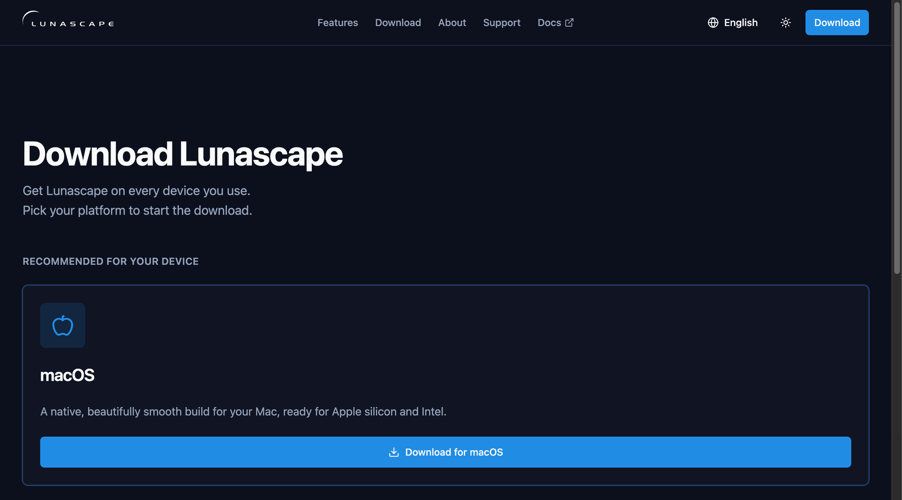
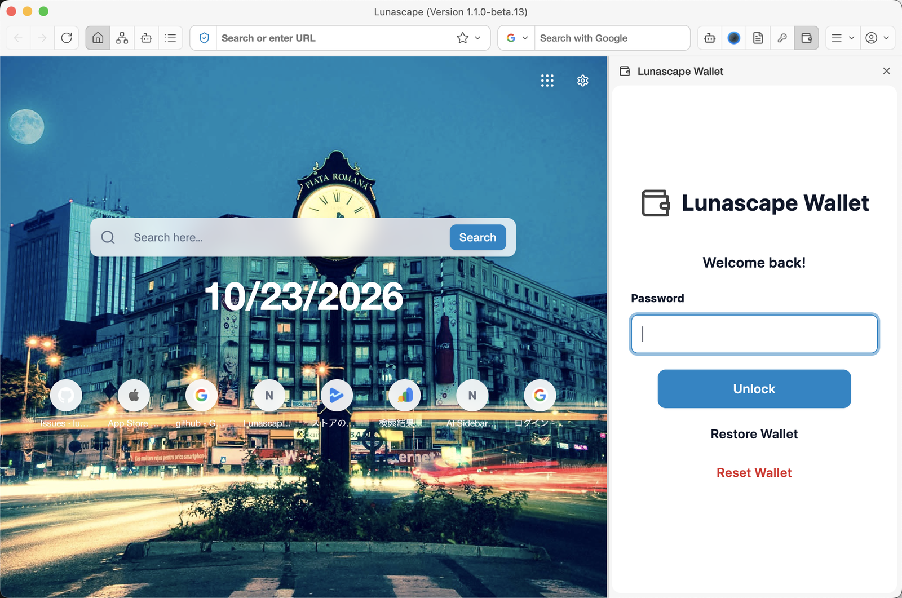
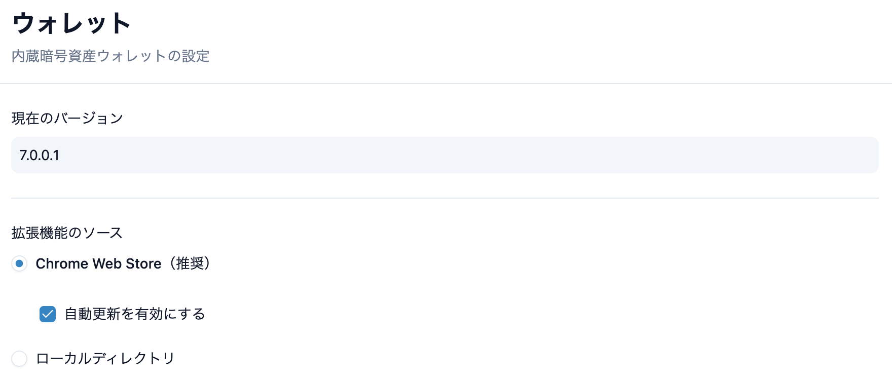

---
navigation:
  order: 150
---

# Use it in Lunascape Desktop

**For:** Windows / Mac

Lunascape Wallet is already part of Lunascape Desktop. There is no extension to add.

## 1. Download Lunascape Desktop

Open the [Lunascape download page](https://www.lunascape.org/en/download) and download the version for your computer. The page recommends the right one for your device.

## 2. Install and start Lunascape

- **Windows:** double-click the downloaded `Setup.exe`. Lunascape starts on its own when the install finishes.
- **Mac:** open the downloaded `.dmg`, drag **Lunascape** into the **Applications** folder, and start it from there.

See [Install](https://docs.lunascape.org/github/gu-corp/lunascape-user-guide/desktop/getting-started/install.md) in the Lunascape Desktop guide for details.

## 3. Open the wallet

Press the Lunascape Wallet button (the wallet shape) in the toolbar. The wallet opens in a panel on the right of the window. Press the button again, or the **×** at the top right of the panel, to close it.

If you can't find the button, check that Lunascape Wallet is on under **Settings** > **Extensions** > **System Extensions** in Lunascape.

The first time, the wallet shows the create screen.

## 4. Create the wallet

1. Choose **Create a new wallet** and press **Next**.

   

2. Enter a master password (at least 8 characters) twice and press **Create**. If you forget it, no one can unlock the wallet for you.

   

3. Read the three items, select all of them and press **Create Account**.

   

4. When the main wallet screen appears, the wallet is ready.

   

To use a wallet you already have, choose **Import your wallet** instead. See [Import a wallet](import-wallet.md).

## 5. Write down your seed phrase

On a computer, the wallet does not show the seed phrase on its own. Be sure to write it down now.

1. Press **⋮** at the top right of the wallet and choose **Settings**.
2. Choose **Security & Privacy**, then **Export Seed Phrase**.
3. Press **Show Seed phrase**, enter your master password, and copy the 12 words onto paper, in order.

> **Important:** Write the seed phrase on paper and keep it where no one else can see it. Don't take a screenshot or save it in the cloud. Anyone who knows your seed phrase can send away everything in your wallet. See [Back up your seed phrase](backup.md).

## Settings only in Lunascape Desktop

**Settings** > **Wallet** in Lunascape shows the wallet extension's **Current Version** and lets you change its **Extension Source**. Leave it on the default — **Chrome Web Store (recommended)** with **Enable auto-update** on.

To stop using Lunascape Wallet, turn it off under **Settings** > **Extensions** > **System Extensions**.

The wallet's screens and operations are the same as when you add it to Chrome.

## Read next

- [The wallet screen](screen.md)
- [Receive](../features/receive.md) — Have crypto sent to your address
- [Connect to a site](../dapps/connect.md)
