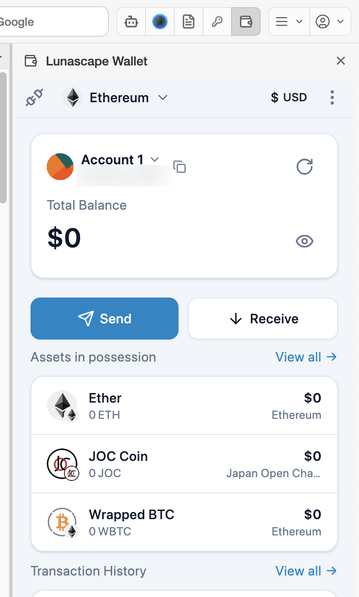

---
navigation:
  order: 500
---

# The wallet screen

The main wallet screen is made up of the following parts, from top to bottom.

| Part | What it does |
| --- | --- |
| Connection icon | The plug icon at the top left. Shows whether you've allowed the current site to connect. See [Connect to a site](../dapps/connect.md) |
| Network | Chooses the network (chain) used when you connect to sites. Your assets and the tokens you can send are all shown whichever network you choose. See [Switch networks](../features/networks.md) |
| Display currency | Chooses the fiat currency for balances (USD, JPY, EUR and so on) |
| Menu (⋮) | Switch **Accounts** or open the wallet's **Settings** |
| Account | The account name and the start and end of its address. Press **∨** next to the name to switch or add accounts, and the copy icon to copy the address. The refresh icon on the right reloads the balance |
| Total Balance | The total of your assets in the display currency. The eye icon hides or shows the amount |
| Send / Receive | [Send](../features/send.md) / [Receive](../features/receive.md) |
| Assets in possession | The tokens you hold and their balances. **View all** opens the full list (tokens and NFTs). See [Check your assets](../features/assets.md) |
| Transaction History | The record of what this account has sent and received |

## Locking

The wallet locks when you quit the browser. You need the master password the next time you open it.
