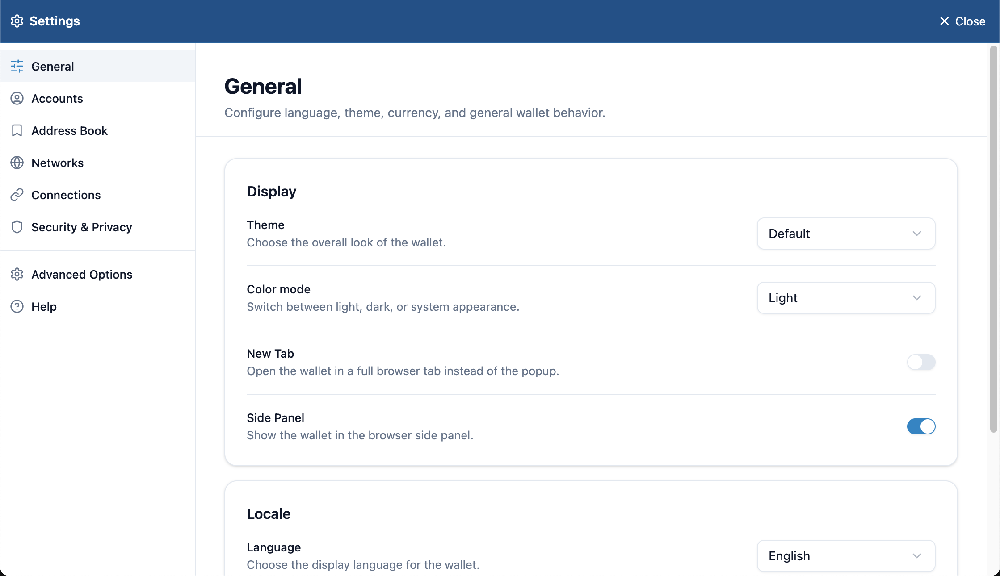
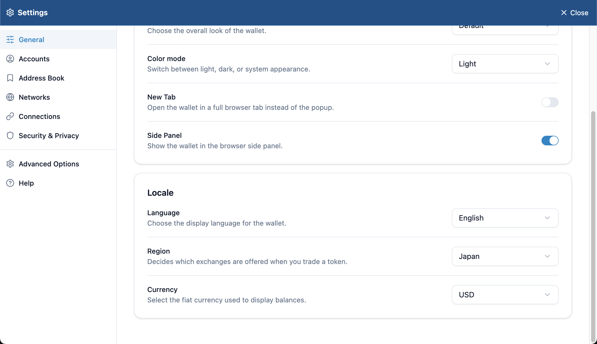
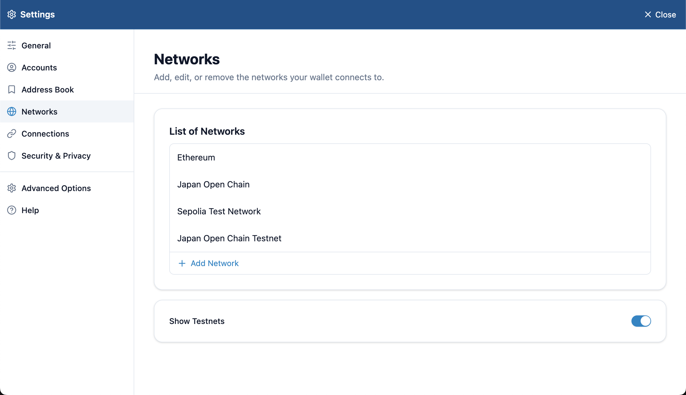
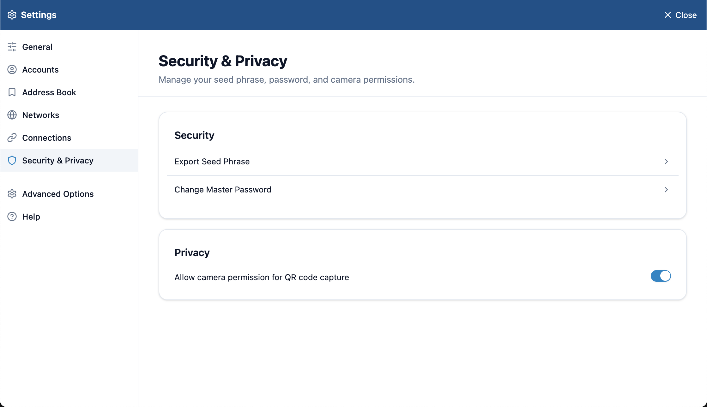

# All settings

## Opening the settings

Press **⋮** at the top right of the wallet panel and choose **Settings**. The wallet's settings open in a browser tab. Press **Close** at the top right to close them.

Choose a section on the left.

| Section | What's in it |
| --- | --- |
| [General](#general) | Display, language, region and display currency |
| [Accounts](#accounts) | The list of accounts, and adding one |
| [Address Book](#address-book) | Saved contacts |
| [Networks](#networks) | Adding, editing and deleting networks; showing testnets |
| [Connections](#connections) | Sites you've allowed to connect |
| Security & Privacy | Seed phrase, master password and camera |
| [Advanced Options](#advanced-options) | WalletConnect, MetaMask compatibility and experimental features |
| Help | Opens the Lunascape Wallet website |

> **Tip:** **Settings** > **Wallet** in Lunascape Desktop is a browser setting (the extension's version and how it's updated). It's a different screen from the wallet's own settings described here.

## General

| Item | What it does | Default |
| --- | --- | --- |
| Theme | Chooses the overall look of the wallet | Default |
| Color mode | Switches between light, dark and system (follow your computer) | Light |
| New Tab | Opens the wallet in a browser tab instead of the popup | Off |
| Side Panel | Shows the wallet in the browser's side panel | On |
| Language | Chooses the wallet's language (日本語 / 英語 (English)) | — |
| Region | Decides which exchanges are offered when you trade a token (Japan / Outside Japan) | Japan |
| Currency | Chooses the fiat currency for balances | USD |

> **Tip:** The wallet's language is set separately from the browser's. Switching the browser to English doesn't change the wallet.

## Accounts

The accounts in the wallet. **Add Account** adds one. See [Manage accounts](../../../features/i18n/en/accounts.md).

## Address Book

Your saved contacts. **Add Contact** saves a name and address.

## Networks

- Press a network to edit or delete it. **Add Network** adds one. See [Switch networks](../../../features/i18n/en/networks.md).
- **Show Testnets**: when on, testnets appear in the network list.

## Connections

Sites you've allowed to connect, listed by account. Removing a site disconnects it. **Add to list** lets you add a site by hand. See [Connect to a site](../../../dapps/i18n/en/connect.md).

## Security & Privacy

| Item | What it does |
| --- | --- |
| Export Seed Phrase | Shows the seed phrase. See [Back up your seed phrase](../../../getting-started/i18n/en/backup.md) |
| Change Master Password | Enter the **Old Password** and a new one to change it |
| Allow camera permission for QR code capture | Lets the wallet scan recipient and WalletConnect QR codes with your camera |

## Advanced Options

| Item | What it does | Default |
| --- | --- | --- |
| WalletConnect | Allows sites to connect through WalletConnect. See [Connect with WalletConnect](../../../dapps/i18n/en/walletconnect.md) | Off |
| Enable ethereum.is MetaMask | Makes sites see the wallet as MetaMask, so it also connects to sites that only support MetaMask | On |
| Sending transactions via the Tor network | An experimental feature that sends transactions through the Tor network to make your IP address harder for others to see. Sending may take longer | Off |
