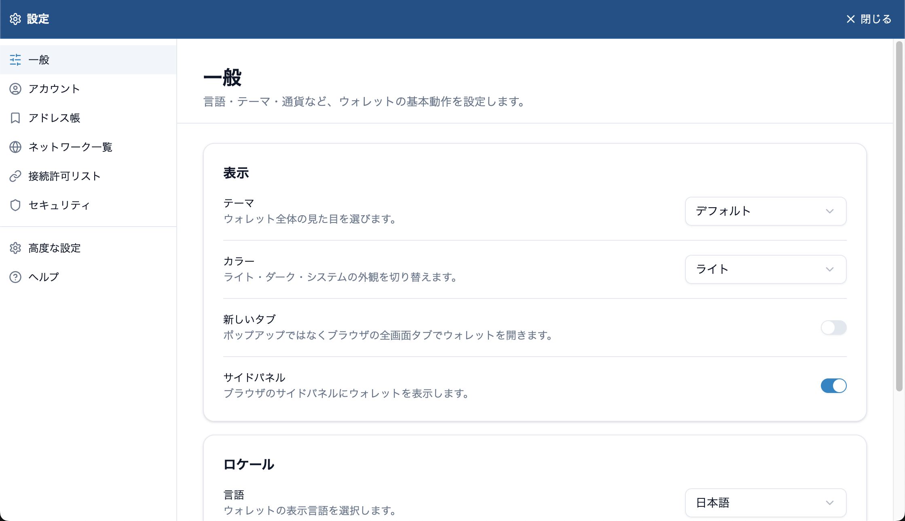
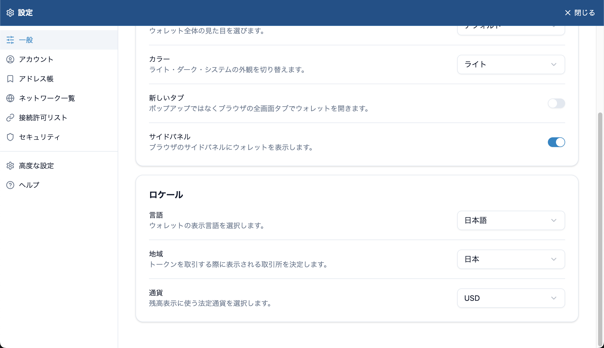
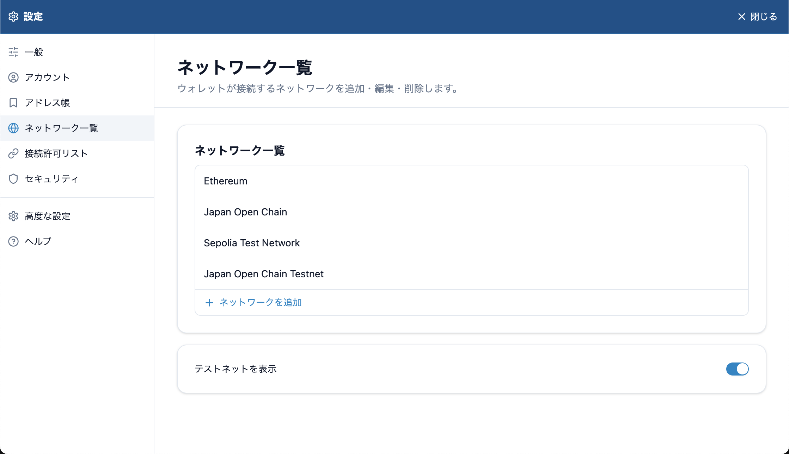
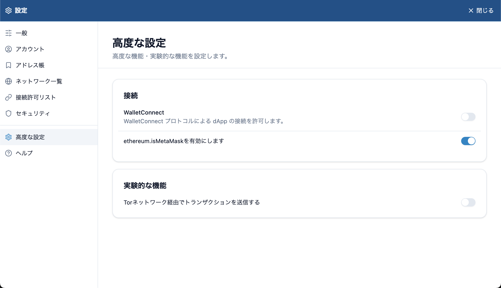

# 設定一覧

## 開きかた

ウォレットのパネル右上の **⋮** を押し、**設定** を選びます。ウォレットの設定がブラウザーのタブで開きます。閉じるときは右上の **閉じる** を押します。

左のメニューで項目を選びます。

| 項目 | 内容 |
| --- | --- |
| [一般](#一般) | 表示、言語、地域、表示通貨 |
| [アカウント](#アカウント) | アカウントの一覧と追加 |
| [アドレス帳](#アドレス帳) | 保存した連絡先 |
| [ネットワーク一覧](#ネットワーク一覧) | ネットワークの追加・編集・削除、テストネットの表示 |
| [接続許可リスト](#接続許可リスト) | 接続を許可したサイト |
| [セキュリティ](#セキュリティ) | シードフレーズ、マスターパスワード、カメラ |
| [高度な設定](#高度な設定) | WalletConnect、MetaMask 互換、実験的な機能 |
| ヘルプ | Lunascape Wallet の Web サイトを開きます |

> **ヒント:** Lunascape Desktop の **設定** > **ウォレット** は、ブラウザー側の設定（拡張機能のバージョンと更新方法）です。ここで説明するウォレットの設定とは別の画面です。

## 一般

| 項目 | 内容 | 初期値 |
| --- | --- | --- |
| テーマ | ウォレット全体の見た目を選びます | デフォルト |
| カラー | ライト / ダーク / システム（パソコンの設定に合わせる）を切り替えます | ライト |
| 新しいタブ | ポップアップではなく、ブラウザーのタブでウォレットを開きます | オフ |
| サイドパネル | ブラウザーのサイドパネルにウォレットを表示します | オン |
| 言語 | ウォレットの表示言語（日本語 / 英語 (English)）を選びます | — |
| 地域 | トークンを取引するときに表示する取引所を決めます（日本 / 日本以外） | 日本 |
| 通貨 | 残高を表示する法定通貨を選びます | USD |

> **ヒント:** ウォレットの言語は、ブラウザーの言語とは別に設定します。ブラウザーを英語にしても、ウォレットの表示は変わりません。

## アカウント

ウォレット内のアカウントの一覧です。**アカウントを追加** で追加できます。詳しくは [アカウントを管理する](../../../features/i18n/ja/accounts.md) を参照してください。

## アドレス帳

保存した連絡先の一覧です。**連絡先を追加** で、名前とアドレスを登録します。

## ネットワーク一覧

- ネットワークを押すと編集・削除できます。**ネットワークを追加** で追加します。詳しくは [ネットワークを切り替える](../../../features/i18n/ja/networks.md) を参照してください。
- **テストネットを表示**: オンにすると、ネットワークの一覧にテストネットが表示されます。

## 接続許可リスト

ウォレットへの接続を許可したサイトが、アカウントごとに並びます。サイトを削除すると、そのサイトとの接続が解除されます。**リストに追加** で、サイトを手動で追加することもできます。詳しくは [サイトと接続する](../../../dapps/i18n/ja/connect.md) を参照してください。

## セキュリティ

| 項目 | 内容 |
| --- | --- |
| シードフレーズをエクスポート | シードフレーズを表示します。[シードフレーズをバックアップする](../../../getting-started/i18n/ja/backup.md) を参照してください |
| マスターパスワードの変更 | **旧パスワード** と新しいパスワードを入力して変更します |
| QRコード撮影のためにカメラの起動を許可する | 送金先や WalletConnect の QR コードをカメラで読み取れるようにします |

## 高度な設定

| 項目 | 内容 | 初期値 |
| --- | --- | --- |
| WalletConnect | WalletConnect でのサイトとの接続を許可します。[WalletConnect で接続する](../../../dapps/i18n/ja/walletconnect.md) | オフ |
| ethereum.isMetaMaskを有効にします | サイトに MetaMask として認識させます。MetaMask にしか対応していないサイトにも接続しやすくなります | オン |
| Torネットワーク経由でトランザクションを送信する | 取引の送信を Tor ネットワーク経由にして、IP アドレスを相手に知られにくくする実験的な機能です。送信に時間がかかることがあります | オフ |
