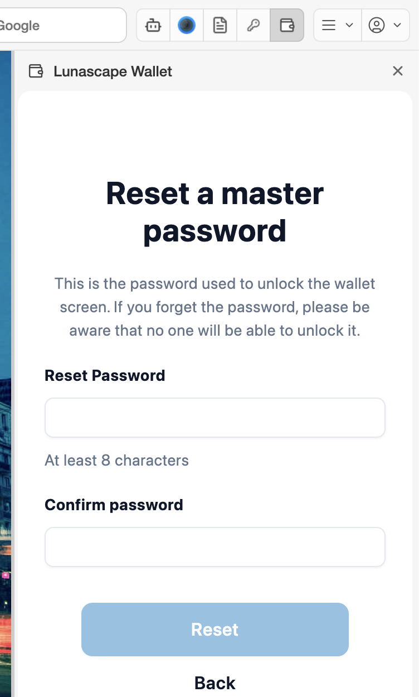

# Forgot your password or can't unlock

The master password unlocks the wallet in this browser. Lunascape doesn't keep a copy, so we can't tell you what it is.

## If you have the seed phrase

Set the wallet up again with the seed phrase and choose a new password. Your assets are on the blockchain, so setting the wallet up again doesn't lose them. Accounts added with a private key or a Ledger don't come back, though — add them again.

1. On the lock screen, press **Restore Wallet**.
2. Enter the seed phrase and a new master password (twice), then press **Restore**.

See [Import a wallet](../../../getting-started/i18n/en/import-wallet.md) for details.

## If you don't have the seed phrase

There is no way to unlock the wallet. Try the passwords you might have used, paying attention to upper and lower case.

> **Caution:** **Reset Wallet** on the lock screen sets a new password, then erases the wallet so you can start over. There's no "Are you sure?" step — pressing **Reset** erases it at once. If you haven't written down the wallet's seed phrase, you lose access to its assets. Don't press it unless you're giving up those assets and starting fresh.

## Change your password

If you can unlock the wallet, change it under the wallet's **Settings** > **Security & Privacy** > **Change Master Password**.

## "Invalid password" appears

- Check your keyboard's input mode and Caps Lock.
- A password set on another computer or in another browser won't work. Each browser where you set up the wallet has its own password.
