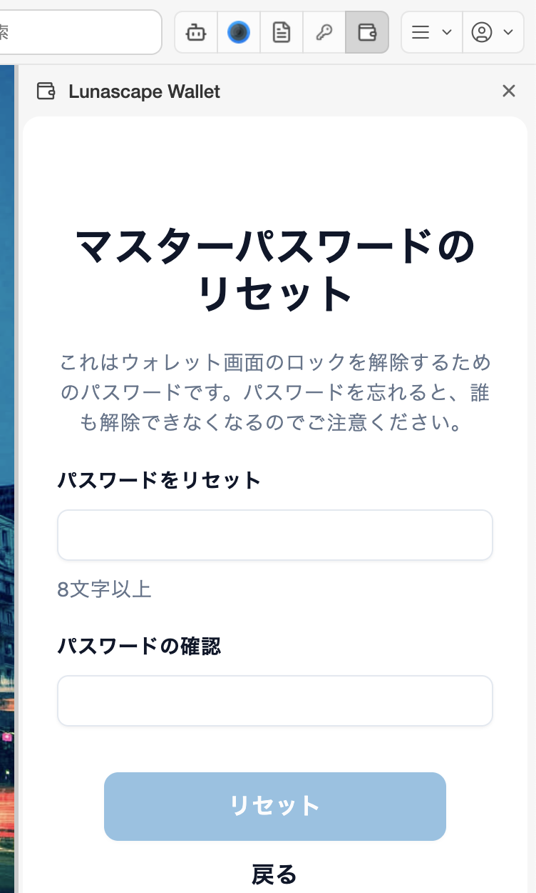

---
navigation:
  order: 100
---

# パスワードを忘れた・ロックを解除できない

マスターパスワードは、このブラウザーでウォレットのロックを解除するためのものです。Lunascape にも記録されていないため、問い合わせても教えられません。

## シードフレーズがある場合

シードフレーズでウォレットを入れ直し、新しいパスワードを決めます。資産はブロックチェーン上にあるので、入れ直しても失われません。

1. ロック画面で **ウォレットを復元** を押します。
2. シードフレーズと、新しいマスターパスワード（2 回）を入力して **リストア** を押します。

詳しくは [ウォレットをインポートする](../getting-started/import-wallet.md) を参照してください。

## シードフレーズがない場合

ウォレットを解除する方法はありません。思い当たるパスワードを、大文字・小文字、全角・半角に気をつけて試してください。

> **注意:** ロック画面の **ウォレットをリセット** は、新しいパスワードを決めて **ウォレットを消し、最初からやり直す** 操作です。確認の画面なしで消えます。シードフレーズを控えていないウォレットでは、資産にアクセスできなくなります。シードフレーズがない状態では押さないでください。

## パスワードを変えたい

ロックを解除できる場合は、ウォレットの **設定** > **セキュリティ** > **マスターパスワードの変更** で変えられます。

## 「無効なパスワードです」と表示される

- キーボードの入力モード（日本語入力がオンになっていないか）と、Caps Lock を確かめてください。
- 別のパソコンやブラウザーで決めたパスワードは使えません。パスワードは、ウォレットを入れたブラウザーごとに別々です。
